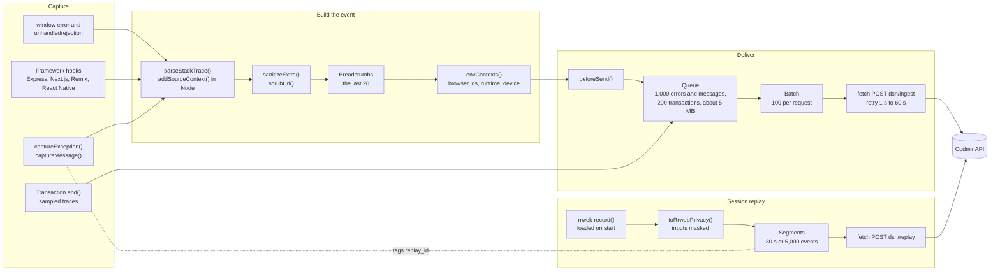
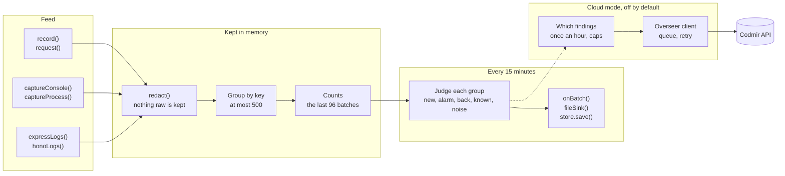

<p align="center">
  <picture>
    <source media="(prefers-color-scheme: dark)" srcset="docs/assets/hero-dark.svg">
    <source media="(prefers-color-scheme: light)" srcset="docs/assets/hero-light.svg">
    
  </picture>
</p>

<p align="center">
  <a href="https://www.npmjs.com/package/@codmir/sdk"></a>
  <a href="LICENSE"></a>
  <a href="#requirements"></a>
  <a href="#typescript"></a>
  <a href="#entry-points"></a>
</p>

<p align="center">
  <a href="#typescript"></a>
  <a href="#nextjs"></a>
  <a href="#express"></a>
  <a href="#hono"></a>
  <a href="#remix"></a>
  <a href="#react-native"></a>
  <a href="#session-replay"></a>
  <a href="#tracing"></a>
  <a href="#typescript"></a>
</p>

<p align="center">
  <a href="#quick-start"><b>Quick start</b></a> ·
  <a href="#framework-guides"><b>Frameworks</b></a> ·
  <a href="#how-it-works"><b>How it works</b></a> ·
  <a href="#configuration"><b>Configuration</b></a> ·
  <a href="#privacy-and-safety"><b>Privacy</b></a> ·
  <a href="#troubleshooting"><b>Troubleshooting</b></a> ·
  <a href="#faq"><b>FAQ</b></a> ·
  <a href="https://codmir.com"><b>codmir.com</b></a>
</p>

Official TypeScript/JavaScript SDK for the [Codmir](https://codmir.com) platform: error tracking, tracing and session
replay for browsers, Node.js, Next.js, Express, Hono, Remix and React Native, plus bug reporting, a setup check and the
Codmir API client. One package, sixteen entry points, nothing loaded that you do not import.

```bash
npm install @codmir/sdk
```

> [!NOTE]
> This page documents the `main` branch. If an import below is missing from the version you installed, compare
> `npm view @codmir/sdk version` with the `version` in [`package.json`](package.json) and read
> [CHANGELOG.md](CHANGELOG.md) for what is not released yet.

<details>
<summary><b>Contents</b></summary>

- [Why Codmir SDK](#why-codmir-sdk)
- [Quick start](#quick-start)
- [Platforms](#platforms)
- [Entry points](#entry-points)
- [How it works](#how-it-works): [the pipeline](#the-pipeline), [one `captureException` call](#one-captureexception-call), [the life of one error](#the-life-of-one-error)
- [Framework guides](#framework-guides): [Browser](#browser), [Next.js](#nextjs), [Express](#express), [Hono](#hono), [Remix](#remix), [React Native](#react-native), [Node.js](#nodejs)
- [Tracing](#tracing)
- [Session replay](#session-replay)
- [Privacy and safety](#privacy-and-safety)
- [Configuration](#configuration): [core options](#core-options), [integration options](#integration-options), [delivery and limits](#delivery-and-limits)
- [Verify your setup](#verify-your-setup)
- [Bug reporting](#bug-reporting)
- [Feedback](#feedback): [what is sent](#what-is-sent), [the results](#the-results), [deleting](#deleting-and-listing), [what became of it](#what-became-of-it)
- [API client](#api-client)
- [TypeScript](#typescript)
- [Bundle size](#bundle-size)
- [Requirements](#requirements)
- [Troubleshooting](#troubleshooting)
- [FAQ](#faq)
- [Repository layout](#repository-layout)
- [Development](#development): [releasing](#releasing)
- [License](#license)

</details>

## Why Codmir SDK

<table>
<tr>
<td width="33%" valign="top">
<br>
<b>Error tracking</b><br>
<code>captureException</code> with stacks parsed for V8, Firefox and Safari, source lines in Node, and browser, OS and runtime contexts.
</td>
<td width="33%" valign="top">
<br>
<b>Session replay</b><br>
rrweb recording, loaded only when a replay starts recording. Inputs masked by default; an error uploads the seconds before it.
</td>
<td width="33%" valign="top">
<br>
<b>Tracing</b><br>
Spans and transactions with W3C <code>traceparent</code> propagation; <code>fetch</code> and XHR calls become <code>http.client</code> spans.
</td>
</tr>
<tr>
<td width="33%" valign="top">
<br>
<b>Web vitals</b><br>
LCP, INP, CLS, TTFB and FCP on the browser pageload transaction, with the final INP and CLS sent when the page hides.
</td>
<td width="33%" valign="top">
<br>
<b>Breadcrumbs</b><br>
Clicks, <code>fetch</code>, XHR, navigation and console warnings in every browser entry, and server requests; the last 20 ride along with every error.
</td>
<td width="33%" valign="top">
<br>
<b>Private by default</b><br>
No headers, cookies, query strings or bodies from the integrations; secret-looking keys dropped from what you attach.
</td>
</tr>
<tr>
<td width="33%" valign="top">
<br>
<b>Reliable delivery</b><br>
Batches of 100, retries with backoff up to 60 s, a 1,000-event queue, and a <code>keepalive</code> send when the page hides.
</td>
<td width="33%" valign="top">
<br>
<b>Framework integrations</b><br>
Next.js, Express, Hono, Remix, React Native and the plain browser, each a separate import.
</td>
<td width="33%" valign="top">
<br>
<b>Bug reporting</b><br>
File, search and upvote bug reports against any vendor; an existing match is upvoted instead of filed twice.
</td>
</tr>
<tr>
<td width="33%" valign="top">
<br>
<b>Setup check</b><br>
<code>verify()</code> sends a test message with a client of its own and reports whether the server took it, step by step.
</td>
<td width="33%" valign="top">
<br>
<b>API client</b><br>
Projects, tickets, test cases, agent tasks and AI chat over the Codmir REST API, with typed errors.
</td>
<td width="33%" valign="top">
<br>
<b>Typed, dual build</b><br>
ES module and CommonJS builds with type declarations for every entry point, and Zod schemas for API input.
</td>
</tr>
</table>

## Quick start

**1. Install.**

```bash
npm install @codmir/sdk
```

**2. Initialise once, as early as possible.** Your project's client key is under **Settings > Codmir SDK** in Codmir.
In a browser app:

```ts
import { init, captureException } from '@codmir/sdk/browser';

init({
  clientKey: 'osk_your_client_key',
  environment: 'production',
  release: '1.4.2',
});

// Uncaught errors and unhandled rejections are captured from here on. Send handled ones yourself:
try {
  JSON.parse('{ not json');
} catch (err) {
  captureException(err, { step: 'parse-settings' });
}
```

In Node.js, import the same functions from the package root:

```ts
import { init, captureException, flush } from '@codmir/sdk';

init({ clientKey: process.env.CODMIR_CLIENT_KEY, environment: 'production' });

try {
  JSON.parse('{ not json');
} catch (err) {
  captureException(err);
}

await flush(2000); // before a short-lived process exits; gives up after 2 s
```

Anything can be thrown, and `captureException` takes any of it. An `Error` (also one from an iframe or a `vm` context) keeps its type, message and
stack. An error event (`ErrorEvent`, or an object with an `error` that is an error) is the error it holds, and a `PromiseRejectionEvent` its reason.
A plain object is captured under its `message` (else `Object captured with keys: a, b, c`, the first 10 keys) and its `name` (else `Error`), with a
cleaned copy in `extra.thrown` (secret keys dropped, depth capped). A string is the message; any other value is its string. For a value that is not an
error the stack starts at your call to `captureException`, never inside the SDK, so two such captures from two functions are two places; a global
handler's rejection with no error in it has no frames, and a window `error` with none has the one frame the event names.

**The second argument.** It sets the event's own fields when it is a capture context, and is `extra` when it is anything else:

```ts
captureException(err, {
  tags: { checkout: 'v2' },            // merged over setTag's; values are sent as strings
  level: 'warning',                    // 'fatal' | 'error' | 'warning' | 'info' | 'debug'
  fingerprint: ['card-declined'],      // the group key; a string is a one-item list
  user: { id: 'user_42' },             // merged over setUser's, with the same sendDefaultPii rule
  contexts: { device: { name: 'kiosk-3' } }, // merged over the runtime contexts; conversation and session stay the SDK's
  extra: { orderId: 'ord_123' },       // cleaned like any extra
});
```

An object is a capture context only when every own key is one of `tags`, `extra`, `level`, `fingerprint`, `user` and `contexts`
(at least one), and every value has its field's shape: `tags` an object of strings, numbers and booleans; `extra` and `user`
objects; `level` one of the five levels; `fingerprint` a non-empty string or an array of strings; `contexts` an object of objects.
Any other object, such as `{ orderId: 7, level: 'warning' }` or `{ level: 'loud' }`, is `extra` as a whole, so it is not read as
something else. A `level` here wins over the one an integration sets. The Express and Next.js integrations send the
route pattern as the tag `route`. Issues can be filtered by tags; `extra` is kept with the issue, within size limits; of
`contexts` the platform keeps only `browser`, `os`, `runtime`, `device` and `trace`, so your app's own data belongs in `extra` or in tags.
Secret-looking values in `extra`, `contexts`, tags and the message are masked before an event is sent.

**Release and environment.** Set `release` and `environment` yourself and they are used as given. When you set neither, a
server reads the host, each value trimmed and the first non-empty one winning:

- release: `CODMIR_RELEASE`, `VERCEL_GIT_COMMIT_SHA`, `RAILWAY_GIT_COMMIT_SHA`, `RENDER_GIT_COMMIT`, `SOURCE_VERSION`
  (Heroku), `CF_PAGES_COMMIT_SHA`, `COMMIT_REF` (Netlify), `GITHUB_SHA`; else `unknown`;
- environment: `CODMIR_ENVIRONMENT`, `VERCEL_ENV`, `NODE_ENV`; else `development`.

Each variable is read on its own, so where there is no `process` (browsers, workers, React Native) a variable the bundler
did not inline is skipped and the others are still read. Vite and webpack production builds inline `process.env.NODE_ENV`
in every module, so a browser bundle gets `NODE_ENV` as its environment. The release is never inlined that way: outside
Next.js on Vercel, pass it from your own build variable. In `@codmir/sdk/nextjs` a browser build also reads
`NEXT_PUBLIC_VERCEL_GIT_COMMIT_SHA` and `NEXT_PUBLIC_VERCEL_ENV`, which Vercel exposes to client bundles when system
environment variables are exposed. Any other browser bundle passes the value from a build-time variable:

```ts
// Vite
init({
  clientKey: 'osk_your_client_key',
  release: import.meta.env.VITE_RELEASE,
  environment: import.meta.env.MODE,
});
```

With `debug: true`, `init` logs once when the release is still `unknown`.

**3. Check the setup** with [`verify()`](#verify-your-setup), then pick your framework below.

> [!TIP]
> Events are sent at most one second after the first unsent capture, or at once when a batch is full, in batches. A script that exits right away should
> `await flush(2000)` first, or the queue dies with the process. A request that is not answered within 10 seconds in Node (30 in a browser
> and in React Native) is given up on and retried with the usual backoff, so one request that hangs never stops later sends; `flush(timeout)`
> resolves `false` at its timeout and leaves the events queued for that retry.

## Platforms

| Platform | Import | Errors | Breadcrumbs | Tracing | Replay |
| --- | --- | --- | --- | --- | --- |
| [Browser](#browser) | `@codmir/sdk/browser` |  |  |  when `tracesSampleRate` > 0 |  `@codmir/sdk/replay` |
| [Next.js](#nextjs) | `@codmir/sdk/nextjs`, `/nextjs/server` |  browser,  `onRequestError` |  clicks, requests, route changes, console |  route handlers, middleware |  in the browser |
| [Express](#express) | `@codmir/sdk/express` |  |  |  + outgoing `fetch` | n/a |
| [Hono](#hono) | `@codmir/sdk/hono` |  `captureException` in `onError` |  |  | n/a |
| [Remix](#remix) | `@codmir/sdk/remix`, `/remix/server` |  `handleError`,  loaders, actions |  server,  browser: clicks, requests, route changes, console |  |  in the browser |
| [React Native](#react-native) | `@codmir/sdk/react-native` |  JS errors, error boundary |  screens, app state | n/a | n/a |
| [Node.js](#nodejs) | `@codmir/sdk` |  |  |  `@codmir/sdk/tracing` | n/a |

**auto** works once `init()` has run. **hook** and **middleware** mean you export, mount or call one function. **wrap**
means you wrap a handler. **manual** means you call the API. **opt-in** means you call `startReplay()`.

### Where the SDK says it runs

An error event says where it ran. The SDK checks in this order and uses the first match:

| `runtime.name` | Where | `runtime.version` | Other contexts |
| --- | --- | --- | --- |
| `bun` | Bun | the Bun version | none |
| `deno` | Deno | the Deno version | none |
| `edge-runtime` | Next.js Edge and Vercel Edge | none | none |
| `workerd` | Cloudflare Workers | none | none |
| `hermes` (else `react-native`) | React Native | the Hermes release, when it says | `device.type` is `mobile`; `os` is what you pass to `setDeviceInfo` (`platform` and `osVersion`), since the SDK does not import `react-native` |
| none | a browser (`window` and `document`) | none | `browser`, `os` and `device`, from `navigator.userAgentData`, else the userAgent |
| `node` | Node, including 21+, which has a global `navigator` | the Node version | `os` is the platform and its release |

## Entry points

Each import is its own bundle, so a page that only reports errors never loads the replay recorder or the API client.

| Import | What it gives you | Runs in |
| --- | --- | --- |
| `@codmir/sdk` | The error SDK (`init`, `captureException`, `captureMessage`, `setUser`, `setTag`, `addBreadcrumb`, `flush` ...), the `Overseer` namespace and `CodmirClient`. In a browser its `init` also captures uncaught errors and unhandled rejections, and nothing more | Anywhere |
| `@codmir/sdk/overseer` | The error SDK alone: the same functions as the root, without the API client | Anywhere |
| `@codmir/sdk/browser` | `init` with the same global handlers, plus click, request, navigation and console breadcrumbs, `fetch` and XHR spans, `startBrowserTracing` | Browser |
| `@codmir/sdk/replay` | `startReplay`, `stopReplay`, `flushReplay`, `ReplayRecorder`, `DEFAULT_PRIVACY` | Browser |
| `@codmir/sdk/tracing` | `startSpan`, `startTransaction`, `startChildSpan`, `traceparent` helpers, `instrumentFetch`, `instrumentXhr` | Anywhere |
| `@codmir/sdk/logs` | `createLogMonitor`, `redact`, `pathPattern`, `messageKey`: findings from an app's own logs, local first; the `LogStore` and `LogState` types for the `store` option | Anywhere |
| `@codmir/sdk/logs/node` | `captureConsole`, `captureProcess`, `fileSink`, `fileStore`, `expressLogs`, `honoLogs`, and for [logs you already have](#read-logs-you-already-have) `readLog`, `followFile` | Node.js |
| `@codmir/sdk/logs/parse` | `parseLogLine`, `parseLogLines`: one line of JSON, Vercel, Railway, journald, pino, access-log or plain-text output as a record or a request | Anywhere |
| `codmir-logs` (a command, `bin`) | `npx codmir-logs [files…]`: [findings from logs you already have](#read-logs-you-already-have), on your machine | Node.js |
| `@codmir/sdk/nextjs` | Next.js `init`, `captureRouterError`, `captureRequestError`, `captureBoundaryError`, `captureUnderscoreErrorException`, click, request, route-change and console breadcrumbs | Browser and server |
| `@codmir/sdk/nextjs/server` | `withCodmirTracing`, `withCodmirMiddleware` | Needs `AsyncLocalStorage`: Node.js runtime, Next.js Edge, Workers with `nodejs_als` or `nodejs_compat` |
| `@codmir/sdk/express` | `init`, `requestHandler`, `tracingHandler`, `errorHandler`, `bindToRequest` | Node.js |
| `@codmir/sdk/hono` | `codmirTracing()` middleware | Needs `AsyncLocalStorage`: Node, Bun, Deno, Workers with `nodejs_als` or `nodejs_compat` |
| `@codmir/sdk/remix` | `init`, `handleError`, `wrapLoader`, `wrapAction`, `captureRemixServerError`, `setupBrowserTracking` | Server and browser |
| `@codmir/sdk/remix/server` | `withCodmirTracing`, `withCodmirRequestHandler` | Needs `AsyncLocalStorage`: Node, Bun, Deno, Workers with `nodejs_als` or `nodejs_compat` |
| `@codmir/sdk/react-native` | `init` with a global JS error handler, `createErrorBoundary`, screen and app-state breadcrumbs | React Native |
| `@codmir/sdk/verify` | `verify`, `quickVerify`, `printVerifyResult` | Anywhere |
| `@codmir/sdk/report` | `Codmir.reportBug`, `searchBugs`, `upvote`, `captureException` | Anywhere |
| `@codmir/sdk/feedback` | `sendFeedback`, `deleteFeedback`, `listFeedback`, `feedbackStatus`, `answerFeedback`: what a visitor says, what became of it, sent with the replay, the error and the failed request of their session | Anywhere (a browser, React Native, a worker, Node 20+) |
| `@codmir/sdk/client` | `CodmirClient` | Server side (it holds an API key) |
| `@codmir/sdk/types` | API types, `CodmirApiError`, `CreateTicketSchema`, `CreateAgentTaskSchema` | Anywhere |

**Root or `/browser`.** In a browser, `init` from `@codmir/sdk` captures uncaught errors and unhandled rejections: the same
two listeners `@codmir/sdk/browser` installs, so an app that calls both `init`s still captures each error once, in either order,
and `close()` removes them. It adds no breadcrumbs, no click, request or navigation tracking and no tracing: import
`@codmir/sdk/browser` for those. In Node, a worker and React Native the root `init` installs no page listener. With
`debug: true` it logs one line saying so.

> [!IMPORTANT]
> **What is in this package.** `@codmir/sdk` is the error, tracing and replay SDK: error capture (`overseer`),
> tracing, session replay, the framework integrations (Next.js, Express, Hono, Remix, React Native, browser), bug
> reporting, setup verification and the API client. The agent runtime, council, serverless, task-runner protocol,
> AI-call monitoring (`/ai`), MCP client (`/mcp`) and the framework task helpers were removed from the published
> package. They live in the private, unpublished workspace [`packages/agent-kit`](packages/agent-kit)
> (`@codmir/agent-kit`) in this repo. Importing `@codmir/sdk/agent`, `/council`, `/serverless`, `/runtime`, `/ai` or
> `/mcp` no longer works, and none of them has a published replacement; see [MIGRATION_GUIDE.md](MIGRATION_GUIDE.md#2x-to-30).

## How it works

### The pipeline

Everything an integration catches goes through one client: it is turned into an event, cleaned, queued, batched and
posted to your Codmir project. Session replay runs beside it and uploads its own segments.



### One `captureException` call

The functions below are named as they are in [`src/overseer/index.ts`](src/overseer/index.ts) and
[`src/overseer/transport.ts`](src/overseer/transport.ts).

```mermaid
sequenceDiagram
    autonumber
    participant App as Your code
    participant Fn as captureException()
    participant C as OverseerClient
    participant B as parseStackTrace()<br/>sanitizeExtra()<br/>envContexts()
    participant H as ReplayHook
    participant T as transport.ts
    participant N as Codmir API

    App->>Fn: captureException(err, context)
    Fn->>C: client.captureException(err, context)
    C->>C: shouldSample(sampleRate) and generateId()
    C->>B: stackFor(err.stack), sanitizeExtra(context), requestOf(), envContexts()
    B-->>C: frames, cleaned extra, request url and method, contexts
    opt startReplay() is recording
        C->>H: getReplayId()
    end
    C->>C: sendEvent() runs beforeSend(event), then enqueue()
    opt the event was queued and startReplay() is recording
        C->>H: onError(eventId)
    end
    C-->>App: event id
    Note over C: flush timer, 1 s after the first unsent capture; at once when a batch is full
    C->>C: flush() then drain() then sendBatch(up to 100 events)
    C->>T: buildBody(events) with toWireEvent() and sdkFingerprint()
    C->>N: POST dsn/ingest with x-overseer-key
    alt 2xx
        N-->>C: accepted, readDroppedEvents() in debug mode
    else network error, 5xx, 408 or 429
        N-->>C: retry
        C->>C: requeue, then scheduleRetry() after retryDelayMs(attempt)
    else any other 4xx
        N-->>C: batch dropped, never retried
    end
```

### The life of one error

What one `captureException` call sends, step by step. The body below was produced by the built SDK in Node with
`fetch` stubbed out; only the stack was written by hand, so the paths read cleanly.

```ts
import { init, setUser, setTag, addBreadcrumb, captureException } from '@codmir/sdk';

init({ clientKey: 'osk_example', environment: 'production', release: '1.4.2', service: 'checkout-api' });
setUser({ id: 'user_42' });
setTag('region', 'eu-west-1');
addBreadcrumb({ category: 'cart', message: '3 items', data: { items: 3, authToken: 'abc' } });

const err = new TypeError('Card 4242 declined for order 1234');
captureException(err, { orderId: 'ord_123', password: 'hunter2', req: { headers: { cookie: 'sid=1' }, method: 'POST' } });
```

1. **Sampling and id.** `enabled` and `sampleRate` decide whether the error is kept (a message uses `messageSampleRate` when it is set); if it is, it gets a 21-character id,
   which `captureException` returns at once.
2. **Stack.** `parseStackTrace` reads every frame and marks `in_app` false for `node_modules`, Node internals, the
   SDK's own files, a frame with no `file:line` (`Promise.all (index 0)`, `<anonymous>`, `native`), a browser extension
   (`chrome-extension:`, `moz-extension:`, `safari-extension:`, `safari-web-extension:`) or Deno's `ext:` file, and, in a
   browser, an http(s) script on any origin but the page's own, the one `init()` was called from or one in
   `inAppOrigins` (a tag manager's script, say). The fingerprint and the culprit use the first in-app frame, and the culprit is the frame the fingerprint uses (the top error's, else the first cause's), or the top frame when none is in-app; `causes` frames follow the same origin rules. A script URL in a frame (`https://`, `blob:`, `webpack-internal:`) keeps its origin and path only,
   never the query or fragment, so a token or a `?v=` cache-buster never reaches the culprit or the fingerprint. In
   Node, the first three in-app frames whose file can be read also get `pre_context`, `context_line` and
   `post_context` (5 lines each side). The errors behind it go in `exception.causes`: each entry is
   `{ type, value, stacktrace?, source, parent }`, where `source` is `"cause"` or `"errors[i]"` (an `AggregateError`'s inner
   errors, so a `Promise.any` failure sends why each promise failed; `errors` is read from an `AggregateError` only, never from another error that keeps a list there) and `parent` is the index of the entry it hangs from
   (`-1` for the top error). The walk is breadth first, cycle-safe, at most 5 deep, 10 inner errors per `AggregateError` and
   10 entries in all; each entry has at most 30 frames and no source lines, and its message is scrubbed like the top one's.
   An error with nothing to walk has no `causes`. An error with no frame of its own takes its frame, for the fingerprint and the culprit, from the first entry of `causes` that has one.
3. **Cleaning.** `sanitizeExtra` drops `password` and `req` from the context, and `addBreadcrumb` already dropped
   `authToken` from the breadcrumb.
4. **Context.** The user, tags, breadcrumbs, environment, release, SDK name and version and the runtime contexts are
   attached. Inside a server request the event also gets `request.url` (origin and path) and `request.method`; in a
   browser, `request.url` is the page's origin and path.
5. **Queue and send.** At most one second after the first unsent capture (or at once when a batch is full) the queue is sent as one request:

```http
POST https://www.codmir.com/api/v1/overseer/ingest
Content-Type: application/json
x-overseer-key: osk_example
```

<details>
<summary><b>The request body</b></summary>

```json
{
  "events": [
    {
      "type": "error",
      "event": {
        "id": "4qwTm-PQHv2FCXjml6yoq",
        "timestamp": "2026-11-23T19:57:26.638Z",
        "level": "error",
        "message": "Card 4242 declined for order 1234",
        "exception": {
          "type": "TypeError",
          "value": "Card 4242 declined for order 1234",
          "stacktrace": [
            { "function": "chargeCard", "filename": "/srv/app/src/checkout.js", "lineno": 42, "colno": 11, "in_app": true },
            { "function": "placeOrder", "filename": "/srv/app/src/checkout.js", "lineno": 18, "colno": 5, "in_app": true },
            { "filename": "/srv/app/node_modules/express/lib/router/layer.js", "lineno": 95, "colno": 5, "in_app": false }
          ],
          "mechanism": { "type": "generic", "handled": true }
        },
        "user": { "id": "user_42" },
        "tags": { "region": "eu-west-1" },
        "extra": { "orderId": "ord_123", "conversationId": null, "sessionId": null },
        "breadcrumbs": [
          { "category": "cart", "message": "3 items", "data": { "items": 3 }, "timestamp": "2026-11-23T19:57:26.633Z" }
        ],
        "environment": "production",
        "release": "1.4.2",
        "sdk": { "name": "@codmir/sdk", "version": "2.2.0" },
        "contexts": {
          "runtime": { "name": "node", "version": "22.22.1" },
          "os": { "name": "linux", "version": "7.0.0-43-generic" }
        },
        "fingerprint": ["TypeError", "src/checkout.js:chargeCard", "src/checkout.js:placeOrder"]
      },
      "group": {
        "fingerprint": ["TypeError", "src/checkout.js:chargeCard", "src/checkout.js:placeOrder"],
        "legacyFingerprint": ["TypeError", "/srv/app/src/checkout.js:42", "Card <N> declined for order <N>"],
        "message": "Card 4242 declined for order 1234",
        "culprit": "/srv/app/src/checkout.js:42",
        "level": "error"
      }
    }
  ],
  "service": "checkout-api",
  "environment": "production",
  "release": "1.4.2"
}
```

</details>

6. **Grouping.** An issue is where the error happens, not what it says. The fingerprint (`group.fingerprint`, and
   `event.fingerprint`) is:
   - the error type;
   - the first 3 in-app frames, each as `<file>:<function>`;
   - when the error has `causes`, the type of the root cause (the deepest `cause` link) as the last part.

   The frames come from the top error if it has an in-app frame, else from the first cause that has one. Fewer than 3
   in-app frames gives fewer parts. The example above is `["TypeError", "src/checkout.js:chargeCard",
   "src/checkout.js:placeOrder"]`: the app root is `/srv/app`, where the process ran when `init()` was called.

   **Why not the line.** A line number moves with any edit above it, so every deploy that touched the top of a file made
   the same recurring bug a new issue, ticket and fix. The function name does not move. An anonymous function is keyed
   by its trimmed source line when the frame has one (in Node the first three in-app frames do), and by its line number
   only when it has nothing else.

   **Why not the message.** The same bug reads differently in Chrome, Firefox, Safari and Hermes, and carries whatever
   the user typed: an email, a slug, a quoted value, an id, a date. With a frame to say where, the message is left out.
   An error with no in-app frame has nothing else, so it keeps its message, folded like a log line is: quoted values,
   dates, times, durations, short hashes, numbers and emails folded, a URL cut to its path, then UUIDs, long hex runs and
   digits masked, cut to 100 characters. The repeat cap (`rateLimit`) groups a `captureMessage` the same way.

   **The file is normalized, for the key only** (the frames that are sent keep theirs):
   - an `http(s)` URL keeps its path: no scheme, host, query or fragment, so tenant hosts, `www` and the apex, preview
     aliases and `?v=` cache-busters are one;
   - `file://` and Hermes' `address at ` prefixes are dropped;
   - the iOS app container, an Android app-data directory and an `app.asar/` prefix become `app:///`, so one install or
     OS user is the same as another;
   - a Node absolute path inside the app root (`process.cwd()` at `init()`) is made relative to it;
   - `/releases/<id>/` becomes `/releases/<release>/`;
   - a content hash before the extension is removed: a `.` or `-` segment of 8 or more characters made of hex digits, or
     of letters and digits with at least one of each, so `main.3f2a9c1e.js` is `main.js` and `index-8f2a1b3c.js` is
     `index.js`; or Rollup's (and so Vite's): exactly the last 8 characters of the name, after a `-` or `.`, made of
     letters, digits, `_` and `-` with at least one digit or upper-case letter, so `index-Dx_9lC-p.js` is `index.js`.
     `.chunk`, `.bundle` and `.min` before `.js`, `.mjs` or `.cjs` are part of the extension, so
     `main.3f2a9c1e.chunk.js` is `main.chunk.js`. `index-header.js`, `vendor-react.js` and `app-settings.js` keep their
     names.

   A function name loses `async `, `new `, `[as x]`, generic receivers such as `Object.` and `Module.`, and Firefox's
   `promise callback*`.

   **Minified bundles.** A minifier renames functions, and differently in every build (`p`, `x`, `C`, then `s`, `x`,
   `_`), so a function name there would start a new group on each deploy. A frame whose function looks mangled keys as
   its normalized file alone: a name of 1 or 2 characters (letters, digits, `_`, `$`), or of 3 on line 1 or 2 at a
   column above 1000, deep inside a one-line bundle. So does an anonymous frame with no source line on line 1 or 2 at a
   column above 1000, whose line number says nothing there. In a method name such as `e.charge`, a mangled class name
   before the method is dropped by the same rule and the method name is kept (`charge`), because a minifier renames
   classes and not properties; a class name that does not look mangled (`OrderService.charge`) stays. Only a mangled
   function name, not a dropped class name, adds the message below. When any of the key's frames is one of these, the folded
   message (as above) is added after the frame parts, so two different errors in one bundle stay apart and each stays
   stable across deploys, with no source map. To get frame-based grouping back, keep the names in the bundler: esbuild
   `keepNames`, terser `keep_fnames` and `keep_classnames`. Source maps are not used for grouping yet.

   **The legacy key and the one-time move.** Releases before this one keyed on the type, the first in-app frame's
   `file:line` and the masked message. Every error still carries that key as `group.legacyFingerprint`, so the platform
   can attach a new event to an issue created before: it falls back to `legacyFingerprint` when no issue has the new key.
   That is the one-time move: the first error of a bug after the upgrade finds its old issue by the legacy key and
   carries on under the new one, so an open issue keeps its ticket and history. A bug whose old issue no longer matches
   its legacy key (its line or message had changed since) starts one new issue. The platform's own copy of the
   fingerprint, for events that carry none (an older SDK's), stays the old rule.

   Set `event.fingerprint` in `beforeSend` to group your own way: it wins, and then no `legacyFingerprint` is sent. The
   culprit is for display and is unchanged: the frame the fingerprint uses, printed `file:line`.
7. **Delivery.** A 2xx ends it. A network error, a 5xx, 408 or 429 puts the batch back and retries after 1 s, 2 s,
   4 s ... up to 60 s, honouring `Retry-After`. Any other 4xx drops the batch, because sending it again cannot help.

## Framework guides

### Browser

```ts
import { init, setUser, addBreadcrumb } from '@codmir/sdk/browser';

init({
  clientKey: 'osk_your_client_key',
  environment: 'production',
  trackClicks: true, // default true: ui.click breadcrumbs
  trackRequests: true, // default true: fetch and XHR breadcrumbs, http.client spans, traceparent
  trackNavigation: true, // default true: navigation breadcrumbs for pushState, replaceState and popstate
  trackConsole: ['error', 'warn'], // default ['error', 'warn']: console breadcrumbs; true is the default, false is off
  trackInputs: false, // default false: ui.input breadcrumbs, never the value
  captureConsoleErrors: false, // default false: console.error sent as an error-level message
  tracesSampleRate: 0.2, // above 0 turns on pageload and navigation transactions
});

setUser({ id: 'user_42' });
addBreadcrumb({ category: 'checkout', message: 'coupon applied' });
```

| After `init()` | Detail |
| --- | --- |
| Uncaught errors | `window` `error` events, captured with the file, line and column (`captureGlobalErrors`, default on) |
| Unhandled rejections | `unhandledrejection` events (`captureUnhandledRejections`, default on) |
| Click breadcrumbs | Tag, id, class and, for buttons and links, up to 50 characters of their text |
| Request breadcrumbs | `fetch` and XHR: method, origin and path, status and duration; never the query string. The message names the path and the outcome: `GET /api/cart 500`, or `GET /api/cart failed` when no answer came back |
| Navigation breadcrumbs | The first page (`/checkout`), then `pushState /checkout`, `replaceState /cart` and `popstate /`: the message names the page after the move, never its query; a fragment stays only when it is a route (`#/settings`, `#!/users/42`), see below |
| Console breadcrumbs | `console.error` and `console.warn` by default (`trackConsole`; add `'info'`, `'log'` or `'debug'`): the arguments joined, secrets masked, cut to 200 characters. A message identical to the newest breadcrumb adds no new one and raises its `data.count` |
| Spans | Every `fetch` and XHR made inside a trace becomes an `http.client` span; same-origin requests and your `tracePropagationTargets` get a `traceparent` header |
| Transactions | With `tracesSampleRate` above 0: one `pageload` transaction, then one `navigation` transaction per client-side route change, with web vitals on the pageload |

An error carries its last 20 breadcrumbs, so the trail is short: add the ones that matter. The SDK's own requests (errors,
replay uploads, feedback) never become breadcrumbs or spans.

`init()` in `@codmir/sdk/browser` does nothing outside a browser and logs a warning, so it is safe in code that also
renders on a server. Add [session replay](#session-replay) with one more import.

### Next.js

Next.js 15 or later. Next.js 14 never calls `onRequestError`, so on it the server hook below would send no server error,
even with `experimental.instrumentationHook` on. The SDK installs on Next.js 14 and its browser side works there; only the
server hook sends nothing. CI starts an app and checks that a server error is sent, on Next.js 15.0.0 and on the example's version.

Browser side, in `instrumentation-client.ts`:

```ts
// instrumentation-client.ts
import * as Codmir from '@codmir/sdk/nextjs';

Codmir.init({
  clientKey: process.env.NEXT_PUBLIC_CODMIR_CLIENT_KEY,
  environment: process.env.NODE_ENV,
  release: process.env.NEXT_PUBLIC_APP_VERSION,
});

// Next.js 15.3+: a breadcrumb for each route transition
export const onRouterTransitionStart = Codmir.captureRouterTransitionStart;
```

`onRouterTransitionStart` receives the full href, query and hash included. The route is scrubbed like every URL: the
breadcrumb `Navigating to /reset` never carries a `?token=` or an OAuth `#access_token=`; a path stays a path and an absolute
URL stays absolute. A fragment stays only when it is a route (`#/settings`, `#!/users/42`), cut at its first `?`, `=` or `&`.

Server side, in `instrumentation.ts`. Next.js hands server errors to `onRequestError`, and `captureRouterError` has
the shape it expects:

```ts
// instrumentation.ts
import type { Instrumentation } from 'next';
import * as Codmir from '@codmir/sdk/nextjs';

export function register() {
  Codmir.init({
    clientKey: process.env.CODMIR_CLIENT_KEY,
    environment: process.env.NODE_ENV,
    tracesSampleRate: 0.1,
  });
}

export const onRequestError: Instrumentation.onRequestError = Codmir.captureRouterError;
```

Next.js bundles the SDK once for `instrumentation.ts` and again for each route, and only the copy that ran `init` has a
client of its own. The copies share it, so `captureException`, `setUser`, `withCodmirTracing` and the rest work from any
route handler, and a request's user, tags and active span are seen by every copy. To keep a single copy anyway, add
`serverExternalPackages` to `next.config.js`; it is optional:

```js
// next.config.js
module.exports = { serverExternalPackages: ['@codmir/sdk'] };
```

Each server error carries `request.url` (origin from `Host` and `X-Forwarded-Proto`, path without its query),
`request.method`, and the route as `routerKind`, `routePath`, `routeType` and `route`. No header is sent.

A route handler, server action or server component you did not wrap has no request scope of its own, and on a Node.js
server it does not need one for `setUser`: `init` makes every `request` event of the `node:http` and `node:https` servers
in the process (Next.js's own server included) run with a fresh, empty scope. A `setUser`, `setTag`, `setTags`,
`addBreadcrumb`, `setConversationId` or `setSessionId` inside a request writes to that scope, so two overlapping requests
each report their own user, tags and breadcrumbs, a request that sets none reports only the process-wide values, and the next request on a
keep-alive connection starts clean. The same call outside any request writes the process-wide state, exactly as on a plain
Node.js script: a tag, user or breadcrumb set at module top level, in `register()` in `instrumentation.ts`, in a startup
script or from a timer reaches every request that starts after it. Nothing is opened with `enterWith`, so no setter ever
leaves a scope behind outside a request. A server that does not emit `request` through `node:http` or `node:https`
(HTTP/2, a runtime with its own server) is not covered: there these setters are process-wide, so wrap the handler with
`withCodmirTracing`. The scope is not a request, so an event it carries has no `request` (wrap the handler with
`withCodmirTracing` for that, and for a transaction). The scope needs `process.getBuiltinModule` (Node.js 20.16 and 22.3
and later); on the Edge runtime, and on an older Node.js with no wrapped handler yet, these setters stay process-wide.

Route handler transactions come from `@codmir/sdk/nextjs/server`. Next.js does not tell a handler its own route
pattern, so pass it to group by route rather than by URL:

```ts
// app/api/users/[id]/route.ts
import { withCodmirTracing } from '@codmir/sdk/nextjs/server';

export const GET = withCodmirTracing(
  async (request: Request) => Response.json({ path: new URL(request.url).pathname }),
  { route: '/api/users/[id]' },
);
```

```ts
// middleware.ts, Node.js runtime only
import { NextResponse } from 'next/server';
import { withCodmirMiddleware } from '@codmir/sdk/nextjs/server';

export const middleware = withCodmirMiddleware(() => NextResponse.next());
```

> [!WARNING]
> `@codmir/sdk/nextjs/server` needs `AsyncLocalStorage`, which Node.js and Next.js Edge (an Edge route with
> `export const runtime = "edge"`, or Edge middleware) provide. It imports no other Node built-in, so it builds for Edge.
> Never import it from client code. `@codmir/sdk/nextjs` itself has no Node import.

To capture an error you handled yourself, with the request it belongs to:

```ts
import { captureRequestError, flushRequestError } from '@codmir/sdk/nextjs';

export async function POST(request: Request) {
  try {
    const order: unknown = await request.json();
    return Response.json({ received: order !== null });
  } catch (err) {
    captureRequestError(err as Error, { routePath: '/api/orders', routeType: 'route' }, request);
    await flushRequestError(); // on a serverless platform, send it before answering
    return Response.json({ error: 'internal error' }, { status: 500 });
  }
}
```

`captureRequestError` only queues the event. `flushRequestError()` sends it (2 seconds at most): it hands the send to
Next's `waitUntil` when the request has one, and otherwise you await it, so the function is not frozen first.
`onRequestError` (`captureRouterError`) does this itself, because Next awaits it. On a serverless runtime (`VERCEL`,
`AWS_LAMBDA_FUNCTION_NAME`, `NETLIFY`, `K_SERVICE`, or a request with Next's `waitUntil`), `withCodmirTracing` and
`withCodmirMiddleware` also send the transaction before they return; pass `flushOnEnd: false` to turn that off, or
`flushOnEnd: true` to turn it on elsewhere. A long-running Node server does not flush per request.

Errors an error boundary catches need one more call. In a production build Next.js hands them to `console.error`
only, so neither the browser handlers nor `onRequestError` see them. `app/error.tsx` and `app/global-error.tsx` call
`captureBoundaryError`, which sends the error with Next's `error.digest` as the tag `digest`. `captureRouterError` and
`captureRequestError` send the same `digest` on the server error, so a server error and its client report can be
matched. Each error is sent once: the same Error object is never sent twice across `onRequestError`, `_error`, the
error boundaries and the window handlers, even when Next.js loads two copies of the SDK in one process (a Pages Router
render error reaches `onRequestError` first, with its `routerKind`, `routePath` and `routeType`, and then `_error`):

```tsx
// app/error.tsx
'use client';
import { useEffect } from 'react';
import { captureBoundaryError } from '@codmir/sdk/nextjs';

export default function Error({ error, reset }: { error: Error & { digest?: string }; reset: () => void }) {
  useEffect(() => {
    captureBoundaryError(error);
  }, [error]);
  return <button onClick={reset}>Try again</button>;
}
```

`app/global-error.tsx` replaces the root layout when it renders, so it must render `<html>` and `<body>`. Next.js
hands the errors it catches to `console.error` here too:

```tsx
// app/global-error.tsx
'use client';
import { useEffect } from 'react';
import { captureBoundaryError } from '@codmir/sdk/nextjs';

export default function GlobalError({ error }: { error: Error & { digest?: string } }) {
  useEffect(() => {
    captureBoundaryError(error);
  }, [error]);
  return (
    <html>
      <body>
        <h1>Something went wrong</h1>
      </body>
    </html>
  );
}
```

The Pages Router renders every error through `pages/_error.js`, and Next.js hands a client render error to
`console.error` only. Await `captureUnderscoreErrorException` in `getInitialProps`; it sends nothing for a 404 with no
error, adds the request's method and path (no headers, no query), and on a serverless runtime resolves after the send:

```js
// pages/_error.js
import Error from 'next/error';
import { captureUnderscoreErrorException } from '@codmir/sdk/nextjs';

export default function CustomError(props) {
  return <Error statusCode={props.statusCode} />;
}

CustomError.getInitialProps = async (ctx) => {
  await captureUnderscoreErrorException(ctx);
  return Error.getInitialProps(ctx);
};
```

<details>
<summary><b>What <code>@codmir/sdk/nextjs</code> does in the browser</b></summary>

- `window` `error` and `unhandledrejection` are captured (`captureUnhandledErrors`, `captureUnhandledRejections`, both on).
- The same breadcrumbs as `@codmir/sdk/browser`: clicks (`trackClicks`, on), inputs (`trackInputs`, off), `fetch` and
  XHR (`trackRequests`, on), route changes (`trackNavigation`, on; `trackRouteChanges` is the older name) and `console`
  warnings and errors (`trackConsole`, `['error', 'warn']`). A route move reads `pushState /checkout`, with the path
  after the move, no query, and no fragment unless it is a route (`#/settings`, `#!/users/42`).
- `captureRouterTransitionStart(route)` adds a `Navigating to <route>` breadcrumb when you call it, or when Next.js 15.3+
  does (`export const onRouterTransitionStart = Codmir.captureRouterTransitionStart;`). The route is scrubbed like every URL.
- It starts no pageload transaction and no replay. For replay call `startReplay()` from
  [`@codmir/sdk/replay`](#session-replay) after `init()`; the `enableReplay` option is accepted but not read at this
  version.

</details>

### Express

```ts
import express from 'express';
import * as Codmir from '@codmir/sdk/express';

Codmir.init({
  clientKey: process.env.CODMIR_CLIENT_KEY,
  environment: process.env.NODE_ENV,
  tracesSampleRate: 0.2,
  extractUser: (req) => (req.user ? { id: String(req.user.id) } : null),
});

const app = express();

app.use(Codmir.requestHandler()); // first: request breadcrumb, request scope, user
app.use(Codmir.tracingHandler()); // an http.server transaction per request

app.get('/orders/:id', (req, res) => {
  res.json({ id: req.params.id });
});

app.use(Codmir.errorHandler()); // after every route: captures the error, then calls next(err)

app.listen(3000);
```

| Middleware | What it does |
| --- | --- |
| `requestHandler()` | Adds an `http.request` breadcrumb (method and path), runs `extractUser` once, and runs the rest of the chain in the request's scope, so any capture in the handler's async tail carries this request's `request.url`, `request.method` and user. Mount it first. |
| `tracingHandler()` | Continues an incoming `traceparent` or starts a trace, opens an `http.server` transaction named after the route pattern (`GET /orders/:id`), ends it when the response finishes or the client hangs up, and adds an `http.response` breadcrumb with the status and duration. A 5xx marks it `error`. |
| `errorHandler(options?)` | Captures the error with the route pattern and the request's user, then calls `next(err)` so your own error handler still runs. An error with a 4xx status is passed on and not sent (see below). Mount it after the routes. |

**4xx errors are not sent by default.** A malformed JSON body (`400`), an unknown path (`next(createError(404))`) or a failed
login (`401`) is the client's doing, not a bug in your app, and sending it let any visitor create events and issues.
`errorHandler()` now sends an error only when it carries no HTTP status or a status of 500 or more, read from `status`,
then `statusCode`, then `output.statusCode` (a boom error), and only an integer from 100 to 599 counts. Every error is
still passed to `next(err)`, and the transaction's status and the request breadcrumb do not change. To decide yourself,
pass `shouldHandleError: (error, req, res) => boolean`; one that throws sends nothing. This one also reports 404s:

```ts
app.use(
  Codmir.errorHandler({
    shouldHandleError: (error) => {
      const status = (error as { status?: number }).status;
      return status === undefined || status >= 500 || status === 404;
    },
  }),
);
```

**A capture inside a route has the signed-in user.** `requestHandler()` runs `extractUser` before your auth middleware sets
`req.user`, so an event captured later in the request, in a route handler for instance, runs it again with `req.user` as
it stands then: at most once per change of `req.user`, never once per event. A user set with `setUser` in the request
wins over `extractUser`'s.

`init()` also wraps the global `fetch`, so outgoing calls inside a traced request become `http.client` spans and carry
a `traceparent` to same-origin URLs and to your `tracePropagationTargets`.

> [!NOTE]
> `errorHandler()` also puts the request's user in `extra.user`, cut down by the same rule as `event.user` (see
> [Privacy and safety](#privacy-and-safety)): by default only the `id` and `username` (the `email` when there is no `id`).
> It adds `clientIp` (`req.ip`) only with `sendDefaultPii: true`. An `extractUser` that also answers
> `ip_address: req.ip` or an `email` has them sent only with that option.

**Each request has its own user, tags and breadcrumbs.** Inside a request, an event's user is the request's: what `extractUser` answered (`null`
or `undefined` means nobody, not the process-wide user; an `extractUser` that throws leaves the request without a user and
never breaks it), or what `setUser` was last called with inside this request. `setUser` inside a request sets that request's
user and leaves the process-wide one, and every other request, alone; outside a request it is process-wide, as before. A
request with no user of its own (no `extractUser`, no `setUser`) takes the process-wide one, such as `initialUser`.

`setTag`, `setTags` and `addBreadcrumb` work the same way. Inside a request they write that request's own tags and
breadcrumbs (the newest 20) and leave the process-wide ones, and every other request, alone; this includes the
breadcrumbs `instrumentFetch()` records, which go through `addBreadcrumb`. An error, a message or a transaction carries the
process-wide tags with the request's on top (the request's win, key by key) and the process-wide breadcrumbs followed by the
request's. Outside a request all three are process-wide, as before.

Listeners on `req` and `res` keep the request's scope and its `http.server` span too. Node runs a listener where its event
is emitted, in the HTTP parser, so a middleware that continues from `req.on('end')` (multer, a body reader, a pipe callback)
would otherwise hand the rest of the request on with no scope: no `request`, `setUser` falling through to the process-wide
user, no child span for an outgoing call. `requestHandler()` binds every listener added to `req` and `res`, so `off` and
`removeListener` with the original still work and `once` still fires once. For another emitter a middleware makes during the
request (a busboy stream, say), call `bindToRequest(emitter)` from `@codmir/sdk/express`; outside a request it does nothing.

Which handlers run in a request scope that survives `await` without you doing anything:

| Integration | Scope | Survives `await` |
| --- | --- | --- |
| Express `requestHandler()` (and `tracingHandler()`, `errorHandler()` after it) | yes | yes |
| Hono `codmirTracing()` | yes | yes |
| Next.js `withCodmirTracing`, `withCodmirMiddleware` from `/nextjs/server` | yes | yes |
| Remix `withCodmirTracing`, `withCodmirRequestHandler` from `/remix/server` | yes | yes |
| Next.js `captureRequestError`, `captureRouterError` | only around the capture itself | no: there is no user of the request |
| Next.js: a route handler, server action or server component you did not wrap, on a Node.js server | its own: `init` gives one to every `node:http` and `node:https` request | yes, for the whole request; a setter outside any request stays process-wide (see [Next.js](#nextjs)) |
| A handler you did not wrap, or code that runs before Express's `requestHandler()`, anywhere else | none | `setUser`, `setTag`, `setTags` and `addBreadcrumb` there are process-wide, so two requests that overlap can see each other's user, tags and breadcrumbs: wrap the handler, or call them inside a wrapped one |

The scope is AsyncLocalStorage, installed by the first request that goes through one of these wrappers.

### Hono

```ts
import { Hono } from 'hono';
import { init, captureException } from '@codmir/sdk';
import { codmirTracing } from '@codmir/sdk/hono';

init({ clientKey: process.env.CODMIR_CLIENT_KEY, tracesSampleRate: 0.2 });

const app = new Hono();
app.use(codmirTracing());

app.get('/users/:id', (c) => c.json({ id: c.req.param('id') }));

app.onError((err, c) => {
  captureException(err); // carries this request's url and method, never its query
  return c.text('Internal Server Error', 500);
});

export default app;
```

`codmirTracing()` names each transaction after the matched route (`GET /users/:id`), continues an incoming
`traceparent`, and marks the transaction `error` on a 5xx or a thrown handler. It needs `AsyncLocalStorage` (Node, Bun, Deno, and
Workers with `nodejs_als` or `nodejs_compat`); `hono` is an optional peer dependency. When a handler throws and the runtime gives the request an execution context (Cloudflare
Workers), the queued error and the transaction are handed to `c.executionCtx.waitUntil` (2 seconds at most) so the
isolate stays alive until they are sent; a request without an error, and Node, are unchanged.

### Remix

Server, in `entry.server.tsx`:

```ts
import * as Codmir from '@codmir/sdk/remix';

Codmir.init({ clientKey: process.env.CODMIR_CLIENT_KEY, environment: process.env.NODE_ENV });

export const handleError = Codmir.handleError;
```

In a route module, wrap loaders and actions. Errors are captured and rethrown, so your error boundaries still run. A wrapped
loader or action runs in its request's scope unless one is already open (a server wrapper's, which is kept): its `Loader:` /
`Action:` breadcrumb, whatever it adds with `addBreadcrumb` or `setTag`, and a captured error or thrown `Response` belong to
that request and carry its `request.url` and `request.method`, never another's. This needs the process's async store, which
the `/remix/server` wrappers, Express and Next.js install; without one the loader runs on the process-wide state, as before.

```ts
import type { ActionFunctionArgs, LoaderFunctionArgs } from '@remix-run/node';
import { wrapLoader, wrapAction } from '@codmir/sdk/remix';

export const loader = wrapLoader(async ({ params }: LoaderFunctionArgs) => {
  return { id: params.id };
});

export const action = wrapAction(async ({ request }: ActionFunctionArgs) => {
  const form = await request.formData();
  return { fields: Array.from(form.keys()) };
});
```

Browser, in `entry.client.tsx`, before you hydrate:

```ts
import * as Codmir from '@codmir/sdk/remix';

Codmir.init({ clientKey: 'osk_your_client_key' });
Codmir.setupBrowserTracking(); // window errors, unhandled rejections, click, request, navigation and console breadcrumbs
```

Transactions come from `@codmir/sdk/remix/server`: wrap the request handler for one transaction per request, or a
single loader with its route pattern.

```ts
import { createRequestHandler, type ServerBuild, type LoaderFunctionArgs } from '@remix-run/node';
import { withCodmirRequestHandler, withCodmirTracing } from '@codmir/sdk/remix/server';

declare const build: ServerBuild;

// One transaction per request, loaders and actions included
export const handle = withCodmirRequestHandler(createRequestHandler(build));

// Or per route
export const loader = withCodmirTracing(
  async ({ params }: LoaderFunctionArgs) => Response.json({ id: params.id }),
  { route: '/users/:id' },
);
```

Errors captured inside these wrappers carry `request.url` (origin and path), `request.method` and the user `setUser` set
inside the request, as in the Express, Next.js and Hono integrations; the transaction is named after the route.

<details>
<summary><b>What each Remix function captures</b></summary>

| Function | Captures | On the event |
| --- | --- | --- |
| `handleError(error, { request })` | Server errors Remix reports. A thrown `Response` with a status of 500 or more is captured as `Response Error: <status> <statusText>` unless `captureResponseErrors: false`; a redirect or a 4xx is not an error | event mechanism `remix-handleError`, `responseStatus`, `responseStatusText` |
| `wrapLoader(fn)` | Errors thrown by the loader (`captureLoaderErrors`); a thrown `Response` is rethrown and captured only as `handleError` would (5xx, `captureResponseErrors`), plus a `loader` breadcrumb with method and path | event mechanism `remix-loader` |
| `wrapAction(fn)` | Errors thrown by the action (`captureActionErrors`); a thrown `Response` is handled as in `wrapLoader`, plus an `action` breadcrumb | event mechanism `remix-action`, and `formDataKeys` (the form's field names, never their values) when the action threw before reading the body |
| `captureRemixServerError(error, request)` | Rendering errors from `entry.server.tsx`; returns the event id | event mechanism `remix-server-render` |
| `setupBrowserTracking()` | `window` errors and unhandled rejections; click, `fetch`, XHR, navigation and console breadcrumbs, as `init()` was told (`trackNavigation: false` or `captureRouteChanges: false` turns the route ones off) | event mechanism `onerror` or `onunhandledrejection` |

A thrown `Response` (`throw redirect()`, a 404) is rethrown unchanged by `wrapLoader`, `wrapAction` and `handleError`, and
classified by its status in a `remix/server` transaction; a redirect (3xx) or a client error (4xx) is not an error.
A status of 500 or more is captured as `Response Error: <status> <statusText>` when `captureResponseErrors` is on, once
even when a wrapper and `handleError` both see the same object.

An error a wrapper sent is not sent again by `handleError`: Remix hands the object `wrapLoader` or `wrapAction` rethrew to
`handleError`, which skips it, so an app that uses both gets one event per error, with the wrapper's mechanism. The check
is by object identity; a thrown string or other non-object cannot be marked and is sent by each that sees it. A `Response`
with a status of 500 or more carries `formDataKeys` from `wrapAction` like any other error. `formDataKeys` lists the form's
field names, never the values: when the action reads `request.formData()` itself, `wrapAction` keeps the names that read
parsed (the request is never cloned, so an upload is not buffered twice), and when the action never reads its body the
names are read when it throws. An error from `captureRemixServerError(error, request)` and one captured inside
`withCodmirRequestHandler` carry the request's method and URL, without the query string.

</details>

### React Native

```tsx
// App.tsx
import React from 'react';
import { Text } from 'react-native';
import { NavigationContainer } from '@react-navigation/native';
import * as Codmir from '@codmir/sdk/react-native';

Codmir.init({ clientKey: 'osk_your_client_key', environment: 'production' });

const ErrorBoundary = Codmir.createErrorBoundary(React);

export default function App() {
  return (
    <ErrorBoundary fallback={<Text>Something went wrong.</Text>}>
      <NavigationContainer onStateChange={Codmir.createNavigationListener()}>
        <Text>Home</Text>
      </NavigationContainer>
    </ErrorBoundary>
  );
}
```

`init()` installs a global JS error handler through `ErrorUtils` and still calls the handler that was there before.
The error boundary captures render errors with the component stack, then shows `fallback` (a node, or a function of
the error).

A fatal JS crash is sent before the app ends: the handler captures it, flushes for up to 2 seconds, and only then calls
the handler that was there before (which ends the app in a release build), so a hung network delays the end by 2
seconds at most. A second fatal error during that flush calls the previous handler at once, and so does any error that
is not fatal. Unhandled promise rejections are captured on Hermes, with mechanism `onunhandledrejection`; in a
development build the warning React Native prints for them is still printed. On JavaScriptCore there is no hook for
them, so rejections are not captured there. Screens, app state and device details are recorded through calls:

```ts
import { AppState, Platform } from 'react-native';
import * as Codmir from '@codmir/sdk/react-native';

Codmir.setDeviceInfo({
  platform: Platform.OS === 'ios' ? 'ios' : 'android',
  osVersion: String(Platform.Version),
}); // tags: device.platform, device.os_version, device.model, app.version, app.build

AppState.addEventListener('change', (state) => {
  if (state === 'active' || state === 'background' || state === 'inactive') {
    Codmir.trackAppStateChange(state); // app.lifecycle breadcrumb; 'background' also sends what is queued
  }
});

Codmir.trackScreenView('HomeScreen'); // navigation breadcrumb: "Screen: HomeScreen"
```

> [!NOTE]
> `captureNativeCrashes`, `trackScreenViews`, `trackAppState` and `includeDeviceInfo` are accepted by `init()` but not
> read at this version: screens, app state and device details come from the calls above, and native crashes are not
> captured.

> [!TIP]
> `@codmir/sdk/react-native` is a subpath export: it exists only in the `exports` map of `package.json`, with no
> `react-native` folder at the package root. Metro must resolve package exports for it. React Native 0.79 and later do
> by default; on 0.72 to 0.78 set `resolver.unstable_enablePackageExports = true` in `metro.config.js`.

### Node.js

Any Node.js service, worker or script can use the root import. Node ends a crashed process, and one that is told to
stop (SIGTERM on a deploy), before the one-second send timer, so errors queued just before are lost. The simple way is
`captureProcessErrors: true`:

```ts
import { init, captureException, flush, setTag } from '@codmir/sdk';

init({
  clientKey: process.env.CODMIR_CLIENT_KEY,
  environment: process.env.NODE_ENV ?? 'development',
  release: process.env.APP_VERSION,
  service: 'billing-worker',
  captureProcessErrors: true,
});
setTag('queue', 'invoices');
```

With it, an uncaught exception and an unhandled rejection are captured as `fatal` (mechanism `onuncaughtexception` and
`onunhandledrejection`, `handled: false`), the queue is flushed for 2 seconds at most, and the process then ends as it
would have: the error is printed and the exit code is 1. SIGTERM and SIGINT flush the queue the same way and then end the
process by that signal. If your app has its own `uncaughtException`, `unhandledRejection` or signal listener, the SDK
only captures and flushes, and the listener decides what happens next. `close()` removes everything the option
installed. The option is off by default in the core `init` and on in `@codmir/sdk/express`'s `init` unless you set it to
`false`.

To do it by hand, remember that **a listener switches Node's default off**: with an `unhandledRejection` listener a
rejection no longer ends the process, so the listener must end it. Flush with a time limit, so a network that hangs
cannot keep a crashed process alive:

```ts
process.on('uncaughtException', async (err) => {
  captureException(err);
  await flush(2000);
  process.exit(1);
});

process.on('unhandledRejection', async (reason) => {
  captureException(reason);
  await flush(2000);
  process.exit(1); // Node's default for a rejection, which a listener turns off
});
```

`close(timeoutMs?)` returns a promise: `true` when the queue was sent within the time (2000 ms by default), `false`
otherwise, so a shutdown hook can wait for it: `await close(2000)`. A caller that ignores the result works as before.

> [!NOTE]
> Express 4 does not pass the rejection of an `async` route handler to `errorHandler()`: the request hangs and Node
> reports an unhandled rejection. Catch inside the handler and call `next(err)`, or upgrade to Express 5, which does it.
> With `captureProcessErrors` on, such a rejection is captured as a fatal crash and the process ends.

In Node, events carry `contexts.runtime` (`node` and its version) and `contexts.os` (platform and release), and the first
three in-app frames carry source lines. The retry timer is `unref`'d, so a pending retry never keeps the process alive.

## Tracing

Tracing is off until `tracesSampleRate` is above 0 or a `tracesSampler` is set. The decision is made once per trace, at its root, and travels to
other services in the `traceparent` sampled flag.

```ts
import { init } from '@codmir/sdk';
import { startSpan } from '@codmir/sdk/tracing';

init({ clientKey: process.env.CODMIR_CLIENT_KEY, tracesSampleRate: 0.2 });

const total = await startSpan({ name: 'checkout', op: 'function' }, async (span) => {
  span.setTag('cart.size', '3');
  const price = await startSpan({ name: 'price cart', op: 'function' }, async () => 42);
  await startSpan({ name: 'charge card', op: 'payment' }, () => fetch('https://payments.example.com/charge', { method: 'POST' }));
  return price;
});
```

- `startSpan(options, fn)` nests under the active span, or opens a root transaction when none is active. It ends the
  span when `fn` returns, throws or settles; a throw or rejection marks it `error` and propagates unchanged.
- When a root ends, it and its finished children are queued as one `transaction` event on the same transport as
  errors. At most 1,000 spans go in one transaction. `beforeSend` does not see transactions; `beforeSendTransaction` does.
- `beforeSendTransaction(transaction)` sees every transaction before it is queued: its name, tags, measurements and
  spans (each with its `description` and `data`). Return it, changed if you like, or `null` to drop it. A server
  transaction is named by the raw path when no route is given, and an `http.client` span carries the path in its name
  and `data.url`, so rename them here:

  ```ts
  init({
    tracesSampleRate: 0.1,
    beforeSendTransaction(tx) {
      const clean = (s: string) => s.replace(/\/reset\/[^/\s?]+/, '/reset/:token');
      return {
        ...tx,
        name: clean(tx.name), // 'GET /reset/9f8a2c' -> 'GET /reset/:token'
        spans: tx.spans.map((s) => ({
          ...s,
          description: s.description && clean(s.description),
          data: s.data && { ...s.data, ...(typeof s.data.url === 'string' ? { url: clean(s.data.url) } : {}) },
        })),
      };
    },
  });
  ```

  It gets a copy, so editing it never changes your own objects. As with `beforeSend`, a throw, a rejected Promise or a
  result that is not a transaction drops the transaction, never reaches your app, and `onDropped` hears `before_send`;
  `null` drops it silently. An async hook is awaited, and `flush()` and `close()` wait for it. It is not called for
  errors, and `beforeSend` is not called for transactions.
- An error captured inside a span carries that span's `trace_id` and `span_id` in `contexts.trace`, sampled or not, so
  an issue links to its trace and the errors of two services in one trace can be joined. Outside any span, and with
  tracing off, it carries none. A `contexts.trace` you pass in the capture context wins:
  `captureException(err, { contexts: { trace: { trace_id, span_id } } })`. In a browser, the pageload and navigation
  transactions count as the active span between `startSpan` calls. It is the same through every entry point and the
  Express, Next.js, Hono and Remix wrappers, where it is the request's span.
- `startTransaction({ name, op, traceparent })` starts a root you end yourself, continuing an incoming trace:

```ts
import { startTransaction, withActiveSpan } from '@codmir/sdk/tracing';

export async function handleJob(job: { traceparent?: string; run(): Promise<void> }) {
  const tx = startTransaction({ name: 'process job', op: 'queue.process', traceparent: job.traceparent });
  try {
    await withActiveSpan(tx, () => job.run());
    tx.setStatus('ok');
  } catch (err) {
    tx.setStatus('error');
    throw err;
  } finally {
    tx.end();
  }
}
```

<details>
<summary><b>Sampling, propagation and outgoing requests</b></summary>

`tracesSampler` decides per trace root, so an app can keep every checkout trace and drop its health checks:

```ts
init({
  clientKey: process.env.CODMIR_CLIENT_KEY,
  tracesSampler: ({ name, op, parentSampled, request }) => {
    if (request?.url.endsWith('/health')) return 0;
    if (name.includes('/checkout')) return 1;
    return parentSampled ?? 0.1; // follow the caller, else one trace in ten
  },
});
```

The context holds the root's `name` and `op`; `parentSampled`, the incoming `traceparent`'s flag (`undefined` when
there is none); and `request` (`method` and `url`) when a server integration (Express,
Next.js, Hono, Remix) starts the root. From Express, `request.url` is origin (from `Host` and `X-Forwarded-Proto`) plus path; from Next.js, Hono and Remix it is the request's own `url` as the runtime gives it, cut at the first `?` or `#`. Neither has a query string or fragment. Browser pageload and navigation roots give `name` and `op` only. Return a
probability from 0 to 1, or a boolean. NaN, a negative number or a non-number counts as 0, a number above 1 as 1. A
sampler that throws counts as 0 for that root, is reported once with `debug` on, and never breaks the request. It is
called once per trace root and never for a child span; the answer travels downstream in the `traceparent` sampled flag.
Without a sampler, the rules below hold unchanged.

`messageSampleRate` does the same for messages: `init({ sampleRate: 1, messageSampleRate: 0.1 })` keeps every error and
one message in ten. Unset, messages follow `sampleRate`.

| Rule | Behaviour |
| --- | --- |
| `tracesSampler` set | It decides every trace root and wins over `tracesSampleRate`; see below |
| `tracesSampleRate: 0` (default, no sampler) | Nothing is recorded, even when the caller sent a sampled `traceparent` |
| Incoming `traceparent` (no sampler) | Its sampled flag wins over your rate, and its trace id is kept |
| No incoming `traceparent` (no sampler) | Sampled with probability `tracesSampleRate` |
| `traceparent` format | W3C version 00: `00-<32 hex trace id>-<16 hex span id>-<01 or 00>` (`formatTraceparent`, `parseTraceparent`) |
| Outgoing `traceparent` | Added to same-origin requests and to URLs matching `tracePropagationTargets` (a string matches when the full URL contains it, a RegExp when it tests true), never to the Codmir ingest URL, never over an existing header |
| `fetch` spans | `@codmir/sdk/browser` and `@codmir/sdk/express` wrap `fetch` for you. Elsewhere call `instrumentFetch()` (and `instrumentXhr()` in a browser) from `@codmir/sdk/tracing`; both are idempotent and return a function that undoes them |

In Node.js, the first request through any server integration (Express, Next.js server, Hono, Remix server) stores the
active span in `AsyncLocalStorage`, so concurrent requests never see each other's spans. Before that, and always in a
browser, the active span is a stack: two flows running at once can see each other's span.

</details>

<details>
<summary><b>Browser pageload, navigation and web vitals</b></summary>

`@codmir/sdk/browser` starts browser tracing when `tracesSampleRate` is above 0 or a `tracesSampler` is set (or when you pass `browserTracing:
true` or an options object). You can also call `startBrowserTracing(options)` yourself.

- A `pageload` transaction starts at `performance.timeOrigin`; each client-side route change (`pushState`,
  `replaceState`, `popstate`, when the pathname or the route fragment changes) ends the current root and starts a `navigation` one.
- A root ends when no child span has been open for `idleTimeout` ms (default 1,000), or after `finalTimeout` ms
  (default 30,000), whichever comes first; spans still open then are ended `cancelled`.
- The pageload carries `lcp`, `inp`, `cls`, `ttfb` and `fcp` as measured so far. INP and CLS settle when the page hides,
  so the final values are sent then as a small `web-vitals` transaction in the same trace.
- `routeName(pathname, kind)` names a root by its route (`/orders/42` to `/orders/:id`); `onPageloadEnd(transaction)`
  sees the pageload just before it ends.

</details>

## Session replay

`@codmir/sdk/replay` records the page with [rrweb](https://github.com/rrweb-io/rrweb) (loaded lazily, only by this
entry) and uploads segments to Codmir. Call `startReplay()` after `init()`:

```ts
import { init } from '@codmir/sdk/browser';
import { startReplay } from '@codmir/sdk/replay';

init({
  clientKey: 'osk_...',
  replaysSessionSampleRate: 0.1, // default 0: share of sessions recorded and uploaded every 30 s / 5,000 events
  replaysOnErrorSampleRate: 1.0, // default 1: keep the last 30-60 s, upload them plus the next 30 s on an error
});
startReplay();
```

Both rates at 0 record nothing and never load rrweb. While a replay records, every error event carries
`tags.replay_id`, and the replay's segments list the ids of the errors that were queued while they recorded: an error
your `beforeSend` drops (or one that is rate limited) never makes an on-error replay upload.
`startReplay()` returns the replay id, or `null` when nothing records: no client, no client key, not in a browser, or
neither rate hit.

A session is a visit in one tab. Its replay id, the draw that chose it (a miss too) and its next segment number are kept
in `sessionStorage` under `codmir.replay.session`, with the times it started and was last active, and never any recorded
content. A reload or a same-tab navigation continues it: the same replay id, segment numbers carrying on, and a full
snapshot first; a visit that was not sampled stays unsampled, so `replaysSessionSampleRate: 0.1` records one visit in
ten, not one page in ten. An on-error buffer never outlives its page, so each page buffers under its own id while the
decision is kept. A session ends after 15 minutes without user input (`SESSION_IDLE_MS`; a DOM change alone is not
input): a page that was idle that long and then gets input continues under a new replay id, and a stored session older
than that is not continued, so the next page load makes a new draw. After `maxSessionDuration` recording does not stop:
the replay is split and recording goes on under a new id. A browser with no usable `sessionStorage` records page by
page, as before. `stopReplay()` forgets the stored session.

`sessionStorage` is copied into a duplicated tab and into a tab opened with `window.open`, and the server keeps one
object per replay id and segment number, so two pages must not number one replay. A page that continues a stored replay
asks on a `BroadcastChannel` (`codmir.replay.session`) whether a live page records that id; if one answers, the asking
page begins its own replay (a new id, segments from 0, a full snapshot) and the answering page keeps the id. A page
closes the channel when it goes away, so a page that left never answers and a navigation still continues the replay. A
page restored from the back-forward cache reads the stored session: the same id carries on from the larger next segment
number, another id or none begins its own replay. A runtime with no `BroadcastChannel` cannot ask, and a duplicated tab
there shares the replay.

A session takes a full snapshot every 5 minutes, and a segment that did not arrive (a failed upload, or one event the
server refused as too large) is followed by a fresh snapshot, taken once the page is back online, so a replay is never
lost for good to one segment. At most 3 such snapshots are taken with no segment stored in between; after that a loss
waits for the next periodic snapshot, so a wrong key or a long outage never makes the page serialise more often than
normal recording does. A page whose snapshot is over the limit of one request (about 1.8 MB) cannot be played, so
nothing of that replay is uploaded and recording stops; `upload.debug` prints one line saying so.

A busy server or an offline browser delays a segment instead of losing it: a 429 is waited out for its `Retry-After`
(60 s without one), and a segment whose upload failed twice waits in a queue of at most 10 segments or 5 MB, sent in
order after 5 s, doubling to 5 minutes, and at once when the page comes back online (a wait the server asked for is
still kept). The queue outlives a replay and `stop()`, so the replay of an error is still sent when its 30 s window has
ended; an entry is given up after 6 attempts from the queue, so a queue that never succeeds ends by itself. A queue
that would overflow is dropped, each replay in it as one lost segment, which the fresh snapshot above then covers; a
page hide sends what waits in the queue, oldest first, then the new segment; a hide send that fails waits in the queue like any other.

Feedback and `flushReplay()` upload too. In on-error mode `sendFeedback` (see [Feedback](#what-is-sent)) uploads the buffer
under its replay id, as an error does but with no error id, and keeps recording for 30 s (`postErrorDuration`), so the
replay the feedback names exists. In session mode the replay already uploads, so nothing extra is sent. `flushReplay()`
does the same on demand: in on-error mode it uploads the buffer now and keeps recording for 30 s, in session mode it
uploads the pending segment, and it resolves when those requests have answered (a segment that must wait for a retry
does not hold it up), or at once when no replay records. It never rejects.

```ts
import { flushReplay } from '@codmir/sdk/replay';

await flushReplay(); // for example before the page hands off to a payment provider
```

Privacy is on by default: every input is masked, a picked radio button or checkbox is not recorded, `[data-private]`
and `.private` text is masked, `[data-codmir-block]` subtrees are not recorded, and password fields are masked
whatever the config says (the exact rules are [below](#what-a-recording-holds)). Meta tags carrying a token (CSRF, XSRF,
nonce, secret or key) are never recorded. Pass
`startReplay({ privacy: { maskSelectors: [...], blockSelectors: [...] } })` to add selectors to the defaults:

```ts
import { startReplay, stopReplay } from '@codmir/sdk/replay';

const replayId = startReplay({
  privacy: {
    maskSelectors: ['.customer-name'],   // added to [data-private] and .private, which still mask
    blockSelectors: ['#card-form'],      // added to [data-codmir-block] and [data-block-replay]
    dropDefaultSelectors: ['.private'],  // optional: leave one default out, by its exact string
    maskAllText: false,                  // optional: mask the text of the whole page
  },
});
console.log(replayId ? `recording ${replayId}` : 'not recording');

// Later, for example on sign-out:
stopReplay();
```

```html
<input name="email">                         <!-- value masked: every input is -->
<p data-private>Order for Jane Doe</p>       <!-- text replaced by * -->
<section data-codmir-block>...</section>     <!-- not recorded; a same-size placeholder instead -->
```

#### What a recording holds

With `maskAllInputs` on (the default), or with the type named in `maskInputTypes`:

| Control | What the recording holds |
| --- | --- |
| `<input type="radio">`, `<input type="checkbox">` | That the control is there, with its `type`, `name`, `value` and label (page content). **Not** whether it is checked: no `checked` (attribute or property) in a snapshot or an added node, a change of the `checked` attribute is dropped, and its input events and clicks are dropped. A radio group sends no event for any member. Any case of `<INPUT TYPE="RADIO">` counts. |
| `<select>` and `<option>` | The options and their `value`s (page content), a mask in place of the selected value, no `selected` on any option. |
| text, email, number, search, tel, url, `textarea`, `range`, `color`, `date`, `datetime-local`, `month`, `time`, `week`, `hidden`, `file` | A fixed mask of eight `*` for any value that is not empty, as typed and as written in the markup. |
| `password` | The same mask, whatever the config says. |

With `maskAllInputs: false`, a radio button or checkbox is recorded, state included, unless its type is in
`maskInputTypes` (`['radio']`, `['checkbox']`); `select` in that list hides the selected option the same way, and the
other types are recorded as typed unless named.

A list in `maskSelectors`, `blockSelectors` or `ignoreSelectors` is added to the defaults, defaults first and without
duplicates: a team that adds `.card` still masks `[data-private]` and `.private`. The one way to leave a default out is
`dropDefaultSelectors`, which names it by its exact string (`['.private']` suits a team whose own CSS uses that class).
An entry that names no default is ignored, and `upload.debug` prints one line for it.

A mask covers more than text. Under `[data-private]` (and the rest of `maskSelectors`), under a contenteditable area
while `maskAllInputs` is on, and everywhere with `maskAllText`:

- **Text** is replaced by `*` for every character but a space. A contenteditable area (`[contenteditable]` that is not
  `contenteditable="false"`) is masked like an input, so what is typed in a rich-text editor is not recorded; with
  `maskAllInputs: false` it is recorded as typed. `maskAllText: true` masks the text of every element, and the text of
  `<style>` and `<script>` stays as it is.
- **Masked attributes:** `title`, `alt`, `aria-label`, `aria-description`, `placeholder`, and the `value` of a
  `<button>` or an `<input>` of type `button`, `submit` or `reset`, are replaced by `*` for every character but a space,
  so their length shows, as the length of masked text does.
- **Cut attributes:** an `href` that starts with `mailto:` or `tel:` (any case, after leading spaces) is cut to its scheme.
- **Replaced attributes:** a `data:` URL in `src`, `srcset`, `poster`, `href` or `xlink:href` (a picked file's preview,
  say) is replaced by one fixed 1×1 transparent GIF, none of the original.
- Every other attribute, and every element outside a mask, is recorded as before. This holds for the first snapshot, for
  what is added and for an attribute that changes later.

`[data-codmir-block]` (and the rest of `blockSelectors`) and the masks above hold inside open shadow roots and
same-origin iframes as well, for what is added or changed later as for the first snapshot: what is under a block is not
recorded: not its nodes, not its attribute changes, not the input, click, scroll or media events on it (a blocked
`<iframe>`'s document is never attached). An input, click, scroll or media event on a node the recorder does not know is
not recorded either. Under a mask, input values follow `maskAllInputs` and `maskInputTypes`. A selector on a shadow host or on an iframe, or on one of their ancestors, reaches the content inside. Closed
shadow roots and cross-origin iframes are not recorded at all.

What it does not cover:

- **A custom control is page markup.** `<div role="radio" aria-checked="true">`, `data-state="on"` and a class that
  says "selected" are recorded like any other attribute. Put `data-codmir-block` on it (or `data-private` for its text)
  to leave it out.
- **`contenteditable`** text is masked only while `maskAllInputs` is on. With it off, mark the area `data-private` or `data-codmir-block`.
- **Where the pointer is.** A click, a scroll and the pointer's path are recorded. A click on a radio button or a
  checkbox, or a focus on it, is dropped, but a click on its label is a click on the label, and the pointer's path
  passes over what it passes over.
- **A recording with more than 50,000 elements known at once**: the recorder then does not know which inputs are
  choices, so it drops every `checked`, every input event and every click until the next full snapshot.
- **The page's own text and markup** (headings, labels, a confirmation message that appears after a pick, class names).
  Keep what must not leave out of them.

The page's query string is not in a recording. A link or source that points at the page itself, and a `url(...)` in CSS
(a style attribute, a `<style>`, a stylesheet rule, a style declaration, an `@import`, `image-set(...)`) that rrweb
resolved against the page's address, is cut to the page's origin and path. CSS that you write with another site's
address and a query of its own stays as it is.

<details>
<summary><b>Replay options, modes and limits</b></summary>

| Option (`startReplay` or `createReplayRecorder`) | Default | Meaning |
| --- | --- | --- |
| `sessionSampleRate` | `replaysSessionSampleRate`, else 0 | Share of sessions that record continuously and upload segments |
| `errorSampleRate` | `replaysOnErrorSampleRate`, else 1 | Share of the other sessions that keep a rolling buffer for an error |
| `firstSegmentDelay` | 5,000 ms | In a sampled session the first segment, the one with the full snapshot, is uploaded this long after the replay starts, so a short visit keeps its replay; at least 1,000 and at most `segmentDuration` |
| `segmentDuration` | 30,000 ms | A segment is uploaded after this long ... |
| `maxSegmentEvents` | 5,000 | ... or after this many events, whichever comes first |
| `bufferDuration` | 60,000 ms | History the on-error buffer keeps (between half of this and all of it) |
| `postErrorDuration` | 30,000 ms | How long recording continues after an error before the follow-up segment uploads |
| `maxSessionDuration` | 1 hour | Upper bound on one replay of a session: at it recording continues under a new replay id (segments from 0, a full snapshot first), it does not stop |
| `privacy.maskAllInputs` | `true` | Mask the value of every input, textarea and select |
| `privacy.maskInputTypes` | `['password', 'credit-card']` | Input types masked even when `maskAllInputs` is false; `password` always is |
| `privacy.maskSelectors` | `['[data-private]', '.private']` | Text of matching elements and their descendants is replaced by `*` |
| `privacy.blockSelectors` | `['[data-codmir-block]', '[data-block-replay]']` | Matching subtrees are not recorded |
| `privacy.ignoreSelectors` | `[]` | Input events on matching elements are not recorded |

A selector the browser rejects, or one left unclosed such as `[data-x`, is skipped (with an `[Overseer replay]` message
when `upload.debug` is on), and the rest of its list still applies.

- **Session mode** (session rate hit): records and uploads the first segment after `firstSegmentDelay` (5 s), then a
  segment every 30 s or 5,000 events.
- **On-error mode** (only the error rate hit): keeps the last 30 to 60 s in memory, uploads it when `captureException`
  runs, keeps recording for 30 s more, uploads that, then goes back to buffering under a new replay id.
  An error captured before the recorder has loaded still leaves the buffer rotating: its id rides on the segment that
  follows it, and the next error uploads the last 30 to 60 s, not everything since the page opened.
- Each upload is one `POST <dsn>/replay` with `x-overseer-key`, cut to stay under about 1.8 MB (UTF-8) and 10,000 events; a
  network error, 5xx, 408 or 429 is retried once. When the page hides, the queue and the new segment go out in order, each with `keepalive`
  while it fits the budget below; one that does not fit, and every later one, goes without it.
- An error history over that size is sent as several segments in order; the error's id rides on the last one, which
  ends at the error, so the player lands on the error and not on the end of an earlier chunk.
- The on-error buffer holds at most 4 MiB of event JSON, each event measured once when it is recorded. Over that the
  older of its two checkout generations goes, and the current generation is closed by an early full snapshot once it
  reaches half the cap (2 MiB) and has grown 1 MiB past its own snapshot, so the history an error sends always opens
  with a Meta event and a FullSnapshot. A session or post-error segment is also cut when it reaches 4 MiB, besides
  30 s and `maxSegmentEvents`. A page that changes a lot therefore keeps less than 30 to 60 s of history, and takes a
  full snapshot more often: a page that re-renders a 500-row table every second closed 14 generations in 120 s, where
  closing only at a full 4 MiB closed 7. One that changes little is unaffected.
- A replay has at most two uploads in flight at a time: the chunks of an error's history, and segments emitted while
  others are out, go in sequence order and the next starts when one answers, so an error sends no more than about
  4 MiB, two requests at a time, not everything at once. At page hide what still waits goes out like the retry queue.
- An upload request that has not answered in 30 s (`UPLOAD_TIMEOUT_MS`) is aborted and handled as a network error: its
  slot is freed and its segment goes to the retry queue, so two requests that never answer cannot stall the rest. It is not
  tried again at once. A `keepalive` request sent at page hide has no timeout. The segments waiting for a slot hold at most
  5 MiB of request bodies; past that the oldest of a replay are lost with the later ones of it, which could not play
  without them, and `upload.debug` prints one line.
- `ReplaySession` (what `stop()` returns) keeps the ids of the newest 500 errors and the metadata of the newest 500
  segments; a page that lives for days does not grow it.
- Sizes are counted in UTF-8 bytes, the unit the server limits, so a page in Chinese, Japanese, Korean or Cyrillic is cut
  as small as one in English. Browsers refuse `keepalive` requests past 64 KiB of bodies in flight per page, so the SDK keeps one budget of 60,000
  UTF-8 bytes for the error transport and the replay together: a request takes `keepalive` while its body, plus those of
  the SDK's keepalive requests still in flight, fits it. At hide the error queue is sent first; an error batch that does
  not fit stays queued for the normal flush. A segment the
  server still refuses with `413` is not retried: it is cut in two and each half is sent (the first under its own
  segment number, the second under the next free one of that replay, with the error ids), down to one event, which is
  dropped.
- If the server answers that it stored nothing (`202` with `stored: false`), the recorder stops uploading for the
  rest of the session.
- `createReplayRecorder(config)` gives you a `ReplayRecorder` without the client wiring: with no `upload` target it
  only calls your `onSegment` handler.

</details>

## Log findings

`@codmir/sdk/logs` reads what your app logs and the requests it serves, groups them, and every 15 minutes tells you what
is new, what is on fire and what came back. It runs on your machine: no account, no key, no network. Add `cloud` and
the findings also arrive in your Codmir project as issues.

```ts
import { createLogMonitor } from '@codmir/sdk/logs';

const logs = createLogMonitor({
  onBatch: (batch) => {
    for (const f of batch.findings) console.log(`${f.judgement} ${f.hits}x ${f.title}`);
  },
});
logs.record({ level: 'error', message: 'payment failed for order 8812' });
logs.request({ method: 'GET', path: '/users/42', status: 500, durationMs: 31 });
await logs.flush(); // a batch ends every 15 minutes; flush() ends the open one now
await logs.stop();
```



Only `warning`, `error` and `fatal` lines and requests with status 400 and above become findings. Everything else is only
counted in `stats()`. A log line is grouped by its text with numbers, ids, hashes, dates and quoted values folded; a
request by method, path pattern (`/users/:n`) and status. A JSON line or an object is grouped by its `msg`, `message` or
`event` (and the message of its `err` or `error`), an `Error` by its first line and the file it came from.

| Judgement | When |
| --- | --- |
| `new` | The group was never seen before |
| `alarm` | A request of status 500 or above, or a `fatal` line, with 3 hits or more in the batch; or any group at 10 times its usual |
| `back` | Seen again after 24 quiet hours, or after `logs.mark(id, { fixed: true })` |
| `known` | You marked it: `logs.mark(id, { known: 'https://example.com/issue/12' })` |
| `noise` | Scanner probes (`wp-`, `.env`, `.git`, `.php` and the like), bots on a 404, or your own `noise` patterns |
| `seen` | An ordinary repeat |

Each finding carries its hit count per batch (the last 96), first and last seen, the releases it was seen in and one
redacted sample. `logs.findings()` returns them at any time.

### On a Node server

`@codmir/sdk/logs/node` adds what only Node can do. Nothing here changes what your app or Node does: `console` still
prints, a crash still prints its stack and exits with code 1.

```ts
import { createLogMonitor } from '@codmir/sdk/logs';
import { captureConsole, captureProcess, fileSink, expressLogs } from '@codmir/sdk/logs/node';
import express from 'express';

const logs = createLogMonitor({
  service: 'billing',
  release: process.env.APP_VERSION,
  onBatch: fileSink('./logs/findings.jsonl'), // one JSON line per batch, mode 0600, makes the folder, rotates at 5 MB, keeps 2
});
captureConsole(logs, ['error', 'warn']); // returns a function that puts the originals back
captureProcess(logs); // uncaught exceptions and unhandled rejections, recorded as fatal

const app = express();
app.use(expressLogs(logs)); // status and duration of every answered request, the route or the path without its query
```

For Hono, `app.use(honoLogs(logs))` does the same. `captureProcess` adds no `unhandledRejection` listener, because that
would change what Node does with one.

### Findings that survive a restart

Findings and marks live in memory. After a restart every old problem would be `new` again, a `known` or `fixed` mark would
be gone and, in cloud mode, the same finding would be sent again at once. Give the monitor a `store` and it keeps them:

```ts
import { createLogMonitor } from '@codmir/sdk/logs';
import { fileStore } from '@codmir/sdk/logs/node';

const logs = createLogMonitor({ store: fileStore('./logs/state.json') }); // loaded now, saved after every batch
logs.record({ level: 'error', message: 'payment failed for order 8812' });
await logs.stop(); // saves once more
```

`store.load()` is called once, when the monitor is made. `store.save()` is called at the end of every batch (after
`onBatch` and the cloud decision), on `mark()` and in `stop()`, never per record. After a restart:

- A repeat is `seen`, not `new`. A group last seen more than 24 hours ago is `back` on its next hit; a `fixed` mark makes
  the next hit `back`; `known` stays `known`, with its note.
- `total`, `counts`, first seen, releases and user-agent families go on. Every whole batch window the process was down is
  one 0 in `counts` (at most 96), so "10 times its usual" keeps working. A group quiet for 30 days is forgotten.
- In cloud mode a finding sent 20 minutes before the restart is not sent again for 40 more minutes, the hits since the
  last send are counted right, and `perDay` goes on counting within the same UTC day.

The file is JSON: `{ version, savedAt, batchMinutes, groups, marks, cloud }`. A group is what the monitor holds for it:
key and id, title, the redacted sample, counts per batch, total, first and last seen, releases, user-agent families,
the `known` note and what was sent. **It holds nothing raw.** Everything was redacted before the monitor kept it; what
you typed (a mark's note and id) is redacted when saved, and a group whose key `redact` would change, such as a path with
an address in it, is not kept. A note that looks like an id is changed too: `issues/12345` is saved as `issues/:id`.

`fileStore(path)` writes a temporary file next to `path` (mode 0600, created exclusively, named for the process) and
renames it over `path`, so a crash leaves the old state or the new one, never half of one; it makes the folder, and a
file that had wider rights ends up 0600. It reads a regular file of at most 5 MB (some 7,000 groups) and nothing else: a
symbolic link, a folder or a device is an empty start. **Use one file per process** (and per worker): two processes on one
path never mix, because the last save wins, but then each loses what the other kept.

Loading trusts nothing. A wrong version, a broken, cut or hand-edited file or a store that throws means an empty start. A
group with a bad field is dropped on its own and the others stay; counts and times must be whole numbers in range (a time
in the future becomes now), strings are cut to the lengths the monitor uses and redacted again, a group whose id is not the
id of its key is dropped, and at most `limits.groups` groups (the largest totals) and 500 marks are taken. A store that
throws, hangs on a huge value or answers with a promise changes nothing but `stats().errors`. To keep the state elsewhere
(a database, a key-value service), pass your own `{ load(): unknown; save(state: LogState): void }`; both are synchronous.

### Read logs you already have

You cannot always change the app, and the logs are often somewhere already. `codmir-logs` reads them and gives the same findings, on your machine, with no account and no network. It comes with the package: `npm install @codmir/sdk` first (or, in a place without it, `npx --package @codmir/sdk codmir-logs …`; plain `npx codmir-logs` would look for another package of that name):

```bash
npx codmir-logs app.log                                  # a file (a .gz file is unpacked)
journalctl -u myapp -o json | npx codmir-logs            # the system journal
vercel logs … --json | npx codmir-logs --format vercel   # a hosting platform's CLI output (Vercel; Railway's is --format railway)
node server.js | npx codmir-logs --format pino           # pino, or any JSON lines
npx codmir-logs /var/log/nginx/access.log                # a web server's access log (Common or Combined Log Format)
docker logs --timestamps myapp 2>&1 | npx codmir-logs    # a container's output
```

```
JUDGED    HITS  ID        TITLE                                                         FIRST SEEN           LAST SEEN
new          5  3b39957f  report failed for user #: upstream rejected api_key=[secret]  2026-11-24 10:01:00  2026-11-24 10:01:40
read 8 lines (662 B): 7 records, 0 requests, 1 skipped. 1 finding: 1 new.
```

The format is found per line by default (`--format auto`); say it with `--format` when you know it. A line that does not fit its format is read as plain text, so no line is lost.

| Format | What it reads |
| --- | --- |
| `json` | One JSON object per line. Level from `level`, `severity`, `lvl`, `log.level` or `levelname` (a word, or a pino number); text from `message`, `msg`, `event` or an error object (`type: message`); time from `time`, `timestamp`, `ts`, `@timestamp` or `asctime` (a date, UTC when it names no zone, or seconds, milliseconds, microseconds or nanoseconds, by size); service from `service`, `service.name`, `name` or `logger`; release from `release`, `version`, `service.version` or `dd.version`. A request when it has a method, a path or URL and a status: `method/path/status`, `req.method/req.url/res.statusCode`, `httpRequest.*`, `request.*/response.status`, `http.request.method/url.path/http.response.status_code`, `http.method/http.target/http.status_code` or `request_method/request_uri/status`, with the duration (`durationMs`, `duration`, `responseTime`, `elapsed`) and the user agent. A name with dots is the key of that name or the nested one. A request logged at error level with a status under 400 stays a log line. A container's `{"log":"…","stream":"…","time":"…"}` is the line inside, with the container's time |
| `pino` | The same reader: numeric `level` (10 trace to 60 fatal), `msg`, `time`, `req`, `res`, `responseTime`, `err.type` and `err.message` |
| `vercel` | The CLI's JSON lines (`{"type":"request"\|"log","data":…}`; `summary` and error lines are skipped), a log drain's records (one per line, or a JSON array of them) and the older CLI's flat line. A drain record gives its request and its message, each on its own: `statusCode: -1` (the function crashed) is 500, or the status `proxy.statusCode` holds when that is a real one; `proxy.statusCode: -1` (a revalidation in the background) counts no request; the path and the method are the proxy's (what was asked for) before the function's; a request counts once per `requestId` (the last 5,000 are remembered, per monitor; an id is never kept, shown or sent), and counts as the worst status its records gave; a `stdout`, `stderr` or `fatal` line counts its request only with a `requestId`; records of the firewall (`challenge`, `deny`, `rate_limit`) and of a build count nothing; the platform's own `report`, `delimiter`, `metrics` and invocation records and its `START`, `END`, `REPORT` and `INIT_START` lines and `[GET] /path status=200` summaries are no text of your app. The CLI's `{"type":"request"|"log","data":…}` lines and the older flat line keep their old reading: the request when the status is 500 or above, else the log line when its level is warning or worse, else the request. A message that is a JSON logger's line, or starts with a level or an exception's name, has that level: the platform's is the stream's. A request the app logged itself is not counted again. The deployment is the release; the environment (and source) is the service |
| `railway` | JSON lines with `timestamp`, `severity` or `level`, `message` and `attributes` (`level`, `method`, `path`, `status` in it). Without a level in `attributes`, the `message` is a line of its own and `severity` only stands when it names none |
| `journald` | `journalctl -o json`: `PRIORITY` 0 to 7 (0-2 fatal, 3 error, 4 warning, 5-6 info, 7 debug), `MESSAGE` (text, bytes or null), `__REALTIME_TIMESTAMP`, service from the unit, `SYSLOG_IDENTIFIER` or `_COMM`. The `MESSAGE` is read as a line of its own (JSON, an access-log line or text) with the journal's service and time; the priority stands when the line names no level (a service's output is all priority 6) |
| `clf` | Apache and nginx Common and Combined Log Format, with or without the host name first: method, path, status, time and user agent. The client address, the user and the referer are never kept |
| `text` | A leading time (ISO, `2026/11/24 10:00:00`, `[…]`, syslog's `Nov 24 10:00:00`) and a level word in the first 60 characters (`ERROR`, `[error]`, `[proxy:error]`, `E/`, `level=error msg="…"`), or an exception's name at the start (`TypeError: …`, `java.lang.IllegalStateException: …`). What syslog or a container runtime writes before the line (`host app[123]:`, `stderr F`) is taken off; `method=… path=… status=…` is a request. A stack-trace line (`    at …`, `Caused by:`, a Python `File "…", line …`) belongs to the line before it and is skipped. A time with no zone is UTC, and one with no year is in the last year that does not put it into the future. Colours are removed. A time in front of JSON is read |

The Vercel and Railway shapes are written from their documented and sample output, not checked against the services; a line that does not fit is read as text, and `--format` lets you pick the reader.

A line is cut to 64 KB before anything is done with it (a JSON line or array longer than that is read as text), JSON nested
more than 20 levels deep is read as text too, and every pattern is linear: no line makes the command slow. A 200 MB file is read in a few seconds with flat memory.

| Option | Meaning |
| --- | --- |
| `[files…]` | Files to read, `-` or none for standard input |
| `--format <f>` | `auto` (default), `json`, `vercel`, `railway`, `journald`, `pino`, `clf`, `text` |
| `--json` | One JSON document: the findings and the read counts (with `--follow`, one line per batch) |
| `--state <file>` | Keeps findings and marks (`fileStore`), so a second run knows what is `seen`, `known` or `back`. A file that is something else is never written over. Lines read twice count twice: give a run the new lines (`journalctl --since`, a rotated file) |
| `--min-status <n>`, `--level <l>` | What becomes a finding: status from 400 up and warning and up by default |
| `--noise <text>` | Your own noise (repeatable) |
| `--service <name>`, `--release <name>` | For lines that do not name one |
| `--follow`, `--batch <min>` | Keep reading files as they grow (or standard input), and print each finished batch (1 minute by default) |
| `--fail-on new\|alarm\|any` | Exit 1 when there is a new, back or alarm finding; an alarm; anything but noise and known |
| `--top <n>` | Rows printed, 20 by default |
| `--cloud` | Also send the findings to Codmir, at most 50 a run, and say what it did not take. Needs `CODMIR_CLIENT_KEY`; nothing is sent without this flag |
| `codmir-logs mark <id> --known <note>` or `--fixed` `--state <file>` | Sets a mark, as `logs.mark()` does. The id is the one the table prints |

A run over files is one batch, and the times in it are the log's own, not the clock's. Exit codes: 0, 1 when `--fail-on`
matches, 2 for a wrong call, a file that cannot be read or, with `--cloud`, findings Codmir did not take. Ctrl-C ends a `--follow` with a last batch and exit 0; a closed
pipe (`| head`) ends quietly.

**What is printed.** A table of the findings (judgement, hits, id, title, first and last seen) and one summary line; with `--json`, the
findings as `createLogMonitor` gives them. Every text printed has its control characters and escape sequences removed: a log
line can hold terminal commands, and none of them runs. Colour only on a terminal and when `NO_COLOR` is unset.
**What is kept.** Only with `--state`: the state file of [Findings that survive a restart](#findings-that-survive-a-restart),
mode 0600, nothing raw in it. **What is never sent.** Nothing, unless you pass `--cloud`; then what [Send the findings to
Codmir](#send-the-findings-to-codmir) says, with the same caps. Secrets, addresses, query strings and fragments in a line,
a path or a name are removed before a finding is kept, printed or sent; a client address in an access log is not read at all.

The same readers are a library. `parseLogLine(line, format?)` (`@codmir/sdk/logs/parse`, no Node import) gives a
`{ record }` or a `{ request }` for the monitor, or `null`; `readLog` and `followFile` (`@codmir/sdk/logs/node`) feed a monitor:

```ts
import { createLogMonitor } from '@codmir/sdk/logs';
import { followFile, readLog } from '@codmir/sdk/logs/node';

const logs = createLogMonitor({ onBatch: (b) => console.log(b.findings) });
const read = await readLog('./app.log.gz', logs, { format: 'auto', signal }); // { lines, records, requests, skipped, bytes }
const tail = followFile('./app.log', logs, { from: 'end', intervalMs: 1000 }); // polls with stat; survives truncation, rotation, a missing file
await tail.stop();
```

`followFile` takes a regular file only, has no native watcher and its timer does not keep the process alive. A line without
its newline is not read until the writer ends it. A file that is truncated and written past its old size between two looks is not noticed.

### Send the findings to Codmir

```ts
import { createLogMonitor } from '@codmir/sdk/logs';

const logs = createLogMonitor({
  release: process.env.APP_VERSION,
  cloud: { apiKey: process.env.CODMIR_CLIENT_KEY }, // or `cloud: true` to use the client init() made
});
```

`logs.stats().cloud` says what became of them: `sent` (handed to the client), `refused` with its `reason` (a wrong key, no
card), `waiting` (no answer yet), `skipped` (over a limit).

One finding is one issue: its fingerprint is the group, and a repeat counts up. A finding is sent the first time it
matters, then at most once per `everyMinutes` while it has hits, and at once when it is `back`. `noise` is never sent and
`known` only the first time, with its note. Delivery is the SDK's own client: its queue, its batching and its retry. A
refusal or a network failure never throws and never blocks your app.

With `cloud.apiKey`, a finding the server did not take (a wrong key, no card, a limit, or a queue that gave up on it) is not
counted as sent: it goes out again with its next hit, all its hits with it, a restart too, and its place in `perDay` is
given back. After a refusal nothing is sent for 1 minute, doubled per refusal in a row up to 60, and
`stats().cloud.pausedUntil` says until when; a send that is taken ends it. With `cloud: true` (the client your app made)
nobody tells the monitor what happened, so nothing is taken back.

| What is sent | What is never sent |
| --- | --- |
| The issue title (`GET /orders/:n answers 500`, or the folded log line), level and the group as its fingerprint | The raw log line, or any text that was not redacted |
| Method, path pattern, status, user-agent family, the hits since the last send, the last 8 batch counts, first and last seen, releases | Query strings, headers, cookies, request bodies |
| One sample, redacted, quoted values folded, at most 300 characters | Emails, IP addresses, tokens, JWTs, `token=` values, card numbers, long ids and secrets |

Redaction runs before anything is kept, and again on the event. It is stable: `redact(redact(x)) === redact(x)`. Add
your own patterns with `redact: [/ORDER-\d{6}/]`; every match becomes `[redacted]`.

A release and a service are names you chose, so they are not masked as secrets: `web@1.4.0`, a commit, `main-<commit>`, a
version, a date stamp and plain words stay as they are, and two commits are two releases. What is personal or secret (an
email address, an IP address, a JWT, a token, a `key=value` pair, a prefixed secret), or what your own `redact` patterns
match, is no name: it is dropped, and the finding has no `release` or `service`. A key such as `sk_live_…` is masked only
with its separator and its length, so `skipped_records` and `npm-mirror-service` stay words in a message.

<details>
<summary><b>Log monitor options, limits and cost</b></summary>

| Option (`createLogMonitor`) | Default | Meaning |
| --- | --- | --- |
| `batchMinutes` | 15 | Minutes between batches, 1 to 10,080; the timer never keeps the process alive. Where a runtime refuses timers (a worker's module scope), call `flush()` yourself |
| `include.levels` | `['warning', 'error', 'fatal']` | Levels that become findings |
| `include.minStatus` | 400 | Lowest status that becomes a finding |
| `noise` | `[]` | Your own noise: a string (substring) or a RegExp, tested against `GET /path 404` or `ERROR the folded message` |
| `redact` | `[]` | Your own redaction patterns |
| `limits.groups` | 500 | Groups held; the quietest is dropped and counted in `stats().dropped` |
| `onBatch` | none | Called with `{ from, to, records, findings, alarms }`; it may be async, and an error it throws or rejects with is counted in `stats().errors` and never reaches your app |
| `service`, `release` | none | Attached to findings; a record can carry its own |
| `cloud` | off | `true`, or `{ apiKey, dsn, minSeverity: 'warning', everyMinutes: 60, perBatch: 50, perDay: 1000 }` |
| `store` | none | `{ load(), save(state) }`, both synchronous: `fileStore(path)` from `@codmir/sdk/logs/node`, or your own. Findings and marks then [survive a restart](#findings-that-survive-a-restart) |

| Limit | Value |
| --- | --- |
| Group key | 200 characters |
| Text looked at per record | 1,000 characters; the rest is cut before any pattern runs |
| Counts per group | The last 96 batches |
| Time per record | About 10 microseconds on Node.js 22 and 30 on 18 and 20, measured on a desktop; 100,000 records of 1,000 shapes take 1 to 3 s and about 2 MB of memory |
| Cloud: per batch / per day | 50 / 1,000 findings, most serious first |
| Cloud: repeat | Once per 60 minutes while a finding has hits |

Codmir bills stored events. In cloud mode each finding sent is one event, so `perDay` is your ceiling: 1,000 findings a
day at most, and far fewer in practice, because a finding is sent at most once an hour, `known` only once and `noise` never.
Local mode costs nothing.

`logs.flush()` ends the open batch now; `logs.stop()` does that once more, stops the timer and ignores later records. A call
made while a batch is being delivered (an app that logs inside `onBatch`) is skipped, never recursed into.

</details>

To turn it off: do not create a monitor, or call `await logs.stop()`; `captureConsole` and `captureProcess` return a function
that undoes them. Cloud mode is off unless you pass `cloud`.

## Privacy and safety

> [!IMPORTANT]
> The integrations never put a request's headers, cookies, authorization, query string, route params or body in an
> event. What a server error says about its request is `request.url` (origin and path), `request.method` and a `route`
> pattern; Remix's `wrapAction` can add an action error's form field names, never their values.

- **What you attach is cleaned.** The `context` you pass to `captureException` and the `data` of every breadcrumb lose,
  at every level (anything nested deeper than 6 levels becomes `[Truncated]`): keys containing `cookie`,
  `authorization`, `token`, `secret`, `password`, `passwd`, `pwd`, `jwt`, `session`, `signature`, `credential`, `cvv` or
  `cvc`, `api key` or `private key` (with or without `-` or `_`: `apiKey`, `x-api-key`) and `card number` (`cardNumber`,
  `card_number`), in any case; keys that are `auth`, but not `author` or `authority`; keys that are `sid` or `sig` or have
  it as a whole part (`x-sig`, `userSid`, but not `side`, `design` or `signal`); keys named `request`, `req`, `headers`, `header`,
  `cookies`, `query`, `querystring`, `query_string`, `params`,
  `body`, `rawbody` or `formdata`; any `Request`, `Headers`, `URLSearchParams` or `FormData`; and any object that looks
  like a request (it has `headers` and a `method` or `url`). A value that is not a plain object is cleaned too: an `Error`
  becomes `{ name, message }` (and its `cause`, cleaned the same way), a `URL` becomes its origin and path, and any other
  class instance (a database document, an entity) is replaced by what its `toJSON()` returns, or by its own properties
  when it has none, with the same rules applied to them (a `toJSON` that throws gives `"[Unserializable]"`). `Date`, `Map`,
  `Set` and typed arrays are kept as they are.
- **Secrets in text are masked.** Before `beforeSend` runs, and before the group of an error is worked out, the
  message, the exception value, every breadcrumb message, every string inside `extra` and a breadcrumb's `data` (under
  any key), and every tag value lose what looks like a secret: `token=...`, `password=...` and `api_key=...` pairs,
  `Bearer` tokens, JWTs, keys with a known prefix (`sk_live_...`, `ghp_...`), cookies and query strings. A tag whose key
  names a secret (`session_token`) is not sent. A transaction's name and tags get the same. So
  `Error("reset failed: token=abc123 Authorization: Bearer xyz789")` is sent as
  `reset failed: token=[secret] Authorization: Bearer [token]`, and two errors that differ only by the secret are one
  issue. Emails and IP addresses in text are not masked: a message such as `no account for ann@example.com` goes as it is.
- **URLs keep origin and path only, and a route fragment.** `fetch` and XHR breadcrumbs, navigation breadcrumbs, transactions and
  `request.url` drop the query string and every fragment but a route one: a fragment that starts with `#/` or `#!/` (a hash
  router such as `createHashHistory` or Vue's hash mode) is kept up to its first `?`, `=` or `&` (`#/access_token=abc` becomes `#/access_token`, so a router that rewrites an OAuth redirect leaks nothing), and any other fragment
  (`#access_token=…`, `#id_token=…`, `#section-2`) is dropped. Path segments are kept as they are, in the path and in a route
  fragment. So an `?access_token=` or an OAuth `#access_token=` in a URL does
  not ride along with your errors, and neither does a `user:password@` (a protocol-relative or padded URL included). A `data:` URL
  is its media type and payload size (`data:image/png;base64,[80000 bytes]`), `blob:` keeps the scrubbed URL inside it, `about:`
  its path, any other scheme without `//` (`javascript:`, `mailto:`) only the scheme, and no URL is longer than 1,024
  characters; a URL in a failed `fetch`'s error text is cut the same way, and so is the request's own URL as your app wrote it, even a relative one (`/x?t=1` becomes `/x`). Session replay's meta events carry the page's address as origin and path too, and
  so does a recorded link or source that points at the page itself, such as `href="#top"`, which keeps its own
  fragment, and a `url(...)` in CSS that rrweb resolved against it. The rest of the recorded page is content (its
  text, other links, CSS with its own addresses), so still keep tokens out of the URLs of pages you record.
- **Replay masks by default.** Every input value is masked, password fields always, and you choose what else is masked
  or not recorded at all ([selectors](#session-replay)).
- **Browser input breadcrumbs** (`trackInputs`, off by default) record the element and its type, never the value.
- **Console breadcrumbs** (`trackConsole`, `error` and `warn` by default) are scrubbed of secrets (tokens, cookies, `key=value` pairs, query strings) and cut to 200 characters; emails and ids in a message stay, so keep personal data out of what you log.
- **Source lines are Node-only.** A browser event never carries source code.
- **The user is cut down to what Codmir reads.** By default an event carries only the user's `id` and `username`, and
  the `email` when there is no `id` (so that user is still counted as one person). `ip_address` and every other key of the
  object you gave `setUser`, `initialUser` or Express's `extractUser` are dropped, and a user with nothing left is no user.
  Express adds no `clientIp`. With `sendDefaultPii: true` every key of the user is sent, `ip_address` and Express's
  `clientIp` included, except a key that names a secret (`passwordHash`, `sessionToken`, `apiKey`, and the other words
  in the first bullet). The same rule applies to `extra.user` that Express adds. Your own object is never changed, and
  `beforeSend` sees the user as it will be sent.
- **`beforeSend` has the last word** on every error and message:

```ts
import { init } from '@codmir/sdk';

init({
  clientKey: process.env.CODMIR_CLIENT_KEY,
  beforeSend(event) {
    if (event.user) event.user = { id: event.user.id }; // keep only the id, even with sendDefaultPii on
    if (event.tags?.internal === 'true') return null; // drop what you tag as internal
    return event;
  },
});
```

`beforeSend` gets copies of `user`, the breadcrumbs and `contexts`, so editing them never changes your own objects. If it throws, the event is dropped (never sent unscrubbed) and `onDropped` hears `before_send`. An async hook is awaited, and `flush()` and `close()` wait for it.

#### Filtering noise

Stored events are billed, and most browser noise is the same few things. Filter it before it is sent, with no hand-written `beforeSend`:

```ts
init({
  clientKey: process.env.CODMIR_CLIENT_KEY,
  ignoreErrors: ['Network request failed', /^Loading chunk \d+ failed/],
  denyUrls: [/^chrome-extension:/, /^moz-extension:/, 'googletagmanager.com'],
  allowUrls: [/^https:\/\/app\.example\.com\//],
  maxBreadcrumbs: 50,
  beforeBreadcrumb(crumb) {
    return crumb.category === 'console' ? null : crumb; // drop console breadcrumbs
  },
});
```

- **`ignoreErrors`** drops an event whose text matches. A string matches as a substring, a RegExp when it tests true. An error is matched on both `<type>: <message>` (`TypeError: x is undefined`) and its bare message; a message event on its text. An empty string and an entry that is neither a string nor a RegExp are ignored.
- **Built in:** the browser's cross-origin `Script error.` (the whole message, with or without the period) and any message that starts with `ResizeObserver loop` are always ignored, as well as your list. `defaultIgnoreErrors: false` turns them off.
- **`denyUrls` / `allowUrls`** match the URL of the script the error was thrown in: the file of the innermost stack frame, else the event's own file name. `denyUrls` drops the event when the URL matches. `allowUrls` drops it when there is a URL and it matches none; an event with no URL (no stack, a message event) is kept.
- **A filtered event** is never sent, sampled or rate limited, and `beforeSend` never sees it. `onDropped` hears it as `{ events: 1, status: 0, reason: 'filtered', eventIds }`, and with `debug: true` the log names the option.
- **`maxBreadcrumbs`** (0 to 100, default 20) is how many breadcrumbs an event keeps, the client's and a request's alike. `0` keeps none; a number outside the range is clamped (a fraction is rounded down) and a value that is not a number is ignored, so the default 20 stays.
- **`beforeBreadcrumb(crumb, hint?)`** sees every breadcrumb before it is kept, automatic (clicks, requests, navigation, console) or added by `addBreadcrumb(crumb, hint)`. Return it, changed if you like, or `null` (or no return value) to drop it. It gets a copy. As with `beforeSend`, a throw, or a result that is not a breadcrumb object (a Promise, say), drops the breadcrumb and never reaches your app; `debug: true` logs it. `onDropped` is about events and does not hear about breadcrumbs.

> [!WARNING]
> Some fields are yours to keep out. Click breadcrumbs carry up to 50 characters of a button's or link's text, and a
> value under a harmless key in your `context` is sent as you wrote it, apart from what looks like a secret. Strip what
> you must not send in `beforeSend`.

> [!CAUTION]
> The client key (`clientKey`) travels in every request from the browser as `x-overseer-key`; it identifies your
> project and is not a secret. An API key for [`CodmirClient`](#api-client) is a secret: keep it on the server.

<details>
<summary><b>Self-healing patches (<code>selfHealing</code>, off by default)</b></summary>

With `selfHealing: { enabled: true }` and a DSN, the browser client fetches a patch manifest from
`<dsn>/patches/manifest` (every 30 s by default, `manifestPollInterval` in seconds), checks its HMAC-SHA-256 signature
with `manifestSecret` (else the client key) and applies its patches only when the signature matches. A patch can
replace text, inject CSS, set attributes, replace HTML or inject a script; a script is loaded only from the DSN's own
origin. Patches are re-applied when the DOM changes, and a patch that throws is reported with `captureException`.
Leave it off unless you serve that manifest.

</details>

## Configuration

### Core options

`init()` in every entry point takes these options (the `OverseerConfig` type). Defaults are the ones in
[`src/overseer/index.ts`](src/overseer/index.ts).

| Option | Default | What it does |
| --- | --- | --- |
| `clientKey` | none | Your project's client key, sent as `x-overseer-key`. Replay needs it. |
| `apiKey` | none | Alias of `clientKey`; `clientKey` wins when both are set |
| `overseerKey` | none | Deprecated alias of `clientKey` |
| `dsn` | `https://www.codmir.com/api/v1/overseer` once a key is set | Where events go: errors to `<dsn>/ingest`, replay to `<dsn>/replay`. A DSN ending in `/ingest` is used as it is |
| `environment` | the first set of `CODMIR_ENVIRONMENT`, `VERCEL_ENV`, `NODE_ENV`, else `'development'` | On every event and request (the request field is cut to 32 characters) |
| `release` | the first set of `CODMIR_RELEASE`, `VERCEL_GIT_COMMIT_SHA`, `RAILWAY_GIT_COMMIT_SHA`, `RENDER_GIT_COMMIT`, `SOURCE_VERSION`, `CF_PAGES_COMMIT_SHA`, `COMMIT_REF`, `GITHUB_SHA`, else `'unknown'` | Your release version (request field cut to 64 characters) |
| `dist` | none | The distribution of the release, such as a build number. Bundled apps (React Native, for one) use it to tell builds apart and to match source maps. Sent on error and message events as `dist` beside `release`, not on transactions; cut to 64 characters |
| `service` | none | Service name on each request (cut to 64 characters) |
| `enabled` | `true` | `false` makes every capture a no-op that returns `''` |
| `debug` | `false` | Logs `[Overseer]` lines: init, failed sends, retries, events the server dropped |
| `sampleRate` | `1` | Share of errors kept (0 to 1), and of messages too unless `messageSampleRate` is set |
| `messageSampleRate` | none | Share of message events kept (0 to 1). When set it replaces `sampleRate` for messages; errors keep `sampleRate` |
| `tracesSampleRate` | `0` | Share of traces recorded, decided once at the root |
| `tracesSampler` | none | `(context) => number \| boolean`: decides every trace root and wins over `tracesSampleRate`. See [Tracing](#tracing) |
| `tracePropagationTargets` | `[]` | URLs, besides same-origin ones, that get a `traceparent` header |
| `replaysSessionSampleRate` | `0` | Read by `startReplay()` |
| `replaysOnErrorSampleRate` | `1` | Read by `startReplay()` |
| `beforeSend` | keeps every event | `(event) => event \| null`, for errors and messages; `null` drops the event |
| `beforeSendTransaction` | keeps every transaction | `(transaction) => transaction \| null`; `null` drops it. See [Tracing](#tracing) |
| `ignoreErrors` | `[]` | Strings (substrings) and RegExps; an error or message that matches is not sent. See [Filtering noise](#filtering-noise) |
| `defaultIgnoreErrors` | `true` | The built-in entries: the cross-origin `Script error.` and `ResizeObserver loop…`. `false` turns them off |
| `denyUrls` / `allowUrls` | `[]` | Drop an error thrown in a script whose URL matches `denyUrls`, or matches none of `allowUrls` (no URL: kept) |
| `maxBreadcrumbs` | `20` | Breadcrumbs an event keeps, 0 to 100 (clamped; a non-number is ignored) |
| `beforeBreadcrumb` | keeps every breadcrumb | `(crumb, hint?) => crumb \| null`, for every breadcrumb before it is kept; `null`, no return value, a throw or a non-breadcrumb result drops it |
| `onDropped` | none | `({ events, status, reason, eventIds }) => void`, called when the server did not take events: a batch it refused, or ones it dropped behind a 200, or ones the client gave up on (`status` 0: the queue was full, the client was closed before the last try went through, or `rateLimit` held the event back). `status` 0 comes with a `reason`: `queue_full`, `closed`, `too_large`, `before_send`, `filtered` (`ignoreErrors`, `denyUrls` or `allowUrls` matched), `rate_limited`, `unserializable` (an event whose `toJSON` or getter throws), `expired` (still unsent after 24 hours) or `not_configured` (the client has no `clientKey` and no `dsn`, so no event can leave; the client warns once at init); a batch the server answers with a 5xx is resent as it was; in an outage nothing is dropped, however long it lasts, and the delay between tries grows to a minute. Only when the server keeps refusing a batch while it takes other requests (5 answers of 5xx, and a 2xx to something else since the one before) is the batch split in half, and a single event is dropped with that `status` and the reason `retry_exhausted`; network errors, timeouts, 408 and 429 are retried with no limit on tries; the server's own reasons (such as `payment_required`) come with its status. `eventIds` are the ids `captureEvent` returned for them |
| `rateLimit` | `{ perGroupPerMinute: 10, perMinute: 100 }` | Caps `error` and `message` events per rolling minute: so many of one group (the event's own `fingerprint`, else the default one) and so many in all. The rest are not sent; `onDropped` hears them as `rate_limited` (`status` 0), in one call a second at most, and on `close()`. It runs after `beforeSend`, so an event the app dropped never counts. Transactions are never capped. `false` turns it off |
| `sendDefaultPii` | `false` | Off: an event carries only the user's `id` and `username` (the `email` when there is no `id`), and Express adds no `clientIp`. On: every key of the user is sent, `email` and `ip_address` included, except a key that names a secret, and Express adds `clientIp`. Applied before `beforeSend` |
| `initialUser` | none | The user from the first event on |
| `initialTags` | `{}` | Tags from the first event on |
| `includeSourceContext` | `true` | Node only: source lines around the first three in-app frames |
| `inAppOrigins` | `[]` | Browser only: origins (`"https://static.example.com"`) whose scripts are your app's code, besides the page's own origin and the origin of the code that called `init()`. A frame from any other http(s) origin (a tag manager, an ad script) is not app code, so it never becomes the fingerprint's frame or the culprit. Extension frames never count. Not used in Node or React Native |
| `captureProcessErrors` | `false` (`true` in `/express`) | Node only: capture uncaught exceptions and unhandled rejections as fatal, flush for up to 2 s, then end the process as Node would (exit code 1); flush on SIGTERM and SIGINT and end by the signal. Your own listeners are left to decide. `close()` removes the hooks |
| `selfHealing` | off | Browser patch runtime ([details](#privacy-and-safety)) |
| `secretKey` | none | Accepted; not sent by this version |

Every option at once:

```ts
import { init } from '@codmir/sdk';

init({
  clientKey: 'osk_your_client_key',
  dsn: 'https://www.codmir.com/api/v1/overseer', // the default once a key is set
  environment: 'production',
  release: '1.4.2',
  service: 'web',
  enabled: true,
  debug: false,
  sampleRate: 1.0,
  tracesSampleRate: 0.2,
  tracePropagationTargets: ['api.example.com', /^https:\/\/internal\.example\.com/],
  replaysSessionSampleRate: 0,
  replaysOnErrorSampleRate: 1,
  initialUser: { id: 'user_42' },
  initialTags: { team: 'payments' },
  includeSourceContext: true,
  beforeSend: (event) => event,
});
```

The error SDK reads no environment variable: pass every value to `init()`. Only [`CodmirClient`](#api-client) falls
back to `CODMIR_API_KEY`. The AI-call monitoring options that used to be listed here (`trackTokenUsage`, `trackCosts`,
`trackLatency`, `capturePrompts`, `captureResponses`, `redactPatterns`) belong to the `/ai` module, which moved to
[`packages/agent-kit`](packages/agent-kit) and is not published.

<details>
<summary><b>Core functions</b></summary>

| Function | What it does |
| --- | --- |
| `init(config)` | Creates the client. Call it once; each call replaces the client |
| `captureException(error, context?)` | Sends an error (anything thrown; a non-`Error` is wrapped). Returns the event id, or `''` before `init`, when disabled or sampled out. Your call is mechanism `generic`, handled, level `error`; a `handled` or `mechanism` key in `context` is plain data in `extra` and changes neither. The integrations send the errors they catch on their own (`window` errors, unhandled rejections, server and framework errors, React Native's global handler) as unhandled, with their own mechanism, and a React Native fatal at level `fatal` |
| `captureMessage(message, level = 'info')` | Sends a message event at `fatal`, `error`, `warning`, `info` or `debug` |
| `setUser(user \| null)` | `{ id, email, username, ip_address, ... }` on every later event; unless `sendDefaultPii` is on, only the `id` and `username` are sent (the `email` when there is no `id`). Inside a server request (see [Express](#express)) it is that request's user only |
| `setTag(key, value)`, `setTags(tags)` | String tags on every later event and transaction |
| `addBreadcrumb(breadcrumb)` | `{ category, message, data, level, type }`; the last 20 are kept, the same 20 an error carries |
| `flush(timeout?)` | Sends everything queued; resolves `true` when all of it was sent or refused, `false` when a batch failed and was put back for a retry, when the client has no `clientKey` and no `dsn` (nothing was sent or refused; `onDropped` hears `not_configured`), or when `timeout` (ms) ran out first; the sending goes on. Each caller has its own time, and the timer never keeps a process alive |
| `close(timeoutMs?)` | Stops timers, listeners (the `captureProcessErrors` hooks too) and the patch runtime, then flushes. Returns a `Promise<boolean>`: `true` when the queue was sent within `timeoutMs` (default 2000), `false` otherwise. In `/browser`, `/nextjs`, `/express`, `/remix` and `/react-native`, `close()` also ends what that entry's `init` started (its error handlers, route breadcrumbs, `fetch`, XHR, `history` and `console.error` patches, its pageload transactions), so a later `init` starts clean with its new config; a second `init` before `close()` is ignored. A patch that another library or a second copy of the SDK put over one of ours stays in place and only passes calls on. An error captured after `close()` and before the next `init` is sent once, without retries |
| `setConversationId(id)`, `setSessionId(id)` | Attach ids to every error (`extra` and `contexts`); the session id is also sent with each request. On a server, inside a request (see [Express](#express)), they apply to that request only: another request's errors never carry them, and a batch, which can hold many requests' events, carries only a session id set outside any request |
| `getClient()`, `getDsn()`, `getEnvironment()`, `getClientKey()` | Read the current client and its settings |

</details>

### Integration options

Each framework's `init()` takes the core options plus its own:

<details>
<summary><b>Browser (<code>BrowserConfig</code>)</b></summary>

| Option | Default | What it does |
| --- | --- | --- |
| `captureGlobalErrors` | `true` | Capture `window` `error` events |
| `captureUnhandledRejections` | `true` | Capture `unhandledrejection` events |
| `captureConsoleErrors` | `false` | Send each `console.error` as an error-level message |
| `trackClicks` | `true` | `ui.click` breadcrumbs |
| `trackInputs` | `false` | `ui.input` breadcrumbs: element and type, never the value |
| `trackRequests` | `true` | `fetch` and XHR breadcrumbs, `http.client` spans and `traceparent` |
| `trackNavigation` | `true` | `navigation` breadcrumbs: the first page, `pushState`, `replaceState`, `popstate` |
| `trackConsole` | `['error', 'warn']` | `console` breadcrumbs for these methods (`'error'`, `'warn'`, `'info'`, `'log'`, `'debug'`); `true` is the default list, `false` is off. Messages are masked, cut to 200 characters, and a repeat of the newest one raises its `data.count` |
| `browserTracing` | on when `tracesSampleRate` > 0 or `tracesSampler` is set | `true`, `false`, or `{ idleTimeout, finalTimeout, routeName, onPageloadEnd }` |

</details>

<details>
<summary><b>Next.js (<code>NextjsConfig</code>)</b></summary>

| Option | Default | What it does |
| --- | --- | --- |
| `captureUnhandledErrors` | `true` | Browser: capture `window` `error` events |
| `captureUnhandledRejections` | `true` | Browser: capture `unhandledrejection` events |
| `trackRouteChanges` | `true` | Browser: navigation breadcrumbs; the older name of `trackNavigation` |
| `trackNavigation` | `true` | Browser: navigation breadcrumbs (wins over `trackRouteChanges` when both are set) |
| `trackClicks` | `true` | Browser: `ui.click` breadcrumbs |
| `trackInputs` | `false` | Browser: `ui.input` breadcrumbs, never the value |
| `trackRequests` | `true` | Browser: `fetch` and XHR breadcrumbs, `http.client` spans and `traceparent` |
| `trackConsole` | `['error', 'warn']` | Browser: `console` breadcrumbs for these methods; `true` is the default list, `false` is off |
| `enableReplay` | `false` | Accepted, not read at this version: call `startReplay()` |

`withCodmirTracing(handler, { route })` and `withCodmirMiddleware(fn, { route })` take one option, the route pattern.

</details>

<details>
<summary><b>Express (<code>ExpressConfig</code>)</b></summary>

| Option | Default | What it does |
| --- | --- | --- |
| `extractUser` | none | `(req) => user \| null`, run when `requestHandler()` runs, and again when an event is captured after a later middleware set `req.user` (once per change); its answer is that request's user, and `null` means nobody |
| `captureRequestBody` | `false` | Deprecated and ignored: a request body is never sent |
| `captureResponseBody` | `false` | Accepted, not read at this version |

</details>

<details>
<summary><b>Remix (<code>RemixConfig</code>)</b></summary>

| Option | Default | What it does |
| --- | --- | --- |
| `captureLoaderErrors` | `true` | Capture errors thrown in wrapped loaders |
| `captureActionErrors` | `true` | Capture errors thrown in wrapped actions |
| `captureRouteChanges` | `true` | Navigation breadcrumbs from `setupBrowserTracking()`; the older name of `trackNavigation` |
| `trackNavigation` | `true` | Navigation breadcrumbs from `setupBrowserTracking()` (wins over `captureRouteChanges` when both are set) |
| `trackClicks` | `true` | Browser: `ui.click` breadcrumbs from `setupBrowserTracking()` |
| `trackInputs` | `false` | Browser: `ui.input` breadcrumbs, never the value |
| `trackRequests` | `true` | Browser: `fetch` and XHR breadcrumbs, `http.client` spans and `traceparent` |
| `trackConsole` | `['error', 'warn']` | Browser: `console` breadcrumbs for these methods; `true` is the default list, `false` is off |
| `captureResponseErrors` | `true` | Capture a thrown `Response` with a status of 500 or more, in `handleError`, `wrapLoader` and `wrapAction` |

</details>

<details>
<summary><b>React Native (<code>ReactNativeConfig</code>)</b></summary>

| Option | Default | What it does |
| --- | --- | --- |
| `captureNativeCrashes` | `true` | Accepted, not read at this version |
| `trackScreenViews` | `true` | Accepted, not read at this version: call `trackScreenView` or `createNavigationListener` |
| `trackAppState` | `true` | Accepted, not read at this version: call `trackAppStateChange` |
| `includeDeviceInfo` | `true` | Accepted, not read at this version: call `setDeviceInfo` |

</details>

<details>
<summary><b>Verify (<code>VerifyConfig</code>) and bug reporting (<code>CodmirReportConfig</code>)</b></summary>

| Option | Default | What it does |
| --- | --- | --- |
| `onProgress` | none | `verify()`: called with each step as it starts and ends |
| `timeout` | `10000` | `verify()`: how long to wait for the server's answer, in ms; then it fails with "No answer" |
| `projectKey` | required | Bug reporting: sent as `Authorization: Bearer <projectKey>` |
| `baseUrl` | `https://www.codmir.com/api/v1` | Bug reporting API base |
| `timeout` (report) | `15000` | Bug reporting request timeout in ms |
| `autoSearch` | `true` | Search for a matching report before filing, and upvote it instead |
| `beforeReport` | none | Edit a report, or return `null` to block it (the call then throws) |
| `onError` | none | Called with every request error before it is thrown |

</details>

### Delivery and limits

| What | Value | Source |
| --- | --- | --- |
| Send delay | At most 1 s after the first unsent capture, or at once when a batch is full | `enqueue()` |
| Repeats | 10 per group and 100 in all per minute; the rest are not sent | `rateLimit` |
| Events per request | 100 | `MAX_BATCH_EVENTS` |
| Queue | 1,000 errors and messages plus 200 transactions, about 5 MB in all; over a cap the oldest of that type are dropped, over the bytes the oldest transactions first | `MAX_QUEUE_SIZE`, `MAX_QUEUED_TRANSACTIONS`, `MAX_QUEUE_BYTES` |
| Retry | Network error, 5xx, 408 and 429; 1 s doubling to 60 s, or `Retry-After` when longer | `retryDelayMs()`, `isRetryableStatus()` |
| Not retried | Any other 4xx | `isRetryableStatus()` |
| Page hide | `pagehide` or `visibilitychange` to hidden sends the queue with `keepalive`, within one 60,000-byte budget shared with the replay; a batch that does not fit stays queued | `flushOnHide()` |
| Breadcrumbs | The last 20 (the server keeps an error's last 20) | `addBreadcrumb()` |
| Repeated breadcrumb | One identical to the newest (same category, level and message) raises its `data.count` instead of adding another | `addRepeatedBreadcrumb()` |
| Spans per transaction | 1,000 | `MAX_SPANS_PER_TRANSACTION` |
| Source context | 3 frames, 5 lines each side, 240 characters per line, files up to 1 MB | `addSourceContext()` |
| Replay request | About 1.8 MB and 10,000 events; the newest 500 error ids per segment | `chunkEvents()`, `buildSegmentBody()` |

### Log monitor options

`createLogMonitor()` from `@codmir/sdk/logs` is configured on its own, not through `init()`; the options are in
[Log findings](#log-findings). With `cloud: true` it sends through the client `init()` made; with `cloud: { apiKey }` it
makes its own, with the same queue and retry.

| Option | Default | What it does |
| --- | --- | --- |
| `batchMinutes` | 15 | Minutes between batches |
| `include` | warning, error, fatal; status 400+ | What becomes a finding |
| `limits.groups` | 500 | Groups held at once |
| `cloud` | off | `true`, or `{ apiKey, dsn, minSeverity, everyMinutes: 60, perBatch: 50, perDay: 1000 }` |
| `store` | none | Keeps findings and marks across a restart: `fileStore(path)` or your own `{ load, save }` |

The `codmir-logs` command is configured by its flags (see [Read logs you already have](#read-logs-you-already-have)) and three environment variables: `CODMIR_CLIENT_KEY` (the project key, read only with `--cloud`), `CODMIR_DSN` (the ingest endpoint for `--cloud`; the SDK's own by default) and `NO_COLOR`.

## Verify your setup

After installing, send your project a test message:

```ts
import { verify, printVerifyResult } from '@codmir/sdk/verify';

const result = await verify({
  clientKey: process.env.CODMIR_CLIENT_KEY,
  onProgress: (step) => console.log(`[${step.status}] ${step.message}`),
});

console.log(printVerifyResult(result));
```

```text
Codmir SDK Verification
=======================
[OK]   Initialize SDK ..................... 0ms
[OK]   Send test event .................... 3ms
[OK]   Server took the event .............. 28ms
[OK]   Connection verified

Event ID: ZPM2bB2SQUMmqqcQNyfuy
Total: 35ms

Your Codmir SDK is working! Events will appear in your dashboard shortly.
```

Or the one-liner, which takes a client key (`osk_` or `csk_`) or a DSN:

```ts
import { quickVerify } from '@codmir/sdk/verify';

const key = process.env.CODMIR_CLIENT_KEY;
if (!key) throw new Error('Set CODMIR_CLIENT_KEY first');

const ok = await quickVerify(key);
```

> [!NOTE]
A failed check prints `[FAIL]` and one sentence that names the server and the status, never the key, a query or a body:

```text
Codmir SDK Verification
=======================
[OK]   Initialize SDK ..................... 0ms
[OK]   Send test event .................... 1ms
[FAIL] https://www.codmir.com does not know this client key (no_project_key).
```

> [!NOTE]
> `verify()` sends one `info` message, "Codmir SDK setup verified", tagged `source: sdk-verify`, with a client of its
> own and reads the answer to that message. It succeeds only when the server answers 2xx and did not refuse the event;
> it fails when there is no `clientKey` (the SDK reads no environment variable for it, so pass your own), the server
> answers 401 or 403 (key refused), 402 (the project has no balance), 404 (nothing at that address), 429 or another 4xx
> or 5xx, the host can not be reached, no answer comes within `timeout`, the answer is not the ingest address's, the
> answer says the event was dropped (the Codmir server answers 200 to a key it does not know and to a project with no
> card or no balance, and names the reason), or the config drops it before it is sent (`enabled: false`,
> `sampleRate: 0`, a `beforeSend` that returns `null`). It does not retry. It never touches the client your app made (its tags, user, queue, breadcrumbs and replay stay as they
> were), starts no listener or patch and leaves no timer behind, so it is safe to call inside your app. The client your
> app made stays initialised. `quickVerify(key, { dsn })` gives only the yes or no; a DSN alone carries no key, so
> `quickVerify(dsn)` is `false`.

## Bug reporting

Report bugs against any software vendor programmatically. Before filing, it searches for a matching report and upvotes
that one instead, so the same bug is not filed twice; it can also turn a caught exception into a report. Also
available as a standalone package: [`@codmir/report`](https://www.npmjs.com/package/@codmir/report).

```ts
import { Codmir } from '@codmir/sdk/report';

Codmir.init({ projectKey: 'your-project-key' });

// File a structured bug report
const report = await Codmir.reportBug({
  vendor: 'stripe',
  title: 'Webhook retries on 202',
  description: 'Duplicate events sent when endpoint returns 202 instead of 200.',
  severity: 'HIGH',
  reproSteps: '1. Set up webhook endpoint returning 202\n2. Send test event',
});
console.log(report.url, report.isDuplicate);

// Turn a caught exception into a report
try {
  await thirdPartySDK.doSomething();
} catch (error) {
  if (error instanceof Error) {
    await Codmir.captureException(error, {
      vendor: 'some-sdk',
      product: 'their-node-client',
      severity: 'HIGH',
    });
  }
}

// Search existing reports
const results = await Codmir.searchBugs({
  vendor: 'stripe',
  query: 'webhook retry',
});

// Upvote
await Codmir.upvote(results.reports[0]?.id ?? 'report-id');
```

`Codmir.captureException` files the error as a `MEDIUM` report (or the severity you pass) titled `<name>: <message>`,
with the stack in the description and the runtime (`browser`, `node`, `os`) as its environment. Severities are `LOW`,
`MEDIUM`, `HIGH` and `CRITICAL`.

## Feedback

An app sends what its visitors say ("the save button does nothing") with one call. Codmir stores the words masked and ties
them to the error or the log finding they are about, when the session, the error event or the failed request is the
same. The SDK knows all three, so you do not pass them. There is no component to install: the form is yours.

```ts
import { init } from '@codmir/sdk/browser';
import { sendFeedback } from '@codmir/sdk/feedback';

init({ clientKey: 'your-project-key' });

form.addEventListener('submit', async (event) => {
  event.preventDefault();
  const result = await sendFeedback({ text: box.value, replyWhenFixed: wantsReply.checked });
  note.textContent = result.ok ? 'Thank you.' : `Not sent: ${result.reason}`;
});
```

`sendFeedback` never throws and never rejects: read `ok`. It needs the client `init()` made, in any entry
(`@codmir/sdk`, `/overseer`, `/browser`, `/nextjs`, `/react-native`), and sends nothing until the page calls it.
`sendFeedback('text')` is the same as `sendFeedback({ text: 'text' })`.

### What is sent

The body is built from a fixed list of keys. What you pass wins, and `false` switches one off; a value that does not fit
the server's limits is left out, and the words are never cut: more than 2,000 characters is refused as `too_long`.

| Key | Where it comes from |
| --- | --- |
| `text` | What the person typed, trimmed. 1 to 2,000 characters |
| `replyWhenFixed` | `replyWhenFixed`, when it is a boolean. A wish only: the server keeps it, and the SDK sends nothing by itself. Read the state of the entry with [`feedbackStatus`](#what-became-of-it) and show the visitor what became of it |
| `replayId` | The id of the [replay](#session-replay) that uploads, when it is a uuid. In on-error mode the feedback uploads the buffer under that id and keeps recording for 30 s, as an error does, so the replay exists; in session mode it is the session's, and nothing extra is sent. Left out when no replay records, the recorder stopped, the visit was not sampled, or an upload cannot happen (a refused card or credits, a replay that cannot play, or nothing recorded yet). `replayId` overrides it and uploads nothing, `replayId: false` leaves it out and uploads nothing |
| `eventId` | The id of the last **error** the SDK queued in the last 10 minutes (not one that was sampled out, dropped by `beforeSend` or captured while `enabled` is false, and not a message). `eventId` overrides it, `eventId: false` leaves it out |
| `failed` | `{ method, path, status, at }` of the newest `fetch` or XHR breadcrumb of the last 5 minutes with a status of 400 or more, to the page's own origin or a `tracePropagationTargets` match, and not one of the SDK's own requests. A request that failed without an answer is not one. `failedRequest` overrides it, `failedRequest: false` leaves it out |
| `pagePath` | `location.pathname`. `pagePath` overrides it, `pagePath: false` leaves it out |
| `environment`, `release` | The client's. A release that is the default `unknown` is left out |
| `userId` | `user.id` from `setUser`. `userId` overrides it, `userId: false` leaves it out. The server stores only a hash of it |
| `at`, `sdk` | The time, and `@codmir/sdk` with its version |

**Never sent:** a query string or a fragment (a path is only a path, also what you pass), an origin, a user's email, name
or IP address, a header, a cookie, a third party's address, a request body. Its own request has no cookies
(`credentials: "omit"`), no `keepalive`, no `traceparent`, and makes no breadcrumb and no span. There is no retry: after a
lost answer nobody knows whether it was stored. Two calls with the same text while the first is in flight are one request
and the same result. The timeout is 10 seconds (`timeoutMs`, 1,000 to 60,000).

**On a server** (no `document`, and not React Native) one client serves every visitor, so its last error, its last failed
request, its replay and its user may be somebody else's. There, only the environment, the release and the SDK come from the
client: pass what you know about this visitor (`replayId`, `eventId`, `failedRequest`, `pagePath`, `userId`). Nothing is
kept, calls are never merged, and the `reporterToken` in the result is yours to hand to the visitor.

### The results

| `reason` | When | `status` | Do |
| --- | --- | --- | --- |
| `not_configured` | No `init()`, `enabled: false`, no DSN or no key. No network at all | none | Nothing: the feature is off |
| `empty` | No text, or only spaces. No network | none | Ask for words |
| `too_long` | More than 2,000 characters. No network | none | Ask for fewer |
| `unauthorized` | The key is missing, unknown or inactive | 401 | Check `clientKey` |
| `payment_required` | The project's owner has no card on file (feedback itself costs nothing) | 402 | Nothing for the visitor |
| `rate_limited` | Too many calls | 429, and `retryAfterMs` from `Retry-After` when it is a number of seconds or a date | Offer a retry after that |
| `refused` | Any other 4xx, `400` and `413` included | the status | A bug in the call: see `status` |
| `unavailable` | 5xx, 404, a network error, the timeout, or an answer that is not the door's | the status, when there was one | Offer a retry |

On success `result` is `{ ok: true, id, reporterToken, known }`. `known` says that it was tied to an error or a log finding
the project already has.

### Deleting and listing

The receipt (the id, the `reporterToken` and the time, **never the text**) is kept on the visitor's device: in
`localStorage` under `codmir:feedback`, the newest 20 per project key, none older than 365 days, other projects' entries
left as they are. What is read back is checked field by field, because any script on the page can write there. Without
`localStorage` (React Native, private mode, a full disk) it is kept in memory. `storage` takes your own
`{ getItem, setItem, removeItem }`, synchronous or not (it is where that call's receipt goes, and `deleteFeedback` and
`listFeedback` read `localStorage`, so pass `deleteFeedback` the token), and `storage: false` keeps nothing.

```ts
import { deleteFeedback, listFeedback } from '@codmir/sdk/feedback';

listFeedback();                       // [{ id, at }], newest first, from this device; [] on a server
await deleteFeedback(id);             // the stored token; or deleteFeedback(id, reporterToken)
// { ok: true }, or { ok: false, reason: 'not_found' | 'unavailable' | 'not_configured' }
```

`204` and `404` both forget the stored receipt (the server says `404` for every reason, so `not_found` can mean it is
already gone). A network error keeps it for another try. See [`examples/feedback`](examples/feedback) for a page with a
plain form that shows every result in words.

### What became of it

Two more calls bring the loop back to the person who spoke. Both need the receipt's token (the stored one on a page, a given
one on a server), both send only the key, the token, the id and, for the answer, one boolean.

```ts
import { feedbackStatus, answerFeedback, listFeedback } from '@codmir/sdk/feedback';

// once per page view, for the newest few
for (const { id } of listFeedback().slice(0, 3)) {
  const s = await feedbackStatus(id);
  if (s.ok && s.state === 'fixed') {
    note.textContent = s.release ? `Fixed in ${s.release}.` : 'Fixed.';
    reply.textContent = s.reply ?? '';          // text, never HTML
  }
}

await answerFeedback(id, true);                 // "It works now"; false is "Still broken"
```

`feedbackStatus(id, reporterToken?)` resolves `{ ok: true, state, release, fixedAt, reply, answer }`:

| `state` | Meaning | `release`, `fixedAt`, `reply`, `answer` |
| --- | --- | --- |
| `received` | Kept, tied to nothing yet | all `null` |
| `known` | Tied to at least one issue that is not resolved | all `null` |
| `fixed` | Every live issue it is tied to is resolved. It can go back to `known` | the release (200 characters at most), the time (ISO), the reply (1,000 at most) and the visitor's answer, `better` or `not_better`, each `null` when there is none |

`answerFeedback(id, better, reporterToken?)` sends `{ "better": true | false }` and resolves the same object with the
`answer` set. A second answer replaces the first. Answers are never merged: the last one counts, and an answer sent while
another is on its way waits for it, so they arrive in order.

Neither call throws or rejects, and neither ever changes the stored receipts: a `404` may be an older server with no such
door, so nothing is forgotten (only `deleteFeedback` forgets). Each field of the answer is checked: an unknown `state`, a
body that is not JSON or one over 8 KB is `unavailable` with the status; a field of the wrong type or over its limit becomes
`null`, and the four are `null` unless the state is `fixed`.

| `reason` | When | `status` | Do |
| --- | --- | --- | --- |
| `not_configured` | No `init()`, `enabled: false`, no DSN or no key. No network | none | Nothing: the feature is off |
| `not_found` | No id, or no token (no request); or `404`: a wrong token, another project's entry, one that is gone, or an older server | none, or 404 | Show nothing; keep the receipt |
| `unauthorized` | The key is missing, unknown or inactive | 401 | Check `clientKey` |
| `rate_limited` | Reads: 30 per address per 10 minutes. Answers: 5. `retryAfterMs` from `Retry-After` | 429 | Try on the next page view |
| `not_fixed` | (`answerFeedback`) The entry is not fixed yet, or not any more | 409 | Hide the buttons |
| `refused` | (`answerFeedback`) `better` is not a boolean (no request), or any other 4xx, `400` and `413` included | none, or the status | A bug in the call |
| `unavailable` | 5xx (`503` when the server can not count), any other 4xx of a read, a network error, the timeout, or an answer that is not the door's | the status, when there was one | Try on the next page view |

The requests have no cookies (`credentials: "omit"`), no `keepalive`, the read is never cached (`cache: "no-store"`), the
token is in a header and never in a URL, there is no retry, no timer and no polling, and they make no breadcrumb, no span and
no `traceparent`; the 10 second timeout is the same. On a page, two `feedbackStatus` calls for the same id and token while
the first is in flight are one request and one result; on a server they are never merged.

**Limits:** ask once per page view, for the newest few entries (`listFeedback().slice(0, 3)`), never in a loop and never on a
timer. The reply is the server's text: put it in with `textContent`, never as HTML. A `not_found` keeps the receipt. See
[`examples/feedback`](examples/feedback): its page shows each state in words and, when fixed, `It works now` and `Still broken`.

## API client

```ts
import { CodmirClient } from '@codmir/sdk';

const client = new CodmirClient({
  apiKey: process.env.CODMIR_API_KEY,
});

// Projects
const projects = await client.listProjects();

// Tickets
const ticket = await client.createTicket({
  title: 'Fix login bug',
  type: 'bug',
  priority: 'high',
  projectId: 'project-123',
});

// AI chat
const response = await client.chat('How is auth implemented?', {
  projectId: 'project-123',
});

// Agent tasks
const task = await client.createAgentTask({
  type: 'code_review',
  prompt: 'Review this PR for security issues',
  projectId: 'project-123',
});
```

`new CodmirClient({ apiKey, baseUrl, timeout, headers })`: the key is sent as `Authorization: Bearer <apiKey>` and,
when you pass none, read from `CODMIR_API_KEY`. `baseUrl` defaults to `https://www.codmir.com/api` and `timeout` to
30,000 ms.

<details>
<summary><b>Every method</b></summary>

| Area | Methods |
| --- | --- |
| Account | `whoami()` |
| Projects | `listProjects()`, `getProject(projectId)`, `createProject(input)` |
| Tickets | `listTickets(projectId, { page, pageSize, status })`, `getTicket(projectId, ticketId)`, `createTicket(input)`, `updateTicket(projectId, ticketId, input)`, `deleteTicket(projectId, ticketId)` |
| Test cases | `listTestCases(projectId)`, `getTestCase(projectId, testCaseId)`, `createTestCase(input)`, `updateTestCase(projectId, testCaseId, input)` |
| Test runs and coverage | `submitTestRunSummary(input)`, `getCoverageInsights(input)` |
| Agent tasks | `listAgentTasks(projectId?)`, `getAgentTask(taskId)`, `createAgentTask(input)`, `runAgentTask({ taskId, options })`, `cancelAgentTask(taskId)` |
| Framework tasks | `executeFrameworkTask(input)`, `getFrameworkTaskStatus(taskId)`, `cancelFrameworkTask(taskId)`, `retryFrameworkTask(taskId)`, `getFrameworkResources()`, `getFrameworkMetrics()`, `subscribeToFrameworkEvents(callback)`, `createFrameworkTaskStream(taskId)` |
| AI chat | `chat(message, { projectId, context, model })`, `streamChat(message, { projectId, context, model, onChunk })` |

</details>

Errors are `CodmirApiError`, with `code`, `message`, `statusCode` and `details`. A timeout is `TIMEOUT` (408) and a
failed connection `NETWORK_ERROR`:

```ts
import { CodmirClient, CodmirApiError } from '@codmir/sdk';

const client = new CodmirClient();

try {
  await client.getTicket('project-id', 'invalid-id');
} catch (error) {
  if (error instanceof CodmirApiError) {
    console.error(`${error.code}: ${error.message} (${error.statusCode})`);
  }
}
```

## TypeScript

Every entry point ships its own type declarations, for `import` (`.d.ts`) and `require` (`.d.cts`):

```ts
import type {
  OverseerConfig,
  OverseerEvent,
  Breadcrumb,
  UserContext,
  SeverityLevel,
  Ticket,
  AgentTask,
  CodmirClientConfig,
} from '@codmir/sdk';
import type { BrowserConfig } from '@codmir/sdk/browser';
import type { ReplayRecorderConfig, ReplayPrivacyConfig } from '@codmir/sdk/replay';
import type { Span, TransactionEvent } from '@codmir/sdk/tracing';
```

Zod schemas validate API input before you send it:

```ts
import { CreateTicketSchema } from '@codmir/sdk/types';

const input = CreateTicketSchema.parse({ title: 'Fix login bug', projectId: crypto.randomUUID(), type: 'bug' });
```

The AI-monitoring and agent types the root used to export (`AIMonitorConfig`, `AIUsageSummary`, `AgentSession`,
`SessionEvent`, `SessionSpan`) moved with that code to [`packages/agent-kit`](packages/agent-kit). `AgentTask` and the
other API types are still here.

## Bundle size

Measured on this repo after version 2.2.0: each built entry bundled with esbuild 0.27.7 (`--bundle --minify
--format=esm --platform=browser --splitting`) from a module that re-exports everything the entry exports, so nothing
is tree-shaken, then compressed with gzip level 9. Importing less can only make it smaller.

| Entry | Minified | Minified + gzip |
| --- | --- | --- |
| `@codmir/sdk/overseer` | 21.7 kB | 7.7 kB |
| `@codmir/sdk/react-native` | 22.5 kB | 8.1 kB |
| `@codmir/sdk/nextjs` | 23.6 kB | 8.4 kB |
| `@codmir/sdk/tracing` | 28.8 kB | 10.1 kB |
| `@codmir/sdk/browser` | 35.1 kB | 12.3 kB |
| `@codmir/sdk/replay` | 29.8 kB, plus 75.7 kB for rrweb | 10.4 kB, plus 23.4 kB for rrweb |
| `@codmir/sdk/logs` | 19.3 kB | 8.4 kB |
| `@codmir/sdk/logs/node` | 19.6 kB | 8.6 kB, with the line parsers and the redaction they use |
| `@codmir/sdk/logs/parse` | 12.2 kB | 5.4 kB |
| `@codmir/sdk/feedback` | 7.7 kB | 3.2 kB, with the URL helpers it shares with tracing and the SDK version |
| `codmir-logs` (the command, a Node program, not a page's bundle) | 46.6 kB | 19.5 kB |

rrweb is a separate chunk that loads only when `startReplay()` decides to record. The log monitor loads the error client
only when `cloud` is on.

## Requirements

- Node.js 20 or later (`engines` in [`package.json`](package.json)); the CI workflow builds and tests on Node 20
  and 22.
- Source lines in Node from an ES module need `process.getBuiltinModule` (Node 20.16 or 22.3 and later); CommonJS
  works on any supported Node.
- TypeScript 5.0 or later, optional. Every resolution mode types every entry point: `node16`, `nodenext` and `bundler` through `exports`, and `node10` (the default of `module: commonjs` without `moduleResolution`) through `typesVersions`, which points at the `.d.cts` declarations. `nodenext` or `bundler` is recommended.
- One optional peer dependency: `hono` 4 or later, for `@codmir/sdk/hono`. `next`, `react` and `react-native` are not peer
  dependencies, because no file of the package loads them, so an app on any version of them installs the SDK. Express and
  Remix are typed structurally and are not dependencies.
- Supported versions, for the integration you use: Next.js 15 or later for server errors (the browser side needs no
  more than the app's own Next.js); React 16.6 or later for the React Native error boundary (`createErrorBoundary` uses
  `getDerivedStateFromError`; you pass it your `React`); React Native 0.72 or later (the subpath export needs Metro's
  package exports, see [React Native](#react-native)); Hono 4 or later.
- Runtime dependencies: `@rrweb/record` 2.2.0 (loaded only by `@codmir/sdk/replay`) and `zod` 3.

## Troubleshooting

<details>
<summary><b>Nothing reaches Codmir</b></summary>

1. Turn on `debug: true` and watch the `[Overseer]` lines.
2. `init()` needs a `clientKey` (or `apiKey`). With neither a key nor a `dsn` the client has nowhere to send, so
   events are logged in debug mode and dropped.
3. Captures before `init()` are ignored: `captureException` returns `''`.
4. `sampleRate` below 1 drops a share of errors on purpose, and `enabled: false` drops all of them.
5. A short-lived script must `await flush(2000)` before it exits.
6. A `beforeSend` that returns `null` drops the event.

</details>

<details>
<summary><b>Calls from one entry point do not see <code>init()</code> from another (two module formats)</b></summary>

Within one module format every entry point shares one client, one tracing context, one replay hook and one request
scope: `init()` from `@codmir/sdk/express` is the client that `@codmir/sdk`, `@codmir/sdk/tracing` and
`@codmir/sdk/replay` use, under `import` and under `require` alike. The two formats are two copies of the SDK. An app
that loads it through both `import` and `require` (an ES module that imports a CommonJS dependency which requires the
SDK, say) has two clients, and so does a page that loads two copies of the package; each copy needs its own `init()`.
Load the SDK one way, or call `init` from the copy you use.

</details>

<details>
<summary><b>No transactions arrive</b></summary>

- `tracesSampleRate` defaults to 0, which records nothing, even under a sampled incoming `traceparent`.
- A caller that sends an unsampled `traceparent` (flags `00`) wins over your rate.
- Spans only nest under an active span: `startChildSpan()` returns `null` outside a trace.
- In Next.js and Hono, outgoing `fetch` calls are not wrapped for you: call `instrumentFetch()` from
  `@codmir/sdk/tracing`.

</details>

<details>
<summary><b>Every request in a Next.js app is its own transaction</b></summary>

Pass the route pattern: `withCodmirTracing(handler, { route: '/api/users/[id]' })`. Without it the transaction is named
after the URL path, one per distinct id.

</details>

<details>
<summary><b>Importing <code>@codmir/sdk/nextjs/server</code> breaks a client bundle</b></summary>

It needs `AsyncLocalStorage`, so it works in the Node.js runtime and in Next.js Edge, but never in client code. Keep `@codmir/sdk/nextjs` in client components.

</details>

<details>
<summary><b><code>startReplay()</code> returns <code>null</code></b></summary>

It needs a client from `init()` with a client key, a browser, and at least one rate that hits:
`replaysSessionSampleRate` (default 0) or `replaysOnErrorSampleRate` (default 1). It sees the client of its own module
format only (see above).

</details>

<details>
<summary><b>No source lines on Node stack frames</b></summary>

Source lines are read for the first three in-app frames with an absolute path or `file://` URL, from files up to
1 MB. From an ES module this needs Node 20.16 or 22.3 and later; `includeSourceContext: false` turns it off.

</details>

<details>
<summary><b>Errors group too much or too little</b></summary>

The fingerprint is the error type and the first 3 in-app frames as `<file>:<function>`, with the root cause's type
last when the error has a `cause` or is an `AggregateError`. There is no line number and, when a frame exists, no message,
so one bug stays one issue across deploys, browsers and user input; two throw sites, or one helper called from two
routes, stay two. Too much in one issue: the frames are in your own code, so look at what the first three in-app frames
share, and set `event.fingerprint` in `beforeSend` to split it. Too many issues: a frameless error groups by its message,
so give it a stack or set `event.fingerprint`; a file whose name differs by more than a
content hash or a path prefix is a different file; a minified build whose function names are mangled keys on the file and the message, so keep the names (esbuild `keepNames`, terser `keep_fnames` and `keep_classnames`). `event.fingerprint` set in `beforeSend` wins over the computed one.

</details>

## FAQ

<details>
<summary><b>Is the client key a secret?</b></summary>

No. Browsers send it with every request as `x-overseer-key`; it identifies your project. Keep `CodmirClient` API keys
and bug-report project keys on the server.

</details>

<details>
<summary><b>Does the SDK send request headers, cookies or bodies?</b></summary>

No integration does, and the core drops request objects and secret-looking keys from what you attach. See
[Privacy and safety](#privacy-and-safety) for the exact rules and the fields that stay your responsibility.

</details>

<details>
<summary><b>What happens when the network is down?</b></summary>

Events wait in memory, up to 1,000, and the client retries with backoff up to 60 s. Past 1,000 the oldest are dropped.
Nothing is written to disk.

</details>

<details>
<summary><b>Does it work in serverless functions?</b></summary>

Yes, with one rule: `await flush(2000)` before the function returns, because events are sent up to one second after the first
unsent capture and a frozen function never gets that second. Next.js `onRequestError`, the Next.js route wrappers
(`flushOnEnd` overrides the serverless detection) and a failing Hono request on Workers do this for you.

</details>

<details>
<summary><b>Can I use my own endpoint?</b></summary>

Yes: set `dsn`. Errors go to `<dsn>/ingest` and replay to `<dsn>/replay`.
[`examples/fullstack-basic`](examples/fullstack-basic) runs everything against a local capture server this way.

</details>

<details>
<summary><b>Does replay record what users type?</b></summary>

Inputs are masked by default, password fields always, so typed text is recorded as asterisks. The sample app's smoke
test checks that a typed password and a typed text value appear nowhere in any capture.

</details>

<details>
<summary><b>Does it load anything I do not use?</b></summary>

No. Each entry point is a separate bundle, and rrweb loads only when a replay starts recording. See
[Bundle size](#bundle-size).

</details>

<details>
<summary><b>Where did the agent SDK go?</b></summary>

To [`packages/agent-kit`](packages/agent-kit), a private workspace in this repo that is not published.
[MIGRATION_GUIDE.md](MIGRATION_GUIDE.md) lists the removed `@codmir/sdk/agent`, `/council`, `/serverless`, `/runtime`, `/runtime/protocol`, `/mcp` and `/ai` entries (2.x to 3.0) and covers the older agent API.

</details>

## Repository layout

| Path | What it holds |
| --- | --- |
| [`src/overseer/`](src/overseer) | The error SDK core: client, stack parsing, source context, contexts, scrubbing and transport |
| [`src/tracing/`](src/tracing) | Spans, transactions, `traceparent`, `fetch` and XHR instrumentation, browser tracing, web vitals |
| [`src/replay/`](src/replay) | The rrweb recorder, privacy mapping and segment upload |
| [`src/browser/`](src/browser), [`src/nextjs/`](src/nextjs), [`src/express/`](src/express), [`src/hono/`](src/hono), [`src/remix/`](src/remix), [`src/react-native/`](src/react-native) | Framework integrations |
| [`src/report/`](src/report) | The bug reporting client |
| [`src/feedback/`](src/feedback) | `sendFeedback`, `deleteFeedback`, `listFeedback`, `feedbackStatus`, `answerFeedback`: what a visitor says, with the session it is about, and what became of it |
| [`src/verify/`](src/verify) | The setup check |
| [`src/client.ts`](src/client.ts), [`src/types.ts`](src/types.ts) | The API client, its types and Zod schemas |
| [`examples/fullstack-basic/`](examples/fullstack-basic) | An Express app and a page that send an error, a 3-span trace and a masked replay to a local capture server, checked against the platform's schemas |
| [`examples/node-smoke/`](examples/node-smoke) | A Node smoke test: one error, one trace and one replay segment, each checked as accepted |
| [`examples/feedback/`](examples/feedback) | A page with a plain form that sends feedback to a local stand-in for the server and shows each result in words |
| [`examples/log-read/`](examples/log-read) | Nine small logs (JSON lines, pino, Vercel, Railway, the journal, an access log, text, a container's output) with one planted bug, and `codmir-logs` finding it with the network refused |
| [`examples/nextjs-build/`](examples/nextjs-build) | A Next.js app that imports `@codmir/sdk/nextjs` in a client component, `app/error.tsx`, `pages/_app.tsx` and an `instrumentation.ts` next to a middleware, and must build |
| [`packages/agent-kit/`](packages/agent-kit) | `@codmir/agent-kit`: agent runtime, council, serverless, task-runner protocol, AI-call monitoring, MCP client and framework task helpers; private, never published |
| [`scripts/`](scripts) | `check-dist-types.mjs`: every export target exists after a build |
| [`docs/assets/`](docs/assets) | This page's hero and icons |
| [`.github/workflows/ci.yml`](.github/workflows/ci.yml) | Typecheck, lint, tests, build and dist checks on Node 20 and 22, and the example smoke and the Next.js build smoke on Node 20, on every push and pull request to `main`; the release job, with semantic-release, runs only when a maintainer dispatches the workflow by hand ([Releasing](#releasing)) |
| [`.github/release/`](.github/release) | The semantic-release plugins: `no-downgrade.cjs` refuses a version not above npm `latest`, and `export-guard.cjs` makes a release a major when an export of the last release is gone; with their tests and those of the release job |
| [CHANGELOG.md](CHANGELOG.md) | Released and unreleased changes |
| [MIGRATION_GUIDE.md](MIGRATION_GUIDE.md) | The entries removed in 3.0, and migrating from the older agent SDK API |
| [AI_REFERENCE.md](AI_REFERENCE.md) | An API client reference written for AI assistants |
| [CONTRIBUTING.md](CONTRIBUTING.md), [CODE_OF_CONDUCT.md](CODE_OF_CONDUCT.md) | How to contribute |

## Development

```bash
git clone https://github.com/codmir-labs/sdk.git
cd sdk
npm ci
npm run build
npm test
```

| Script | What it runs |
| --- | --- |
| `npm run build` | tsup: every entry point as ESM and CommonJS with type declarations |
| `npm run dev` | The same build in watch mode |
| `npm test` | Vitest: the SDK's tests, the Node smoke example's and the release checks in `.github/release/` (`packages/` has its own) |
| `npm run test:agent-kit` | The `packages/agent-kit` tests |
| `npm run lint` | ESLint over `src/` |
| `npm run typecheck` | `tsc --noEmit` |
| `npm run check:dist` | Every file the `exports` map points at exists in `dist` |
| `npm run check:words` | No ticket key, private name or personal address in a tracked file or its name; CI runs it |

See [CONTRIBUTING.md](CONTRIBUTING.md) before opening a pull request, and report bugs in
[GitHub Issues](https://github.com/codmir-labs/sdk/issues).

### Releasing

A push or a merge to `main` runs the CI checks and never releases. A maintainer releases by hand: in GitHub
Actions, run the **CI** workflow on `main` (**Run workflow**, or `gh workflow run ci.yml --ref main`). Once the build
matrix passes, the release job runs semantic-release. It takes the next version from the conventional commits since
the last `v*` tag, updates `CHANGELOG.md` and `package.json`, tags the release, publishes it to npm and creates a
GitHub release. Releases go through that workflow and nothing else: no script of this repository publishes to npm.

The release refuses any version that is not above the npm `latest` of `@codmir/sdk`, prereleases included. The check
is [`.github/release/no-downgrade.cjs`](.github/release/no-downgrade.cjs), a semantic-release plugin listed in the
`release.plugins` of [`package.json`](package.json). A refusal names both versions, and it usually means that the
`v*` tag of the version on `latest` is missing: tag the commit that version was published from
(`npm view @codmir/sdk@<version> gitHead`) as `v<version>`, push the tag and run the workflow again.

## License

[Apache-2.0](LICENSE)
