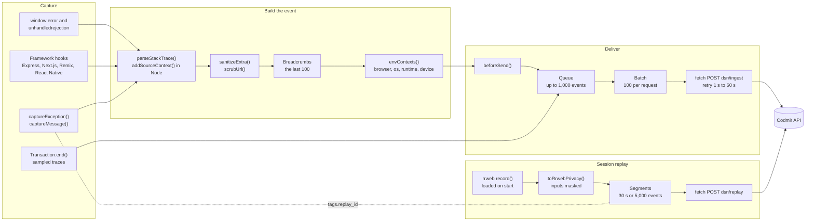
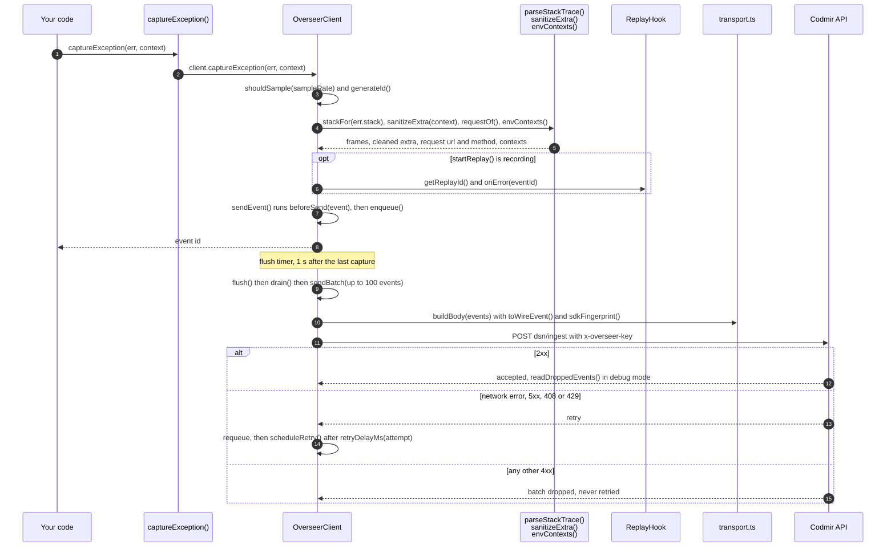
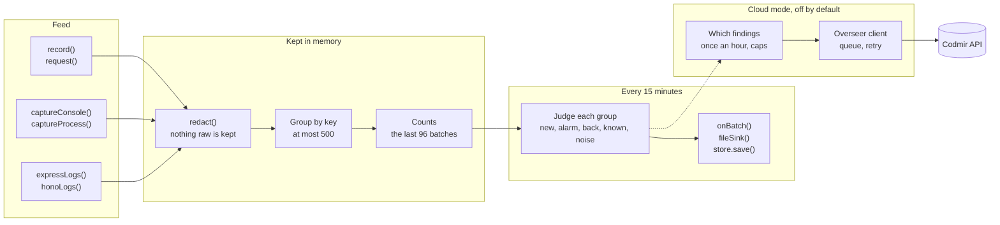

<p align="center">
  <picture>
    <source media="(prefers-color-scheme: dark)" srcset="docs/assets/hero-dark.svg">
    <source media="(prefers-color-scheme: light)" srcset="docs/assets/hero-light.svg">
    
  </picture>
</p>

<p align="center">
  <a href="https://www.npmjs.com/package/@codmir/sdk"></a>
  <a href="LICENSE"></a>
  <a href="#requirements"></a>
  <a href="#typescript"></a>
  <a href="#entry-points"></a>
</p>

<p align="center">
  <a href="#typescript"></a>
  <a href="#nextjs"></a>
  <a href="#express"></a>
  <a href="#hono"></a>
  <a href="#remix"></a>
  <a href="#react-native"></a>
  <a href="#session-replay"></a>
  <a href="#tracing"></a>
  <a href="#typescript"></a>
</p>

<p align="center">
  <a href="#quick-start"><b>Quick start</b></a> ·
  <a href="#framework-guides"><b>Frameworks</b></a> ·
  <a href="#how-it-works"><b>How it works</b></a> ·
  <a href="#configuration"><b>Configuration</b></a> ·
  <a href="#privacy-and-safety"><b>Privacy</b></a> ·
  <a href="#troubleshooting"><b>Troubleshooting</b></a> ·
  <a href="#faq"><b>FAQ</b></a> ·
  <a href="https://codmir.com"><b>codmir.com</b></a>
</p>

Official TypeScript/JavaScript SDK for the [Codmir](https://codmir.com) platform: error tracking, tracing and session
replay for browsers, Node.js, Next.js, Express, Hono, Remix and React Native, plus bug reporting, a setup check and the
Codmir API client. One package, sixteen entry points, nothing loaded that you do not import.

```bash
npm install @codmir/sdk
```

> [!NOTE]
> This page documents the `main` branch. If an import below is missing from the version you installed, compare
> `npm view @codmir/sdk version` with the `version` in [`package.json`](package.json) and read
> [CHANGELOG.md](CHANGELOG.md) for what is not released yet.

<details>
<summary><b>Contents</b></summary>

- [Why Codmir SDK](#why-codmir-sdk)
- [Quick start](#quick-start)
- [Platforms](#platforms)
- [Entry points](#entry-points)
- [How it works](#how-it-works): [the pipeline](#the-pipeline), [one `captureException` call](#one-captureexception-call), [the life of one error](#the-life-of-one-error)
- [Framework guides](#framework-guides): [Browser](#browser), [Next.js](#nextjs), [Express](#express), [Hono](#hono), [Remix](#remix), [React Native](#react-native), [Node.js](#nodejs)
- [Tracing](#tracing)
- [Session replay](#session-replay)
- [Privacy and safety](#privacy-and-safety)
- [Configuration](#configuration): [core options](#core-options), [integration options](#integration-options), [delivery and limits](#delivery-and-limits)
- [Verify your setup](#verify-your-setup)
- [Bug reporting](#bug-reporting)
- [Feedback](#feedback): [what is sent](#what-is-sent), [the results](#the-results), [deleting](#deleting-and-listing)
- [API client](#api-client)
- [TypeScript](#typescript)
- [Bundle size](#bundle-size)
- [Requirements](#requirements)
- [Troubleshooting](#troubleshooting)
- [FAQ](#faq)
- [Repository layout](#repository-layout)
- [Development](#development): [releasing](#releasing)
- [License](#license)

</details>

## Why Codmir SDK

<table>
<tr>
<td width="33%" valign="top">
<br>
<b>Error tracking</b><br>
<code>captureException</code> with stacks parsed for V8, Firefox and Safari, source lines in Node, and browser, OS and runtime contexts.
</td>
<td width="33%" valign="top">
<br>
<b>Session replay</b><br>
rrweb recording, loaded only when a replay starts recording. Inputs masked by default; an error uploads the seconds before it.
</td>
<td width="33%" valign="top">
<br>
<b>Tracing</b><br>
Spans and transactions with W3C <code>traceparent</code> propagation; <code>fetch</code> and XHR calls become <code>http.client</code> spans.
</td>
</tr>
<tr>
<td width="33%" valign="top">
<br>
<b>Web vitals</b><br>
LCP, INP, CLS, TTFB and FCP on the browser pageload transaction, with the final INP and CLS sent when the page hides.
</td>
<td width="33%" valign="top">
<br>
<b>Breadcrumbs</b><br>
Clicks, <code>fetch</code>, XHR, navigation and server requests; the last 100 ride along with every error.
</td>
<td width="33%" valign="top">
<br>
<b>Private by default</b><br>
No headers, cookies, query strings or bodies from the integrations; secret-looking keys dropped from what you attach.
</td>
</tr>
<tr>
<td width="33%" valign="top">
<br>
<b>Reliable delivery</b><br>
Batches of 100, retries with backoff up to 60 s, a 1,000-event queue, and a <code>keepalive</code> send when the page hides.
</td>
<td width="33%" valign="top">
<br>
<b>Framework integrations</b><br>
Next.js, Express, Hono, Remix, React Native and the plain browser, each a separate import.
</td>
<td width="33%" valign="top">
<br>
<b>Bug reporting</b><br>
File, search and upvote bug reports against any vendor; an existing match is upvoted instead of filed twice.
</td>
</tr>
<tr>
<td width="33%" valign="top">
<br>
<b>Setup check</b><br>
<code>verify()</code> initialises, sends a test message and flushes it, reporting each step as it goes.
</td>
<td width="33%" valign="top">
<br>
<b>API client</b><br>
Projects, tickets, test cases, agent tasks and AI chat over the Codmir REST API, with typed errors.
</td>
<td width="33%" valign="top">
<br>
<b>Typed, dual build</b><br>
ES module and CommonJS builds with type declarations for every entry point, and Zod schemas for API input.
</td>
</tr>
</table>

## Quick start

**1. Install.**

```bash
npm install @codmir/sdk
```

**2. Initialise once, as early as possible.** Your project's client key is under **Settings > Codmir SDK** in Codmir.
In a browser app:

```ts
import { init, captureException } from '@codmir/sdk/browser';

init({
  clientKey: 'osk_your_client_key',
  environment: 'production',
  release: '1.4.2',
});

// Uncaught errors and unhandled rejections are captured from here on. Send handled ones yourself:
try {
  JSON.parse('{ not json');
} catch (err) {
  captureException(err, { step: 'parse-settings' });
}
```

In Node.js, import the same functions from the package root:

```ts
import { init, captureException, flush } from '@codmir/sdk';

init({ clientKey: process.env.CODMIR_CLIENT_KEY, environment: 'production' });

try {
  JSON.parse('{ not json');
} catch (err) {
  captureException(err);
}

await flush(); // before a short-lived process exits
```

**3. Check the setup** with [`verify()`](#verify-your-setup), then pick your framework below.

> [!TIP]
> Events are sent one second after the last capture, in batches. A script that exits right away should
> `await flush()` first, or the queue dies with the process.

## Platforms

| Platform | Import | Errors | Breadcrumbs | Tracing | Replay |
| --- | --- | --- | --- | --- | --- |
| [Browser](#browser) | `@codmir/sdk/browser` |  |  |  when `tracesSampleRate` > 0 |  `@codmir/sdk/replay` |
| [Next.js](#nextjs) | `@codmir/sdk/nextjs`, `/nextjs/server` |  browser,  `onRequestError` |  route changes |  route handlers, middleware |  in the browser |
| [Express](#express) | `@codmir/sdk/express` |  |  |  + outgoing `fetch` | n/a |
| [Hono](#hono) | `@codmir/sdk/hono` |  `captureException` in `onError` |  |  | n/a |
| [Remix](#remix) | `@codmir/sdk/remix`, `/remix/server` |  `handleError`,  loaders, actions |  server,  browser |  |  in the browser |
| [React Native](#react-native) | `@codmir/sdk/react-native` |  JS errors, error boundary |  screens, app state | n/a | n/a |
| [Node.js](#nodejs) | `@codmir/sdk` |  |  |  `@codmir/sdk/tracing` | n/a |

**auto** works once `init()` has run. **hook** and **middleware** mean you export, mount or call one function. **wrap**
means you wrap a handler. **manual** means you call the API. **opt-in** means you call `startReplay()`.

## Entry points

Each import is its own bundle, so a page that only reports errors never loads the replay recorder or the API client.

| Import | What it gives you | Runs in |
| --- | --- | --- |
| `@codmir/sdk` | The error SDK (`init`, `captureException`, `captureMessage`, `setUser`, `setTag`, `addBreadcrumb`, `flush` ...), the `Overseer` namespace and `CodmirClient` | Anywhere |
| `@codmir/sdk/overseer` | The error SDK alone: the same functions as the root, without the API client | Anywhere |
| `@codmir/sdk/browser` | `init` with global handlers, click and request breadcrumbs, `fetch` and XHR spans, `startBrowserTracing` | Browser |
| `@codmir/sdk/replay` | `startReplay`, `stopReplay`, `ReplayRecorder`, `DEFAULT_PRIVACY` | Browser |
| `@codmir/sdk/tracing` | `startSpan`, `startTransaction`, `startChildSpan`, `traceparent` helpers, `instrumentFetch`, `instrumentXhr` | Anywhere |
| `@codmir/sdk/logs` | `createLogMonitor`, `redact`, `pathPattern`, `messageKey`: findings from an app's own logs, local first; the `LogStore` and `LogState` types for the `store` option | Anywhere |
| `@codmir/sdk/logs/node` | `captureConsole`, `captureProcess`, `fileSink`, `fileStore`, `expressLogs`, `honoLogs`, and for [logs you already have](#read-logs-you-already-have) `readLog`, `followFile` | Node.js |
| `@codmir/sdk/logs/parse` | `parseLogLine`, `parseLogLines`: one line of JSON, Vercel, Railway, journald, pino, access-log or plain-text output as a record or a request | Anywhere |
| `codmir-logs` (a command, `bin`) | `npx codmir-logs [files…]`: [findings from logs you already have](#read-logs-you-already-have), on your machine | Node.js |
| `@codmir/sdk/nextjs` | Next.js `init`, `captureRouterError`, `captureRequestError`, route-change breadcrumbs | Browser and server |
| `@codmir/sdk/nextjs/server` | `withCodmirTracing`, `withCodmirMiddleware` | Node.js runtime |
| `@codmir/sdk/express` | `init`, `requestHandler`, `tracingHandler`, `errorHandler` | Node.js |
| `@codmir/sdk/hono` | `codmirTracing()` middleware | Node.js (needs `node:async_hooks`) |
| `@codmir/sdk/remix` | `init`, `handleError`, `wrapLoader`, `wrapAction`, `captureRemixServerError`, `setupBrowserTracking` | Server and browser |
| `@codmir/sdk/remix/server` | `withCodmirTracing`, `withCodmirRequestHandler` | Node.js |
| `@codmir/sdk/react-native` | `init` with a global JS error handler, `createErrorBoundary`, screen and app-state breadcrumbs | React Native |
| `@codmir/sdk/verify` | `verify`, `quickVerify`, `printVerifyResult` | Anywhere |
| `@codmir/sdk/report` | `Codmir.reportBug`, `searchBugs`, `upvote`, `captureException` | Anywhere |
| `@codmir/sdk/feedback` | `sendFeedback`, `deleteFeedback`, `listFeedback`: what a visitor says, sent with the replay, the error and the failed request of their session | Anywhere (a browser, React Native, a worker, Node 18+) |
| `@codmir/sdk/client` | `CodmirClient` | Server side (it holds an API key) |
| `@codmir/sdk/types` | API types, `CodmirApiError`, `CreateTicketSchema`, `CreateAgentTaskSchema` | Anywhere |

> [!IMPORTANT]
> **What is in this package.** `@codmir/sdk` is the error, tracing and replay SDK: error capture (`overseer`),
> tracing, session replay, the framework integrations (Next.js, Express, Hono, Remix, React Native, browser), bug
> reporting, setup verification and the API client. The agent runtime, council, serverless, task-runner protocol,
> AI-call monitoring (`/ai`), MCP client (`/mcp`) and the framework task helpers were removed from the published
> package. They live in the private, unpublished workspace [`packages/agent-kit`](packages/agent-kit)
> (`@codmir/agent-kit`) in this repo. Importing `@codmir/sdk/agent`, `/council`, `/serverless`, `/runtime`, `/ai` or
> `/mcp` no longer works.

## How it works

### The pipeline

Everything an integration catches goes through one client: it is turned into an event, cleaned, queued, batched and
posted to your Codmir project. Session replay runs beside it and uploads its own segments.



### One `captureException` call

The functions below are named as they are in [`src/overseer/index.ts`](src/overseer/index.ts) and
[`src/overseer/transport.ts`](src/overseer/transport.ts).



### The life of one error

What one `captureException` call sends, step by step. The body below was produced by the built SDK in Node with
`fetch` stubbed out; only the stack was written by hand, so the paths read cleanly.

```ts
import { init, setUser, setTag, addBreadcrumb, captureException } from '@codmir/sdk';

init({ clientKey: 'osk_example', environment: 'production', release: '1.4.2', service: 'checkout-api' });
setUser({ id: 'user_42' });
setTag('region', 'eu-west-1');
addBreadcrumb({ category: 'cart', message: '3 items', data: { items: 3, authToken: 'abc' } });

const err = new TypeError('Card 4242 declined for order 1234');
captureException(err, { orderId: 'ord_123', password: 'hunter2', req: { headers: { cookie: 'sid=1' }, method: 'POST' } });
```

1. **Sampling and id.** `enabled` and `sampleRate` decide whether the error is kept; if it is, it gets a 21-character id,
   which `captureException` returns at once.
2. **Stack.** `parseStackTrace` reads every frame and marks `in_app` false for `node_modules`, Node internals and the
   SDK's own files. In Node, the first three in-app frames whose file can be read also get `pre_context`,
   `context_line` and `post_context` (5 lines each side).
3. **Cleaning.** `sanitizeExtra` drops `password` and `req` from the context, and `addBreadcrumb` already dropped
   `authToken` from the breadcrumb.
4. **Context.** The user, tags, breadcrumbs, environment, release, SDK name and version and the runtime contexts are
   attached. Inside a server request the event also gets `request.url` (origin and path) and `request.method`; in a
   browser, `request.url` is the page's origin and path.
5. **Queue and send.** One second after the last capture the queue is sent as one request:

```http
POST https://www.codmir.com/api/v1/overseer/ingest
Content-Type: application/json
x-overseer-key: osk_example
```

<details>
<summary><b>The request body</b></summary>

```json
{
  "events": [
    {
      "type": "error",
      "event": {
        "id": "4qwTm-PQHv2FCXjml6yoq",
        "timestamp": "2026-11-23T19:57:26.638Z",
        "level": "error",
        "message": "Card 4242 declined for order 1234",
        "exception": {
          "type": "TypeError",
          "value": "Card 4242 declined for order 1234",
          "stacktrace": [
            { "function": "chargeCard", "filename": "/srv/app/src/checkout.js", "lineno": 42, "colno": 11, "in_app": true },
            { "function": "placeOrder", "filename": "/srv/app/src/checkout.js", "lineno": 18, "colno": 5, "in_app": true },
            { "filename": "/srv/app/node_modules/express/lib/router/layer.js", "lineno": 95, "colno": 5, "in_app": false }
          ],
          "mechanism": { "type": "generic", "handled": true }
        },
        "user": { "id": "user_42" },
        "tags": { "region": "eu-west-1" },
        "extra": { "orderId": "ord_123", "conversationId": null, "sessionId": null },
        "breadcrumbs": [
          { "category": "cart", "message": "3 items", "data": { "items": 3 }, "timestamp": "2026-11-23T19:57:26.633Z" }
        ],
        "environment": "production",
        "release": "1.4.2",
        "sdk": { "name": "@codmir/sdk", "version": "2.2.0" },
        "contexts": {
          "runtime": { "name": "node", "version": "22.22.1" },
          "os": { "name": "linux", "version": "7.0.0-43-generic" }
        },
        "fingerprint": ["TypeError", "/srv/app/src/checkout.js:42", "Card <N> declined for order <N>"]
      },
      "group": {
        "fingerprint": ["TypeError", "/srv/app/src/checkout.js:42", "Card <N> declined for order <N>"],
        "message": "Card 4242 declined for order 1234",
        "culprit": "/srv/app/src/checkout.js:42",
        "level": "error"
      }
    }
  ],
  "service": "checkout-api",
  "environment": "production",
  "release": "1.4.2"
}
```

</details>

6. **Grouping.** The fingerprint is the error type, the `file:line` of the first in-app frame, and the message with
   digits masked as `<N>` (then runs of 8 or more hex characters as `<ID>`), cut to 100 characters. Two declined cards
   with different numbers group together. Set `event.fingerprint` in `beforeSend` to group your own way.
7. **Delivery.** A 2xx ends it. A network error, a 5xx, 408 or 429 puts the batch back and retries after 1 s, 2 s,
   4 s ... up to 60 s, honouring `Retry-After`. Any other 4xx drops the batch, because sending it again cannot help.

## Framework guides

### Browser

```ts
import { init, setUser, addBreadcrumb } from '@codmir/sdk/browser';

init({
  clientKey: 'osk_your_client_key',
  environment: 'production',
  trackClicks: true, // default true: ui.click breadcrumbs
  trackRequests: true, // default true: fetch and XHR breadcrumbs, http.client spans, traceparent
  trackInputs: false, // default false: ui.input breadcrumbs, never the value
  captureConsoleErrors: false, // default false: console.error sent as an error-level message
  tracesSampleRate: 0.2, // above 0 turns on pageload and navigation transactions
});

setUser({ id: 'user_42' });
addBreadcrumb({ category: 'checkout', message: 'coupon applied' });
```

| After `init()` | Detail |
| --- | --- |
| Uncaught errors | `window` `error` events, captured with the file, line and column (`captureGlobalErrors`, default on) |
| Unhandled rejections | `unhandledrejection` events (`captureUnhandledRejections`, default on) |
| Click breadcrumbs | Tag, id, class and, for buttons and links, up to 50 characters of their text |
| Request breadcrumbs | `fetch` and XHR: method, origin and path, status and duration; never the query string |
| Spans | Every `fetch` and XHR made inside a trace becomes an `http.client` span; same-origin requests and your `tracePropagationTargets` get a `traceparent` header |
| Transactions | With `tracesSampleRate` above 0: one `pageload` transaction, then one `navigation` transaction per client-side route change, with web vitals on the pageload |

`init()` in `@codmir/sdk/browser` does nothing outside a browser and logs a warning, so it is safe in code that also
renders on a server. Add [session replay](#session-replay) with one more import.

### Next.js

Browser side, in `instrumentation-client.ts`:

```ts
// instrumentation-client.ts
import * as Codmir from '@codmir/sdk/nextjs';

Codmir.init({
  clientKey: process.env.NEXT_PUBLIC_CODMIR_CLIENT_KEY,
  environment: process.env.NODE_ENV,
  release: process.env.NEXT_PUBLIC_APP_VERSION,
});
```

Server side, in `instrumentation.ts`. Next.js hands server errors to `onRequestError`, and `captureRouterError` has
the shape it expects:

```ts
// instrumentation.ts
import * as Codmir from '@codmir/sdk/nextjs';

export function register() {
  Codmir.init({
    clientKey: process.env.CODMIR_CLIENT_KEY,
    environment: process.env.NODE_ENV,
    tracesSampleRate: 0.1,
  });
}

export const onRequestError = Codmir.captureRouterError;
```

Each server error carries `request.url` (origin from `Host` and `X-Forwarded-Proto`, path without its query),
`request.method`, and the route as `routerKind`, `routePath`, `routeType` and `route`. No header is sent.

Route handler transactions come from `@codmir/sdk/nextjs/server`. Next.js does not tell a handler its own route
pattern, so pass it to group by route rather than by URL:

```ts
// app/api/users/[id]/route.ts
import { withCodmirTracing } from '@codmir/sdk/nextjs/server';

export const GET = withCodmirTracing(
  async (request: Request) => Response.json({ path: new URL(request.url).pathname }),
  { route: '/api/users/[id]' },
);
```

```ts
// middleware.ts, Node.js runtime only
import { NextResponse } from 'next/server';
import { withCodmirMiddleware } from '@codmir/sdk/nextjs/server';

export const middleware = withCodmirMiddleware(() => NextResponse.next());
```

> [!WARNING]
> `@codmir/sdk/nextjs/server` needs `node:async_hooks`. Never import it from an Edge route (`export const runtime =
> "edge"`) or from Edge middleware; Node.js middleware (Next.js 15.5 and later) is fine. `@codmir/sdk/nextjs` itself has
> no Node import.

To capture an error you handled yourself, with the request it belongs to:

```ts
import { captureRequestError } from '@codmir/sdk/nextjs';

export async function POST(request: Request) {
  try {
    const order: unknown = await request.json();
    return Response.json({ received: order !== null });
  } catch (err) {
    captureRequestError(err as Error, { routePath: '/api/orders', routeType: 'route' }, request);
    return Response.json({ error: 'internal error' }, { status: 500 });
  }
}
```

<details>
<summary><b>What <code>@codmir/sdk/nextjs</code> does in the browser</b></summary>

- `window` `error` and `unhandledrejection` are captured (`captureUnhandledErrors`, `captureUnhandledRejections`, both on).
- Route changes become `navigation` breadcrumbs: the first page, `pushState`, `replaceState` and `popstate`, each with
  origin and path only (`trackRouteChanges`, on).
- `captureRouterTransitionStart(route)` adds a `Navigating to <route>` breadcrumb when you call it.
- It starts no pageload transaction and no replay. For replay call `startReplay()` from
  [`@codmir/sdk/replay`](#session-replay) after `init()`; the `enableReplay` option is accepted but not read at this
  version.

</details>

### Express

```ts
import express from 'express';
import * as Codmir from '@codmir/sdk/express';

Codmir.init({
  clientKey: process.env.CODMIR_CLIENT_KEY,
  environment: process.env.NODE_ENV,
  tracesSampleRate: 0.2,
  extractUser: (req) => (req.user ? { id: String(req.user.id) } : null),
});

const app = express();

app.use(Codmir.requestHandler()); // first: request breadcrumb, request scope, user
app.use(Codmir.tracingHandler()); // an http.server transaction per request

app.get('/orders/:id', (req, res) => {
  res.json({ id: req.params.id });
});

app.use(Codmir.errorHandler()); // after every route: captures the error, then calls next(err)

app.listen(3000);
```

| Middleware | What it does |
| --- | --- |
| `requestHandler()` | Adds an `http.request` breadcrumb (method and path), runs `extractUser`, and runs the rest of the chain in the request's scope, so any capture in the handler's async tail carries this request's `request.url` and `request.method`. Mount it first. |
| `tracingHandler()` | Continues an incoming `traceparent` or starts a trace, opens an `http.server` transaction named after the route pattern (`GET /orders/:id`), ends it when the response finishes or the client hangs up, and adds an `http.response` breadcrumb with the status and duration. A 5xx marks it `error`. |
| `errorHandler()` | Captures the error with the route pattern, then calls `next(err)` so your own error handler still runs. Mount it after the routes. |

`init()` also wraps the global `fetch`, so outgoing calls inside a traced request become `http.client` spans and carry
a `traceparent` to same-origin URLs and to your `tracePropagationTargets`.

> [!NOTE]
> `errorHandler()` adds `clientIp` (`req.ip`) and the `extractUser` result to the event's `extra`. Leave
> `extractUser` out, or strip them in `beforeSend`, if you must not send them.

### Hono

```ts
import { Hono } from 'hono';
import { init, captureException } from '@codmir/sdk';
import { codmirTracing } from '@codmir/sdk/hono';

init({ clientKey: process.env.CODMIR_CLIENT_KEY, tracesSampleRate: 0.2 });

const app = new Hono();
app.use(codmirTracing());

app.get('/users/:id', (c) => c.json({ id: c.req.param('id') }));

app.onError((err, c) => {
  captureException(err); // carries this request's url and method, never its query
  return c.text('Internal Server Error', 500);
});

export default app;
```

`codmirTracing()` names each transaction after the matched route (`GET /users/:id`), continues an incoming
`traceparent`, and marks the transaction `error` on a 5xx or a thrown handler. It needs `node:async_hooks`; `hono` is an
optional peer dependency.

### Remix

Server, in `entry.server.tsx`:

```ts
import * as Codmir from '@codmir/sdk/remix';

Codmir.init({ clientKey: process.env.CODMIR_CLIENT_KEY, environment: process.env.NODE_ENV });

export const handleError = Codmir.handleError;
```

In a route module, wrap loaders and actions. Errors are captured and rethrown, so your error boundaries still run:

```ts
import { wrapLoader, wrapAction } from '@codmir/sdk/remix';

export const loader = wrapLoader(async ({ params }) => {
  return { id: params.id };
});

export const action = wrapAction(async ({ request }) => {
  // The SDK types `request` minimally, so formData() is optional here.
  const form = await request.formData?.();
  return { fields: form ? Array.from(form.keys()) : [] };
});
```

Browser, in `entry.client.tsx`, before you hydrate:

```ts
import * as Codmir from '@codmir/sdk/remix';

Codmir.init({ clientKey: 'osk_your_client_key' });
Codmir.setupBrowserTracking(); // window errors, unhandled rejections, navigation breadcrumbs
```

Transactions come from `@codmir/sdk/remix/server`: wrap the request handler for one transaction per request, or a
single loader with its route pattern.

```ts
import { createRequestHandler, type ServerBuild, type LoaderFunctionArgs } from '@remix-run/node';
import { withCodmirRequestHandler, withCodmirTracing } from '@codmir/sdk/remix/server';

declare const build: ServerBuild;

// One transaction per request, loaders and actions included
export const handle = withCodmirRequestHandler(createRequestHandler(build));

// Or per route
export const loader = withCodmirTracing(
  async ({ params }: LoaderFunctionArgs) => Response.json({ id: params.id }),
  { route: '/users/:id' },
);
```

Errors captured inside these wrappers do not get `request.url` or `request.method` at this version (the Express,
Next.js and Hono integrations attach both); the transaction is named after the route.

<details>
<summary><b>What each Remix function captures</b></summary>

| Function | Captures | Extra context |
| --- | --- | --- |
| `handleError(error, { request })` | Server errors Remix reports. A thrown `Response` is captured as `Response Error: <status> <statusText>` unless `captureResponseErrors: false` | `mechanism`, `responseStatus`, `responseStatusText` |
| `wrapLoader(fn)` | Errors thrown by the loader (`captureLoaderErrors`), plus a `loader` breadcrumb with method and path | `mechanism: remix-loader` |
| `wrapAction(fn)` | Errors thrown by the action (`captureActionErrors`), plus an `action` breadcrumb | `mechanism: remix-action`, and `formDataKeys` (the form's field names, never their values) when the action threw before reading the body |
| `captureRemixServerError(error, request)` | Rendering errors from `entry.server.tsx`; returns the event id | `mechanism: remix-server-render` |
| `setupBrowserTracking()` | `window` errors and unhandled rejections; navigation breadcrumbs unless `captureRouteChanges: false` | `mechanism: onerror` or `onunhandledrejection` |

A thrown `Response` (`throw redirect()`, a 404) is classified by its status in a `remix/server` transaction and
rethrown; it is not counted as an error.

</details>

### React Native

```tsx
// App.tsx
import React from 'react';
import { Text } from 'react-native';
import { NavigationContainer } from '@react-navigation/native';
import * as Codmir from '@codmir/sdk/react-native';

Codmir.init({ clientKey: 'osk_your_client_key', environment: 'production' });

// The cast gives TypeScript a component type: createErrorBoundary's own return type is not one at this version.
const ErrorBoundary = Codmir.createErrorBoundary(React) as unknown as React.ComponentType<Codmir.ErrorBoundaryProps>;

export default function App() {
  return (
    <ErrorBoundary fallback={<Text>Something went wrong.</Text>}>
      <NavigationContainer onStateChange={Codmir.createNavigationListener()}>
        <Text>Home</Text>
      </NavigationContainer>
    </ErrorBoundary>
  );
}
```

`init()` installs a global JS error handler through `ErrorUtils` and still calls the handler that was there before.
The error boundary captures render errors with the component stack, then shows `fallback` (a node, or a function of
the error). Screens, app state and device details are recorded through calls:

```ts
import { AppState, Platform } from 'react-native';
import * as Codmir from '@codmir/sdk/react-native';

Codmir.setDeviceInfo({
  platform: Platform.OS === 'ios' ? 'ios' : 'android',
  osVersion: String(Platform.Version),
}); // tags: device.platform, device.os_version, device.model, app.version, app.build

AppState.addEventListener('change', (state) => {
  if (state === 'active' || state === 'background' || state === 'inactive') {
    Codmir.trackAppStateChange(state); // app.lifecycle breadcrumb
  }
});

Codmir.trackScreenView('HomeScreen'); // navigation breadcrumb: "Screen: HomeScreen"
```

> [!NOTE]
> `captureNativeCrashes`, `trackScreenViews`, `trackAppState` and `includeDeviceInfo` are accepted by `init()` but not
> read at this version: screens, app state and device details come from the calls above, and native crashes are not
> captured.

> [!TIP]
> `@codmir/sdk/react-native` is a subpath export: it exists only in the `exports` map of `package.json`, with no
> `react-native` folder at the package root. Metro must resolve package exports for it. React Native 0.79 and later do
> by default; on 0.72 to 0.78 set `resolver.unstable_enablePackageExports = true` in `metro.config.js`.

### Node.js

Any Node.js service, worker or script can use the root import. The core installs no process handlers, so add your own
for crashes:

```ts
import { init, captureException, flush, setTag } from '@codmir/sdk';

init({
  clientKey: process.env.CODMIR_CLIENT_KEY,
  environment: process.env.NODE_ENV ?? 'development',
  release: process.env.APP_VERSION,
  service: 'billing-worker',
});
setTag('queue', 'invoices');

process.on('uncaughtException', async (err) => {
  captureException(err);
  await flush();
  process.exit(1);
});

process.on('unhandledRejection', (reason) => {
  captureException(reason);
});
```

In Node, events carry `contexts.runtime` (`node` and its version) and `contexts.os` (platform and release), and the first
three in-app frames carry source lines. The retry timer is `unref`'d, so a pending retry never keeps the process alive.

## Tracing

Tracing is off until `tracesSampleRate` is above 0. The decision is made once per trace, at its root, and travels to
other services in the `traceparent` sampled flag.

```ts
import { init } from '@codmir/sdk';
import { startSpan } from '@codmir/sdk/tracing';

init({ clientKey: process.env.CODMIR_CLIENT_KEY, tracesSampleRate: 0.2 });

const total = await startSpan({ name: 'checkout', op: 'function' }, async (span) => {
  span.setTag('cart.size', '3');
  const price = await startSpan({ name: 'price cart', op: 'function' }, async () => 42);
  await startSpan({ name: 'charge card', op: 'payment' }, () => fetch('https://payments.example.com/charge', { method: 'POST' }));
  return price;
});
```

- `startSpan(options, fn)` nests under the active span, or opens a root transaction when none is active. It ends the
  span when `fn` returns, throws or settles; a throw or rejection marks it `error` and propagates unchanged.
- When a root ends, it and its finished children are queued as one `transaction` event on the same transport as
  errors. At most 1,000 spans go in one transaction. `beforeSend` does not see transactions.
- `startTransaction({ name, op, traceparent })` starts a root you end yourself, continuing an incoming trace:

```ts
import { startTransaction, withActiveSpan } from '@codmir/sdk/tracing';

export async function handleJob(job: { traceparent?: string; run(): Promise<void> }) {
  const tx = startTransaction({ name: 'process job', op: 'queue.process', traceparent: job.traceparent });
  try {
    await withActiveSpan(tx, () => job.run());
    tx.setStatus('ok');
  } catch (err) {
    tx.setStatus('error');
    throw err;
  } finally {
    tx.end();
  }
}
```

<details>
<summary><b>Sampling, propagation and outgoing requests</b></summary>

| Rule | Behaviour |
| --- | --- |
| `tracesSampleRate: 0` (default) | Nothing is recorded, even when the caller sent a sampled `traceparent` |
| Incoming `traceparent` | Its sampled flag wins over your rate, and its trace id is kept |
| No incoming `traceparent` | Sampled with probability `tracesSampleRate` |
| `traceparent` format | W3C version 00: `00-<32 hex trace id>-<16 hex span id>-<01 or 00>` (`formatTraceparent`, `parseTraceparent`) |
| Outgoing `traceparent` | Added to same-origin requests and to URLs matching `tracePropagationTargets` (a string matches when the full URL contains it, a RegExp when it tests true), never to the Codmir ingest URL, never over an existing header |
| `fetch` spans | `@codmir/sdk/browser` and `@codmir/sdk/express` wrap `fetch` for you. Elsewhere call `instrumentFetch()` (and `instrumentXhr()` in a browser) from `@codmir/sdk/tracing`; both are idempotent and return a function that undoes them |

In Node.js, the first request through any server integration (Express, Next.js server, Hono, Remix server) stores the
active span in `AsyncLocalStorage`, so concurrent requests never see each other's spans. Before that, and always in a
browser, the active span is a stack: two flows running at once can see each other's span.

</details>

<details>
<summary><b>Browser pageload, navigation and web vitals</b></summary>

`@codmir/sdk/browser` starts browser tracing when `tracesSampleRate` is above 0 (or when you pass `browserTracing:
true` or an options object). You can also call `startBrowserTracing(options)` yourself.

- A `pageload` transaction starts at `performance.timeOrigin`; each client-side route change (`pushState`,
  `replaceState`, `popstate`, when the pathname changes) ends the current root and starts a `navigation` one.
- A root ends when no child span has been open for `idleTimeout` ms (default 1,000), or after `finalTimeout` ms
  (default 30,000), whichever comes first; spans still open then are ended `cancelled`.
- The pageload carries `lcp`, `inp`, `cls`, `ttfb` and `fcp` as measured so far. INP and CLS settle when the page hides,
  so the final values are sent then as a small `web-vitals` transaction in the same trace.
- `routeName(pathname, kind)` names a root by its route (`/orders/42` to `/orders/:id`); `onPageloadEnd(transaction)`
  sees the pageload just before it ends.

</details>

## Session replay

`@codmir/sdk/replay` records the page with [rrweb](https://github.com/rrweb-io/rrweb) (loaded lazily, only by this
entry) and uploads segments to Codmir. Call `startReplay()` after `init()`:

```ts
import { init } from '@codmir/sdk/browser';
import { startReplay } from '@codmir/sdk/replay';

init({
  clientKey: 'osk_...',
  replaysSessionSampleRate: 0.1, // default 0: share of sessions recorded and uploaded every 30 s / 5,000 events
  replaysOnErrorSampleRate: 1.0, // default 1: keep the last 30-60 s, upload them plus the next 30 s on an error
});
startReplay();
```

Both rates at 0 record nothing and never load rrweb. While a replay records, every error event carries
`tags.replay_id`, and the replay's segments list the ids of the errors captured while they recorded.
`startReplay()` returns the replay id, or `null` when nothing records: no client, no client key, not in a browser, or
neither rate hit.

Privacy is on by default: every input is masked, `[data-private]` and `.private` text is masked, `[data-codmir-block]`
subtrees are not recorded, and password fields are masked whatever the config says. Pass
`startReplay({ privacy: { maskSelectors: [...], blockSelectors: [...] } })` to change the selectors:

```ts
import { startReplay, stopReplay } from '@codmir/sdk/replay';

const replayId = startReplay({
  privacy: {
    maskSelectors: ['[data-private]', '.private', '.customer-name'], // lists replace the defaults
    blockSelectors: ['[data-codmir-block]', '#card-form'],
  },
});
console.log(replayId ? `recording ${replayId}` : 'not recording');

// Later, for example on sign-out:
stopReplay();
```

```html
<input name="email">                         <!-- value masked: every input is -->
<p data-private>Order for Jane Doe</p>       <!-- text replaced by * -->
<section data-codmir-block>...</section>     <!-- not recorded; a same-size placeholder instead -->
```

<details>
<summary><b>Replay options, modes and limits</b></summary>

| Option (`startReplay` or `createReplayRecorder`) | Default | Meaning |
| --- | --- | --- |
| `sessionSampleRate` | `replaysSessionSampleRate`, else 0 | Share of sessions that record continuously and upload segments |
| `errorSampleRate` | `replaysOnErrorSampleRate`, else 1 | Share of the other sessions that keep a rolling buffer for an error |
| `segmentDuration` | 30,000 ms | A segment is uploaded after this long ... |
| `maxSegmentEvents` | 5,000 | ... or after this many events, whichever comes first |
| `bufferDuration` | 60,000 ms | History the on-error buffer keeps (between half of this and all of it) |
| `postErrorDuration` | 30,000 ms | How long recording continues after an error before the follow-up segment uploads |
| `maxSessionDuration` | 1 hour | Upper bound on one continuous session |
| `privacy.maskAllInputs` | `true` | Mask the value of every input, textarea and select |
| `privacy.maskInputTypes` | `['password', 'credit-card']` | Input types masked even when `maskAllInputs` is false; `password` always is |
| `privacy.maskSelectors` | `['[data-private]', '.private']` | Text of matching elements and their descendants is replaced by `*` |
| `privacy.blockSelectors` | `['[data-codmir-block]', '[data-block-replay]']` | Matching subtrees are not recorded |
| `privacy.ignoreSelectors` | `[]` | Input events on matching elements are not recorded |

A selector the browser rejects, or one left unclosed such as `[data-x`, is skipped (with an `[Overseer replay]` message
when `upload.debug` is on), and the rest of its list still applies.

- **Session mode** (session rate hit): records and uploads a segment every 30 s or 5,000 events.
- **On-error mode** (only the error rate hit): keeps the last 30 to 60 s in memory, uploads it when `captureException`
  runs, keeps recording for 30 s more, uploads that, then goes back to buffering under a new replay id.
- Each upload is one `POST <dsn>/replay` with `x-overseer-key`, cut to stay under about 1.8 MB and 10,000 events; a
  network error, 5xx, 408 or 429 is retried once. When the page hides, a small enough segment goes out with
  `keepalive`.
- If the server answers that it stored nothing (`202` with `stored: false`), the recorder stops uploading for the
  rest of the session.
- `createReplayRecorder(config)` gives you a `ReplayRecorder` without the client wiring: with no `upload` target it
  only calls your `onSegment` handler.

</details>

## Log findings

`@codmir/sdk/logs` reads what your app logs and the requests it serves, groups them, and every 15 minutes tells you what
is new, what is on fire and what came back. It runs on your machine: no account, no key, no network. Add `cloud` and
the findings also arrive in your Codmir project as issues.

```ts
import { createLogMonitor } from '@codmir/sdk/logs';

const logs = createLogMonitor({
  onBatch: (batch) => {
    for (const f of batch.findings) console.log(`${f.judgement} ${f.hits}x ${f.title}`);
  },
});
logs.record({ level: 'error', message: 'payment failed for order 8812' });
logs.request({ method: 'GET', path: '/users/42', status: 500, durationMs: 31 });
await logs.flush(); // a batch ends every 15 minutes; flush() ends the open one now
await logs.stop();
```



Only `warning`, `error` and `fatal` lines and requests with status 400 and above become findings. Everything else is only
counted in `stats()`. A log line is grouped by its text with numbers, ids, hashes, dates and quoted values folded; a
request by method, path pattern (`/users/:n`) and status. A JSON line or an object is grouped by its `msg`, `message` or
`event` (and the message of its `err` or `error`), an `Error` by its first line and the file it came from.

| Judgement | When |
| --- | --- |
| `new` | The group was never seen before |
| `alarm` | A request of status 500 or above, or a `fatal` line, with 3 hits or more in the batch; or any group at 10 times its usual |
| `back` | Seen again after 24 quiet hours, or after `logs.mark(id, { fixed: true })` |
| `known` | You marked it: `logs.mark(id, { known: 'https://example.com/issue/12' })` |
| `noise` | Scanner probes (`wp-`, `.env`, `.git`, `.php` and the like), bots on a 404, or your own `noise` patterns |
| `seen` | An ordinary repeat |

Each finding carries its hit count per batch (the last 96), first and last seen, the releases it was seen in and one
redacted sample. `logs.findings()` returns them at any time.

### On a Node server

`@codmir/sdk/logs/node` adds what only Node can do. Nothing here changes what your app or Node does: `console` still
prints, a crash still prints its stack and exits with code 1.

```ts
import { createLogMonitor } from '@codmir/sdk/logs';
import { captureConsole, captureProcess, fileSink, expressLogs } from '@codmir/sdk/logs/node';
import express from 'express';

const logs = createLogMonitor({
  service: 'billing',
  release: process.env.APP_VERSION,
  onBatch: fileSink('./logs/findings.jsonl'), // one JSON line per batch, mode 0600, makes the folder, rotates at 5 MB, keeps 2
});
captureConsole(logs, ['error', 'warn']); // returns a function that puts the originals back
captureProcess(logs); // uncaught exceptions and unhandled rejections, recorded as fatal

const app = express();
app.use(expressLogs(logs)); // status and duration of every answered request, the route or the path without its query
```

For Hono, `app.use(honoLogs(logs))` does the same. `captureProcess` adds no `unhandledRejection` listener, because that
would change what Node does with one.

### Findings that survive a restart

Findings and marks live in memory. After a restart every old problem would be `new` again, a `known` or `fixed` mark would
be gone and, in cloud mode, the same finding would be sent again at once. Give the monitor a `store` and it keeps them:

```ts
import { createLogMonitor } from '@codmir/sdk/logs';
import { fileStore } from '@codmir/sdk/logs/node';

const logs = createLogMonitor({ store: fileStore('./logs/state.json') }); // loaded now, saved after every batch
logs.record({ level: 'error', message: 'payment failed for order 8812' });
await logs.stop(); // saves once more
```

`store.load()` is called once, when the monitor is made. `store.save()` is called at the end of every batch (after
`onBatch` and the cloud decision), on `mark()` and in `stop()`, never per record. After a restart:

- A repeat is `seen`, not `new`. A group last seen more than 24 hours ago is `back` on its next hit; a `fixed` mark makes
  the next hit `back`; `known` stays `known`, with its note.
- `total`, `counts`, first seen, releases and user-agent families go on. Every whole batch window the process was down is
  one 0 in `counts` (at most 96), so "10 times its usual" keeps working. A group quiet for 30 days is forgotten.
- In cloud mode a finding sent 20 minutes before the restart is not sent again for 40 more minutes, the hits since the
  last send are counted right, and `perDay` goes on counting within the same UTC day.

The file is JSON: `{ version, savedAt, batchMinutes, groups, marks, cloud }`. A group is what the monitor holds for it:
key and id, title, the redacted sample, counts per batch, total, first and last seen, releases, user-agent families,
the `known` note and what was sent. **It holds nothing raw.** Everything was redacted before the monitor kept it; what
you typed (a mark's note and id) is redacted when saved, and a group whose key `redact` would change, such as a path with
an address in it, is not kept. A note that looks like an id is changed too: `issues/12345` is saved as `issues/:id`.

`fileStore(path)` writes a temporary file next to `path` (mode 0600, created exclusively, named for the process) and
renames it over `path`, so a crash leaves the old state or the new one, never half of one; it makes the folder, and a
file that had wider rights ends up 0600. It reads a regular file of at most 5 MB (some 7,000 groups) and nothing else: a
symbolic link, a folder or a device is an empty start. **Use one file per process** (and per worker): two processes on one
path never mix, because the last save wins, but then each loses what the other kept.

Loading trusts nothing. A wrong version, a broken, cut or hand-edited file or a store that throws means an empty start. A
group with a bad field is dropped on its own and the others stay; counts and times must be whole numbers in range (a time
in the future becomes now), strings are cut to the lengths the monitor uses and redacted again, a group whose id is not the
id of its key is dropped, and at most `limits.groups` groups (the largest totals) and 500 marks are taken. A store that
throws, hangs on a huge value or answers with a promise changes nothing but `stats().errors`. To keep the state elsewhere
(a database, a key-value service), pass your own `{ load(): unknown; save(state: LogState): void }`; both are synchronous.

### Read logs you already have

You cannot always change the app, and the logs are often somewhere already. `codmir-logs` reads them and gives the same findings, on your machine, with no account and no network. It comes with the package: `npm install @codmir/sdk` first (or, in a place without it, `npx --package @codmir/sdk codmir-logs …`; plain `npx codmir-logs` would look for another package of that name):

```bash
npx codmir-logs app.log                                  # a file (a .gz file is unpacked)
journalctl -u myapp -o json | npx codmir-logs            # the system journal
vercel logs … --json | npx codmir-logs --format vercel   # a hosting platform's CLI output (Vercel; Railway's is --format railway)
node server.js | npx codmir-logs --format pino           # pino, or any JSON lines
npx codmir-logs /var/log/nginx/access.log                # a web server's access log (Common or Combined Log Format)
docker logs --timestamps myapp 2>&1 | npx codmir-logs    # a container's output
```

```
JUDGED    HITS  ID        TITLE                                                         FIRST SEEN           LAST SEEN
new          5  3b39957f  report failed for user #: upstream rejected api_key=[secret]  2026-11-24 10:01:00  2026-11-24 10:01:40
read 8 lines (662 B): 7 records, 0 requests, 1 skipped. 1 finding: 1 new.
```

The format is found per line by default (`--format auto`); say it with `--format` when you know it. A line that does not fit its format is read as plain text, so no line is lost.

| Format | What it reads |
| --- | --- |
| `json` | One JSON object per line. Level from `level`, `severity`, `lvl`, `log.level` or `levelname` (a word, or a pino number); text from `message`, `msg`, `event` or an error object (`type: message`); time from `time`, `timestamp`, `ts`, `@timestamp` or `asctime` (a date, UTC when it names no zone, or seconds, milliseconds, microseconds or nanoseconds, by size); service from `service`, `service.name`, `name` or `logger`; release from `release`, `version`, `service.version` or `dd.version`. A request when it has a method, a path or URL and a status: `method/path/status`, `req.method/req.url/res.statusCode`, `httpRequest.*`, `request.*/response.status`, `http.request.method/url.path/http.response.status_code`, `http.method/http.target/http.status_code` or `request_method/request_uri/status`, with the duration (`durationMs`, `duration`, `responseTime`, `elapsed`) and the user agent. A name with dots is the key of that name or the nested one. A request logged at error level with a status under 400 stays a log line. A container's `{"log":"…","stream":"…","time":"…"}` is the line inside, with the container's time |
| `pino` | The same reader: numeric `level` (10 trace to 60 fatal), `msg`, `time`, `req`, `res`, `responseTime`, `err.type` and `err.message` |
| `vercel` | The CLI's JSON lines (`{"type":"request"\|"log","data":…}`; `summary` and error lines are skipped), a log drain's objects (one per line, or a JSON array of them) and the older CLI's flat line. A line with both a response and a message is the request when the status is 500 or above, else the log line when its level is warning or worse, else the request. A message that is a JSON logger's line, or starts with a level or an exception's name, has that level: the platform's is the stream's. A request the app logged itself is not counted again. The deployment is the release; the environment (and source) is the service |
| `railway` | JSON lines with `timestamp`, `severity` or `level`, `message` and `attributes` (`level`, `method`, `path`, `status` in it). Without a level in `attributes`, the `message` is a line of its own and `severity` only stands when it names none |
| `journald` | `journalctl -o json`: `PRIORITY` 0 to 7 (0-2 fatal, 3 error, 4 warning, 5-6 info, 7 debug), `MESSAGE` (text, bytes or null), `__REALTIME_TIMESTAMP`, service from the unit, `SYSLOG_IDENTIFIER` or `_COMM`. The `MESSAGE` is read as a line of its own (JSON, an access-log line or text) with the journal's service and time; the priority stands when the line names no level (a service's output is all priority 6) |
| `clf` | Apache and nginx Common and Combined Log Format, with or without the host name first: method, path, status, time and user agent. The client address, the user and the referer are never kept |
| `text` | A leading time (ISO, `2026/11/24 10:00:00`, `[…]`, syslog's `Nov 24 10:00:00`) and a level word in the first 60 characters (`ERROR`, `[error]`, `[proxy:error]`, `E/`, `level=error msg="…"`), or an exception's name at the start (`TypeError: …`, `java.lang.IllegalStateException: …`). What syslog or a container runtime writes before the line (`host app[123]:`, `stderr F`) is taken off; `method=… path=… status=…` is a request. A stack-trace line (`    at …`, `Caused by:`, a Python `File "…", line …`) belongs to the line before it and is skipped. A time with no zone is UTC, and one with no year is in the last year that does not put it into the future. Colours are removed. A time in front of JSON is read |

The Vercel and Railway shapes are written from their documented and sample output, not checked against the services; a line that does not fit is read as text, and `--format` lets you pick the reader.

A line is cut to 64 KB before anything is done with it (a JSON line or array longer than that is read as text), JSON nested
more than 20 levels deep is read as text too, and every pattern is linear: no line makes the command slow. A 200 MB file is read in a few seconds with flat memory.

| Option | Meaning |
| --- | --- |
| `[files…]` | Files to read, `-` or none for standard input |
| `--format <f>` | `auto` (default), `json`, `vercel`, `railway`, `journald`, `pino`, `clf`, `text` |
| `--json` | One JSON document: the findings and the read counts (with `--follow`, one line per batch) |
| `--state <file>` | Keeps findings and marks (`fileStore`), so a second run knows what is `seen`, `known` or `back`. A file that is something else is never written over. Lines read twice count twice: give a run the new lines (`journalctl --since`, a rotated file) |
| `--min-status <n>`, `--level <l>` | What becomes a finding: status from 400 up and warning and up by default |
| `--noise <text>` | Your own noise (repeatable) |
| `--service <name>`, `--release <name>` | For lines that do not name one |
| `--follow`, `--batch <min>` | Keep reading files as they grow (or standard input), and print each finished batch (1 minute by default) |
| `--fail-on new\|alarm\|any` | Exit 1 when there is a new, back or alarm finding; an alarm; anything but noise and known |
| `--top <n>` | Rows printed, 20 by default |
| `--cloud` | Also send the findings to Codmir, at most 50 a run, and say what it did not take. Needs `CODMIR_CLIENT_KEY`; nothing is sent without this flag |
| `codmir-logs mark <id> --known <note>` or `--fixed` `--state <file>` | Sets a mark, as `logs.mark()` does. The id is the one the table prints |

A run over files is one batch, and the times in it are the log's own, not the clock's. Exit codes: 0, 1 when `--fail-on`
matches, 2 for a wrong call, a file that cannot be read or, with `--cloud`, findings Codmir did not take. Ctrl-C ends a `--follow` with a last batch and exit 0; a closed
pipe (`| head`) ends quietly.

**What is printed.** A table of the findings (judgement, hits, id, title, first and last seen) and one summary line; with `--json`, the
findings as `createLogMonitor` gives them. Every text printed has its control characters and escape sequences removed: a log
line can hold terminal commands, and none of them runs. Colour only on a terminal and when `NO_COLOR` is unset.
**What is kept.** Only with `--state`: the state file of [Findings that survive a restart](#findings-that-survive-a-restart),
mode 0600, nothing raw in it. **What is never sent.** Nothing, unless you pass `--cloud`; then what [Send the findings to
Codmir](#send-the-findings-to-codmir) says, with the same caps. Secrets, addresses, query strings and fragments in a line,
a path or a name are removed before a finding is kept, printed or sent; a client address in an access log is not read at all.

The same readers are a library. `parseLogLine(line, format?)` (`@codmir/sdk/logs/parse`, no Node import) gives a
`{ record }` or a `{ request }` for the monitor, or `null`; `readLog` and `followFile` (`@codmir/sdk/logs/node`) feed a monitor:

```ts
import { createLogMonitor } from '@codmir/sdk/logs';
import { followFile, readLog } from '@codmir/sdk/logs/node';

const logs = createLogMonitor({ onBatch: (b) => console.log(b.findings) });
const read = await readLog('./app.log.gz', logs, { format: 'auto', signal }); // { lines, records, requests, skipped, bytes }
const tail = followFile('./app.log', logs, { from: 'end', intervalMs: 1000 }); // polls with stat; survives truncation, rotation, a missing file
await tail.stop();
```

`followFile` takes a regular file only, has no native watcher and its timer does not keep the process alive. A line without
its newline is not read until the writer ends it. A file that is truncated and written past its old size between two looks is not noticed.

### Send the findings to Codmir

```ts
import { createLogMonitor } from '@codmir/sdk/logs';

const logs = createLogMonitor({
  release: process.env.APP_VERSION,
  cloud: { apiKey: process.env.CODMIR_CLIENT_KEY }, // or `cloud: true` to use the client init() made
});
```

`logs.stats().cloud` says what became of them: `sent` (handed to the client), `refused` with its `reason` (a wrong key, no
card), `waiting` (no answer yet), `skipped` (over a limit).

One finding is one issue: its fingerprint is the group, and a repeat counts up. A finding is sent the first time it
matters, then at most once per `everyMinutes` while it has hits, and at once when it is `back`. `noise` is never sent and
`known` only the first time, with its note. Delivery is the SDK's own client: its queue, its batching and its retry. A
refusal or a network failure never throws and never blocks your app.

| What is sent | What is never sent |
| --- | --- |
| The issue title (`GET /orders/:n answers 500`, or the folded log line), level and the group as its fingerprint | The raw log line, or any text that was not redacted |
| Method, path pattern, status, user-agent family, the hits since the last send, the last 8 batch counts, first and last seen, releases | Query strings, headers, cookies, request bodies |
| One sample, redacted, quoted values folded, at most 300 characters | Emails, IP addresses, tokens, JWTs, `token=` values, card numbers, long ids and secrets |

Redaction runs before anything is kept, and again on the event. It is stable: `redact(redact(x)) === redact(x)`. Add
your own patterns with `redact: [/ORDER-\d{6}/]`; every match becomes `[redacted]`.

A release and a service are names you chose, so they are not masked as secrets: `web@1.4.0`, a commit, `main-<commit>`, a
version, a date stamp and plain words are kept as they are (a commit is two releases, not one). What is personal or secret
(an email address, an IP address, a JWT, a token, a `key=value` pair, a prefixed secret) or what your own `redact` patterns
match is no name: it is dropped, and the finding has no `release` or `service`. A key such as `sk_live_…` is masked
only with its separator and its length, so `skipped_records` and `npm-mirror-service` stay words in a message.

<details>
<summary><b>Log monitor options, limits and cost</b></summary>

| Option (`createLogMonitor`) | Default | Meaning |
| --- | --- | --- |
| `batchMinutes` | 15 | Minutes between batches, 1 to 10,080; the timer never keeps the process alive. Where a runtime refuses timers (a worker's module scope), call `flush()` yourself |
| `include.levels` | `['warning', 'error', 'fatal']` | Levels that become findings |
| `include.minStatus` | 400 | Lowest status that becomes a finding |
| `noise` | `[]` | Your own noise: a string (substring) or a RegExp, tested against `GET /path 404` or `ERROR the folded message` |
| `redact` | `[]` | Your own redaction patterns |
| `limits.groups` | 500 | Groups held; the quietest is dropped and counted in `stats().dropped` |
| `onBatch` | none | Called with `{ from, to, records, findings, alarms }`; it may be async, and an error it throws or rejects with is counted in `stats().errors` and never reaches your app |
| `service`, `release` | none | Attached to findings; a record can carry its own |
| `cloud` | off | `true`, or `{ apiKey, dsn, minSeverity: 'warning', everyMinutes: 60, perBatch: 50, perDay: 1000 }` |
| `store` | none | `{ load(), save(state) }`, both synchronous: `fileStore(path)` from `@codmir/sdk/logs/node`, or your own. Findings and marks then [survive a restart](#findings-that-survive-a-restart) |

| Limit | Value |
| --- | --- |
| Group key | 200 characters |
| Text looked at per record | 1,000 characters; the rest is cut before any pattern runs |
| Counts per group | The last 96 batches |
| Time per record | About 10 microseconds on Node.js 22 and 30 on 18 and 20, measured on a desktop; 100,000 records of 1,000 shapes take 1 to 3 s and about 2 MB of memory |
| Cloud: per batch / per day | 50 / 1,000 findings, most serious first |
| Cloud: repeat | Once per 60 minutes while a finding has hits |

Codmir bills stored events. In cloud mode each finding sent is one event, so `perDay` is your ceiling: 1,000 findings a
day at most, and far fewer in practice, because a finding is sent at most once an hour, `known` only once and `noise` never.
Local mode costs nothing.

`logs.flush()` ends the open batch now; `logs.stop()` does that once more, stops the timer and ignores later records. A call
made while a batch is being delivered (an app that logs inside `onBatch`) is skipped, never recursed into.

</details>

To turn it off: do not create a monitor, or call `await logs.stop()`; `captureConsole` and `captureProcess` return a function
that undoes them. Cloud mode is off unless you pass `cloud`.

## Privacy and safety

> [!IMPORTANT]
> The integrations never put a request's headers, cookies, authorization, query string, route params or body in an
> event. What a server error says about its request is `request.url` (origin and path), `request.method` and a `route`
> pattern; Remix's `wrapAction` can add an action error's form field names, never their values.

- **What you attach is cleaned.** The `context` you pass to `captureException` and the `data` of every breadcrumb lose,
  at every level (anything nested deeper than 6 levels becomes `[Truncated]`): keys containing `cookie`,
  `authorization`, `token`, `secret` or `password`, in any case; keys named `request`, `req`, `headers`, `header`,
  `cookies`, `query`, `querystring`, `query_string`, `params`,
  `body`, `rawbody` or `formdata`; any `Request`, `Headers`, `URLSearchParams` or `FormData`; and any object that looks
  like a request (it has `headers` and a `method` or `url`).
- **URLs keep origin and path only.** `fetch` and XHR breadcrumbs, navigation breadcrumbs, transactions and
  `request.url` drop the query string and fragment, so an `?access_token=` or an OAuth `#access_token=` in a URL does
  not ride along with your errors. Session replay's meta events carry the page's address as origin and path too, and
  so does a recorded link or source that points at the page itself, such as `href="#top"`, which keeps its own
  fragment. The rest of the recorded page is content (its text, other links, CSS), so still keep tokens out of the URLs
  of pages you record.
- **Replay masks by default.** Every input value is masked, password fields always, and you choose what else is masked
  or not recorded at all ([selectors](#session-replay)).
- **Browser input breadcrumbs** (`trackInputs`, off by default) record the element and its type, never the value.
- **Source lines are Node-only.** A browser event never carries source code.
- **`beforeSend` has the last word** on every error and message:

```ts
import { init } from '@codmir/sdk';

init({
  clientKey: process.env.CODMIR_CLIENT_KEY,
  beforeSend(event) {
    if (event.user) event.user = { id: event.user.id }; // keep the id, drop email, username and IP
    if (event.message?.includes('ResizeObserver loop')) return null; // drop noise
    return event;
  },
});
```

> [!WARNING]
> Some fields are yours to keep out. `setUser` sends what you give it, `ip_address` included. Express's
> `errorHandler()` adds `clientIp` and the `extractUser` result to `extra`. Click breadcrumbs carry up to 50
> characters of a button's or link's text. Strip what you must not send in `beforeSend`.

> [!CAUTION]
> The client key (`clientKey`) travels in every request from the browser as `x-overseer-key`; it identifies your
> project and is not a secret. An API key for [`CodmirClient`](#api-client) is a secret: keep it on the server.

<details>
<summary><b>Self-healing patches (<code>selfHealing</code>, off by default)</b></summary>

With `selfHealing: { enabled: true }` and a DSN, the browser client fetches a patch manifest from
`<dsn>/patches/manifest` (every 30 s by default, `manifestPollInterval` in seconds), checks its HMAC-SHA-256 signature
with `manifestSecret` (else the client key) and applies its patches only when the signature matches. A patch can
replace text, inject CSS, set attributes, replace HTML or inject a script; a script is loaded only from the DSN's own
origin. Patches are re-applied when the DOM changes, and a patch that throws is reported with `captureException`.
Leave it off unless you serve that manifest.

</details>

## Configuration

### Core options

`init()` in every entry point takes these options (the `OverseerConfig` type). Defaults are the ones in
[`src/overseer/index.ts`](src/overseer/index.ts).

| Option | Default | What it does |
| --- | --- | --- |
| `clientKey` | none | Your project's client key, sent as `x-overseer-key`. Replay needs it. |
| `apiKey` | none | Alias of `clientKey`; `clientKey` wins when both are set |
| `overseerKey` | none | Deprecated alias of `clientKey` |
| `dsn` | `https://www.codmir.com/api/v1/overseer` once a key is set | Where events go: errors to `<dsn>/ingest`, replay to `<dsn>/replay`. A DSN ending in `/ingest` is used as it is |
| `environment` | `'development'` | On every event and request (the request field is cut to 32 characters) |
| `release` | `'unknown'` | Your release version (request field cut to 64 characters) |
| `service` | none | Service name on each request (cut to 64 characters) |
| `enabled` | `true` | `false` makes every capture a no-op that returns `''` |
| `debug` | `false` | Logs `[Overseer]` lines: init, failed sends, retries, events the server dropped |
| `sampleRate` | `1` | Share of errors and messages kept (0 to 1) |
| `tracesSampleRate` | `0` | Share of traces recorded, decided once at the root |
| `tracePropagationTargets` | `[]` | URLs, besides same-origin ones, that get a `traceparent` header |
| `replaysSessionSampleRate` | `0` | Read by `startReplay()` |
| `replaysOnErrorSampleRate` | `1` | Read by `startReplay()` |
| `beforeSend` | keeps every event | `(event) => event \| null`, for errors and messages; `null` drops the event |
| `onDropped` | none | `({ events, status, reason }) => void`, called when the server did not take events: a batch it refused, or ones it dropped behind a 200 |
| `initialUser` | none | The user from the first event on |
| `initialTags` | `{}` | Tags from the first event on |
| `includeSourceContext` | `true` | Node only: source lines around the first three in-app frames |
| `selfHealing` | off | Browser patch runtime ([details](#privacy-and-safety)) |
| `secretKey` | none | Accepted; not sent by this version |

Every option at once:

```ts
import { init } from '@codmir/sdk';

init({
  clientKey: 'osk_your_client_key',
  dsn: 'https://www.codmir.com/api/v1/overseer', // the default once a key is set
  environment: 'production',
  release: '1.4.2',
  service: 'web',
  enabled: true,
  debug: false,
  sampleRate: 1.0,
  tracesSampleRate: 0.2,
  tracePropagationTargets: ['api.example.com', /^https:\/\/internal\.example\.com/],
  replaysSessionSampleRate: 0,
  replaysOnErrorSampleRate: 1,
  initialUser: { id: 'user_42' },
  initialTags: { team: 'payments' },
  includeSourceContext: true,
  beforeSend: (event) => event,
});
```

The error SDK reads no environment variable: pass every value to `init()`. Only [`CodmirClient`](#api-client) falls
back to `CODMIR_API_KEY`. The AI-call monitoring options that used to be listed here (`trackTokenUsage`, `trackCosts`,
`trackLatency`, `capturePrompts`, `captureResponses`, `redactPatterns`) belong to the `/ai` module, which moved to
[`packages/agent-kit`](packages/agent-kit) and is not published.

<details>
<summary><b>Core functions</b></summary>

| Function | What it does |
| --- | --- |
| `init(config)` | Creates the client. Call it once; each call replaces the client |
| `captureException(error, context?)` | Sends an error (anything thrown; a non-`Error` is wrapped). Returns the event id, or `''` before `init`, when disabled or sampled out |
| `captureMessage(message, level = 'info')` | Sends a message event at `fatal`, `error`, `warning`, `info` or `debug` |
| `setUser(user \| null)` | `{ id, email, username, ip_address, ... }` on every later event |
| `setTag(key, value)`, `setTags(tags)` | String tags on every later event and transaction |
| `addBreadcrumb(breadcrumb)` | `{ category, message, data, level, type }`; the last 100 are kept |
| `flush()` | Sends everything queued; resolves `false` when a batch failed and was put back for a retry |
| `close()` | Stops timers, listeners and the patch runtime, then flushes |
| `setConversationId(id)`, `setSessionId(id)` | Attach ids to every error (`extra` and `contexts`); the session id is also sent with each request |
| `getClient()`, `getDsn()`, `getEnvironment()`, `getClientKey()` | Read the current client and its settings |

</details>

### Integration options

Each framework's `init()` takes the core options plus its own:

<details>
<summary><b>Browser (<code>BrowserConfig</code>)</b></summary>

| Option | Default | What it does |
| --- | --- | --- |
| `captureGlobalErrors` | `true` | Capture `window` `error` events |
| `captureUnhandledRejections` | `true` | Capture `unhandledrejection` events |
| `captureConsoleErrors` | `false` | Send each `console.error` as an error-level message |
| `trackClicks` | `true` | `ui.click` breadcrumbs |
| `trackInputs` | `false` | `ui.input` breadcrumbs: element and type, never the value |
| `trackRequests` | `true` | `fetch` and XHR breadcrumbs, `http.client` spans and `traceparent` |
| `browserTracing` | on when `tracesSampleRate` > 0 | `true`, `false`, or `{ idleTimeout, finalTimeout, routeName, onPageloadEnd }` |

</details>

<details>
<summary><b>Next.js (<code>NextjsConfig</code>)</b></summary>

| Option | Default | What it does |
| --- | --- | --- |
| `captureUnhandledErrors` | `true` | Browser: capture `window` `error` events |
| `captureUnhandledRejections` | `true` | Browser: capture `unhandledrejection` events |
| `trackRouteChanges` | `true` | Browser: navigation breadcrumbs |
| `enableReplay` | `false` | Accepted, not read at this version: call `startReplay()` |

`withCodmirTracing(handler, { route })` and `withCodmirMiddleware(fn, { route })` take one option, the route pattern.

</details>

<details>
<summary><b>Express (<code>ExpressConfig</code>)</b></summary>

| Option | Default | What it does |
| --- | --- | --- |
| `extractUser` | none | `(req) => user \| null`, run on each request and on each captured error |
| `captureRequestBody` | `false` | Deprecated and ignored: a request body is never sent |
| `captureResponseBody` | `false` | Accepted, not read at this version |

</details>

<details>
<summary><b>Remix (<code>RemixConfig</code>)</b></summary>

| Option | Default | What it does |
| --- | --- | --- |
| `captureLoaderErrors` | `true` | Capture errors thrown in wrapped loaders |
| `captureActionErrors` | `true` | Capture errors thrown in wrapped actions |
| `captureRouteChanges` | `true` | Navigation breadcrumbs from `setupBrowserTracking()` |
| `captureResponseErrors` | `true` | Capture a thrown `Response` in `handleError` |

</details>

<details>
<summary><b>React Native (<code>ReactNativeConfig</code>)</b></summary>

| Option | Default | What it does |
| --- | --- | --- |
| `captureNativeCrashes` | `true` | Accepted, not read at this version |
| `trackScreenViews` | `true` | Accepted, not read at this version: call `trackScreenView` or `createNavigationListener` |
| `trackAppState` | `true` | Accepted, not read at this version: call `trackAppStateChange` |
| `includeDeviceInfo` | `true` | Accepted, not read at this version: call `setDeviceInfo` |

</details>

<details>
<summary><b>Verify (<code>VerifyConfig</code>) and bug reporting (<code>CodmirReportConfig</code>)</b></summary>

| Option | Default | What it does |
| --- | --- | --- |
| `onProgress` | none | `verify()`: called with each step as it starts and ends |
| `timeout` | `10000` | `verify()`: passed to `flush()`, which does not use it at this version |
| `projectKey` | required | Bug reporting: sent as `Authorization: Bearer <projectKey>` |
| `baseUrl` | `https://www.codmir.com/api/v1` | Bug reporting API base |
| `timeout` (report) | `15000` | Bug reporting request timeout in ms |
| `autoSearch` | `true` | Search for a matching report before filing, and upvote it instead |
| `beforeReport` | none | Edit a report, or return `null` to block it (the call then throws) |
| `onError` | none | Called with every request error before it is thrown |

</details>

### Delivery and limits

| What | Value | Source |
| --- | --- | --- |
| Send delay | 1 s after the last capture | `enqueue()` |
| Events per request | 100 | `MAX_BATCH_EVENTS` |
| Queue | 1,000 events; the oldest are dropped first | `MAX_QUEUE_SIZE` |
| Retry | Network error, 5xx, 408 and 429; 1 s doubling to 60 s, or `Retry-After` when longer | `retryDelayMs()`, `isRetryableStatus()` |
| Not retried | Any other 4xx | `isRetryableStatus()` |
| Page hide | `pagehide` or `visibilitychange` to hidden sends the queue with `keepalive`, under 60,000 bytes per request | `flushOnHide()` |
| Breadcrumbs | The last 100 | `addBreadcrumb()` |
| Spans per transaction | 1,000 | `MAX_SPANS_PER_TRANSACTION` |
| Source context | 3 frames, 5 lines each side, 240 characters per line, files up to 1 MB | `addSourceContext()` |
| Replay request | About 1.8 MB and 10,000 events; the newest 500 error ids per segment | `chunkEvents()`, `buildSegmentBody()` |

### Log monitor options

`createLogMonitor()` from `@codmir/sdk/logs` is configured on its own, not through `init()`; the options are in
[Log findings](#log-findings). With `cloud: true` it sends through the client `init()` made; with `cloud: { apiKey }` it
makes its own, with the same queue and retry.

| Option | Default | What it does |
| --- | --- | --- |
| `batchMinutes` | 15 | Minutes between batches |
| `include` | warning, error, fatal; status 400+ | What becomes a finding |
| `limits.groups` | 500 | Groups held at once |
| `cloud` | off | `true`, or `{ apiKey, dsn, minSeverity, everyMinutes: 60, perBatch: 50, perDay: 1000 }` |
| `store` | none | Keeps findings and marks across a restart: `fileStore(path)` or your own `{ load, save }` |

The `codmir-logs` command is configured by its flags (see [Read logs you already have](#read-logs-you-already-have)) and three environment variables: `CODMIR_CLIENT_KEY` (the project key, read only with `--cloud`), `CODMIR_DSN` (the ingest endpoint for `--cloud`; the SDK's own by default) and `NO_COLOR`.

## Verify your setup

After installing, send your project a test message:

```ts
import { verify, printVerifyResult } from '@codmir/sdk/verify';

const result = await verify({
  clientKey: process.env.CODMIR_CLIENT_KEY,
  onProgress: (step) => console.log(`[${step.status}] ${step.message}`),
});

console.log(printVerifyResult(result));
```

```text
Codmir SDK Verification
=======================
[OK]   Initialize SDK ..................... 0ms
[OK]   Send test event .................... 3ms
[OK]   Flush events ....................... 28ms
[OK]   Connection verified

Event ID: ZPM2bB2SQUMmqqcQNyfuy
Total: 35ms

Your Codmir SDK is working! Events will appear in your dashboard shortly.
```

Or the one-liner, which takes a client key (`osk_` or `csk_`) or a DSN:

```ts
import { quickVerify } from '@codmir/sdk/verify';

const key = process.env.CODMIR_CLIENT_KEY;
if (!key) throw new Error('Set CODMIR_CLIENT_KEY first');

const ok = await quickVerify(key);
```

> [!NOTE]
> `verify()` initialises the SDK with the config you pass (replacing any client you made before), captures one `info`
> message, "Codmir SDK setup verified", tagged `source: sdk-verify`, and flushes it. It does not check the server's
> answer: a success means the SDK initialised, captured the message and finished the flush, even if the server
> refused it or no DSN was set. Look for that message in your project to close the loop, and run `verify()` from a
> one-off script rather than inside your app.

## Bug reporting

Report bugs against any software vendor programmatically. Before filing, it searches for a matching report and upvotes
that one instead, so the same bug is not filed twice; it can also turn a caught exception into a report. Also
available as a standalone package: [`@codmir/report`](https://www.npmjs.com/package/@codmir/report).

```ts
import { Codmir } from '@codmir/sdk/report';

Codmir.init({ projectKey: 'your-project-key' });

// File a structured bug report
const report = await Codmir.reportBug({
  vendor: 'stripe',
  title: 'Webhook retries on 202',
  description: 'Duplicate events sent when endpoint returns 202 instead of 200.',
  severity: 'HIGH',
  reproSteps: '1. Set up webhook endpoint returning 202\n2. Send test event',
});
console.log(report.url, report.isDuplicate);

// Turn a caught exception into a report
try {
  await thirdPartySDK.doSomething();
} catch (error) {
  if (error instanceof Error) {
    await Codmir.captureException(error, {
      vendor: 'some-sdk',
      product: 'their-node-client',
      severity: 'HIGH',
    });
  }
}

// Search existing reports
const results = await Codmir.searchBugs({
  vendor: 'stripe',
  query: 'webhook retry',
});

// Upvote
await Codmir.upvote(results.reports[0]?.id ?? 'report-id');
```

`Codmir.captureException` files the error as a `MEDIUM` report (or the severity you pass) titled `<name>: <message>`,
with the stack in the description and the runtime (`browser`, `node`, `os`) as its environment. Severities are `LOW`,
`MEDIUM`, `HIGH` and `CRITICAL`.

## Feedback

An app sends what its visitors say ("the save button does nothing") with one call. Codmir stores the words masked and ties
them to the error or the log finding they are about, when the session, the error event or the failed request is the
same. The SDK knows all three, so you do not pass them. There is no component to install: the form is yours.

```ts
import { init } from '@codmir/sdk/browser';
import { sendFeedback } from '@codmir/sdk/feedback';

init({ clientKey: 'your-project-key' });

form.addEventListener('submit', async (event) => {
  event.preventDefault();
  const result = await sendFeedback({ text: box.value, replyWhenFixed: wantsReply.checked });
  note.textContent = result.ok ? 'Thank you.' : `Not sent: ${result.reason}`;
});
```

`sendFeedback` never throws and never rejects: read `ok`. It needs the client `init()` made, in any entry
(`@codmir/sdk`, `/overseer`, `/browser`, `/nextjs`, `/react-native`), and sends nothing until the page calls it.
`sendFeedback('text')` is the same as `sendFeedback({ text: 'text' })`.

### What is sent

The body is built from a fixed list of keys. What you pass wins, and `false` switches one off; a value that does not fit
the server's limits is left out, and the words are never cut: more than 2,000 characters is refused as `too_long`.

| Key | Where it comes from |
| --- | --- |
| `text` | What the person typed, trimmed. 1 to 2,000 characters |
| `replyWhenFixed` | `replyWhenFixed`, when it is a boolean. A wish only: the server keeps it, and nothing is sent back yet |
| `replayId` | The id the running [replay](#session-replay) reports, when it is a uuid. `replayId` overrides it, `replayId: false` leaves it out |
| `eventId` | The id of the last **error** the SDK queued in the last 10 minutes (not one that was sampled out, dropped by `beforeSend` or captured while `enabled` is false, and not a message). `eventId` overrides it, `eventId: false` leaves it out |
| `failed` | `{ method, path, status, at }` of the newest `fetch` or XHR breadcrumb of the last 5 minutes with a status of 400 or more, to the page's own origin or a `tracePropagationTargets` match, and not one of the SDK's own requests. A request that failed without an answer is not one. `failedRequest` overrides it, `failedRequest: false` leaves it out |
| `pagePath` | `location.pathname`. `pagePath` overrides it, `pagePath: false` leaves it out |
| `environment`, `release` | The client's. A release that is the default `unknown` is left out |
| `userId` | `user.id` from `setUser`. `userId` overrides it, `userId: false` leaves it out. The server stores only a hash of it |
| `at`, `sdk` | The time, and `@codmir/sdk` with its version |

**Never sent:** a query string or a fragment (a path is only a path, also what you pass), an origin, a user's email, name
or IP address, a header, a cookie, a third party's address, a request body. Its own request has no cookies
(`credentials: "omit"`), no `keepalive`, no `traceparent`, and makes no breadcrumb and no span. There is no retry: after a
lost answer nobody knows whether it was stored. Two calls with the same text while the first is in flight are one request
and the same result. The timeout is 10 seconds (`timeoutMs`, 1,000 to 60,000).

**On a server** (no `document`, and not React Native) one client serves every visitor, so its last error, its last failed
request, its replay and its user may be somebody else's. There, only the environment, the release and the SDK come from the
client: pass what you know about this visitor (`replayId`, `eventId`, `failedRequest`, `pagePath`, `userId`). Nothing is
kept, calls are never merged, and the `reporterToken` in the result is yours to hand to the visitor.

### The results

| `reason` | When | `status` | Do |
| --- | --- | --- | --- |
| `not_configured` | No `init()`, `enabled: false`, no DSN or no key. No network at all | none | Nothing: the feature is off |
| `empty` | No text, or only spaces. No network | none | Ask for words |
| `too_long` | More than 2,000 characters. No network | none | Ask for fewer |
| `unauthorized` | The key is missing, unknown or inactive | 401 | Check `clientKey` |
| `payment_required` | The project's owner has no card on file (feedback itself costs nothing) | 402 | Nothing for the visitor |
| `rate_limited` | Too many calls | 429, and `retryAfterMs` from `Retry-After` when it is a number of seconds or a date | Offer a retry after that |
| `refused` | Any other 4xx, `400` and `413` included | the status | A bug in the call: see `status` |
| `unavailable` | 5xx, 404, a network error, the timeout, or an answer that is not the door's | the status, when there was one | Offer a retry |

On success `result` is `{ ok: true, id, reporterToken, known }`. `known` says that it was tied to an error or a log finding
the project already has.

### Deleting and listing

The receipt (the id, the `reporterToken` and the time, **never the text**) is kept on the visitor's device: in
`localStorage` under `codmir:feedback`, the newest 20 per project key, none older than 365 days, other projects' entries
left as they are. What is read back is checked field by field, because any script on the page can write there. Without
`localStorage` (React Native, private mode, a full disk) it is kept in memory. `storage` takes your own
`{ getItem, setItem, removeItem }`, synchronous or not (it is where that call's receipt goes, and `deleteFeedback` and
`listFeedback` read `localStorage`, so pass `deleteFeedback` the token), and `storage: false` keeps nothing.

```ts
import { deleteFeedback, listFeedback } from '@codmir/sdk/feedback';

listFeedback();                       // [{ id, at }], newest first, from this device; [] on a server
await deleteFeedback(id);             // the stored token; or deleteFeedback(id, reporterToken)
// { ok: true }, or { ok: false, reason: 'not_found' | 'unavailable' | 'not_configured' }
```

`204` and `404` both forget the stored receipt (the server says `404` for every reason, so `not_found` can mean it is
already gone). A network error keeps it for another try. See [`examples/feedback`](examples/feedback) for a page with a
plain form that shows every result in words.

## API client

```ts
import { CodmirClient } from '@codmir/sdk';

const client = new CodmirClient({
  apiKey: process.env.CODMIR_API_KEY,
});

// Projects
const projects = await client.listProjects();

// Tickets
const ticket = await client.createTicket({
  title: 'Fix login bug',
  type: 'bug',
  priority: 'high',
  projectId: 'project-123',
});

// AI chat
const response = await client.chat('How is auth implemented?', {
  projectId: 'project-123',
});

// Agent tasks
const task = await client.createAgentTask({
  type: 'code_review',
  prompt: 'Review this PR for security issues',
  projectId: 'project-123',
});
```

`new CodmirClient({ apiKey, baseUrl, timeout, headers })`: the key is sent as `Authorization: Bearer <apiKey>` and,
when you pass none, read from `CODMIR_API_KEY`. `baseUrl` defaults to `https://www.codmir.com/api` and `timeout` to
30,000 ms.

<details>
<summary><b>Every method</b></summary>

| Area | Methods |
| --- | --- |
| Account | `whoami()` |
| Projects | `listProjects()`, `getProject(projectId)`, `createProject(input)` |
| Tickets | `listTickets(projectId, { page, pageSize, status })`, `getTicket(projectId, ticketId)`, `createTicket(input)`, `updateTicket(projectId, ticketId, input)`, `deleteTicket(projectId, ticketId)` |
| Test cases | `listTestCases(projectId)`, `getTestCase(projectId, testCaseId)`, `createTestCase(input)`, `updateTestCase(projectId, testCaseId, input)` |
| Test runs and coverage | `submitTestRunSummary(input)`, `getCoverageInsights(input)` |
| Agent tasks | `listAgentTasks(projectId?)`, `getAgentTask(taskId)`, `createAgentTask(input)`, `runAgentTask({ taskId, options })`, `cancelAgentTask(taskId)` |
| Framework tasks | `executeFrameworkTask(input)`, `getFrameworkTaskStatus(taskId)`, `cancelFrameworkTask(taskId)`, `retryFrameworkTask(taskId)`, `getFrameworkResources()`, `getFrameworkMetrics()`, `subscribeToFrameworkEvents(callback)`, `createFrameworkTaskStream(taskId)` |
| AI chat | `chat(message, { projectId, context, model })`, `streamChat(message, { projectId, context, model, onChunk })` |

</details>

Errors are `CodmirApiError`, with `code`, `message`, `statusCode` and `details`. A timeout is `TIMEOUT` (408) and a
failed connection `NETWORK_ERROR`:

```ts
import { CodmirClient, CodmirApiError } from '@codmir/sdk';

const client = new CodmirClient();

try {
  await client.getTicket('project-id', 'invalid-id');
} catch (error) {
  if (error instanceof CodmirApiError) {
    console.error(`${error.code}: ${error.message} (${error.statusCode})`);
  }
}
```

## TypeScript

Every entry point ships its own type declarations, for `import` (`.d.ts`) and `require` (`.d.cts`):

```ts
import type {
  OverseerConfig,
  OverseerEvent,
  Breadcrumb,
  UserContext,
  SeverityLevel,
  Ticket,
  AgentTask,
  CodmirClientConfig,
} from '@codmir/sdk';
import type { BrowserConfig } from '@codmir/sdk/browser';
import type { ReplayRecorderConfig, ReplayPrivacyConfig } from '@codmir/sdk/replay';
import type { Span, TransactionEvent } from '@codmir/sdk/tracing';
```

Zod schemas validate API input before you send it:

```ts
import { CreateTicketSchema } from '@codmir/sdk/types';

const input = CreateTicketSchema.parse({ title: 'Fix login bug', projectId: crypto.randomUUID(), type: 'bug' });
```

The AI-monitoring and agent types the root used to export (`AIMonitorConfig`, `AIUsageSummary`, `AgentSession`,
`SessionEvent`, `SessionSpan`) moved with that code to [`packages/agent-kit`](packages/agent-kit). `AgentTask` and the
other API types are still here.

## Bundle size

Measured on this repo after version 2.2.0: each built entry bundled with esbuild 0.27.7 (`--bundle --minify
--format=esm --platform=browser --splitting`) from a module that re-exports everything the entry exports, so nothing
is tree-shaken, then compressed with gzip level 9. Importing less can only make it smaller.

| Entry | Minified | Minified + gzip |
| --- | --- | --- |
| `@codmir/sdk/overseer` | 21.7 kB | 7.7 kB |
| `@codmir/sdk/react-native` | 22.5 kB | 8.1 kB |
| `@codmir/sdk/nextjs` | 23.6 kB | 8.4 kB |
| `@codmir/sdk/tracing` | 28.8 kB | 10.1 kB |
| `@codmir/sdk/browser` | 35.1 kB | 12.3 kB |
| `@codmir/sdk/replay` | 29.8 kB, plus 75.7 kB for rrweb | 10.4 kB, plus 23.4 kB for rrweb |
| `@codmir/sdk/logs` | 19.3 kB | 8.4 kB |
| `@codmir/sdk/logs/node` | 19.6 kB | 8.6 kB, with the line parsers and the redaction they use |
| `@codmir/sdk/logs/parse` | 12.2 kB | 5.4 kB |
| `@codmir/sdk/feedback` | 5.4 kB | 2.6 kB, with the URL helpers it shares with tracing and the SDK version |
| `codmir-logs` (the command, a Node program, not a page's bundle) | 46.6 kB | 19.5 kB |

rrweb is a separate chunk that loads only when `startReplay()` decides to record. The log monitor loads the error client
only when `cloud` is on.

## Requirements

- Node.js 18 or later (`engines` in [`package.json`](package.json)); the CI workflow builds and tests on Node 18, 20
  and 22.
- Source lines in Node from an ES module need `process.getBuiltinModule` (Node 20.16 or 22.3 and later); CommonJS
  works on any supported Node.
- TypeScript 5.0 or later, optional.
- Optional peer dependencies, only for the integration you use: `next` 14 or later, `react` 18 or later,
  `react-native` 0.72 or later, `hono` 4 or later. Express and Remix are typed structurally and are not dependencies.
- Runtime dependencies: `@rrweb/record` 2.2.0 (loaded only by `@codmir/sdk/replay`) and `zod` 3.

## Troubleshooting

<details>
<summary><b>Nothing reaches Codmir</b></summary>

1. Turn on `debug: true` and watch the `[Overseer]` lines.
2. `init()` needs a `clientKey` (or `apiKey`). With neither a key nor a `dsn` the client has nowhere to send, so
   events are logged in debug mode and dropped.
3. Captures before `init()` are ignored: `captureException` returns `''`.
4. `sampleRate` below 1 drops a share of errors on purpose, and `enabled: false` drops all of them.
5. A short-lived script must `await flush()` before it exits.
6. A `beforeSend` that returns `null` drops the event.

</details>

<details>
<summary><b>Calls from one entry point do not see <code>init()</code> from another (CommonJS)</b></summary>

With `import` (ES modules), every entry point shares one client: `init()` from `@codmir/sdk/express` is the client
that `@codmir/sdk`, `@codmir/sdk/tracing` and `@codmir/sdk/replay` use. With `require` (CommonJS), each entry point
carries its own copy of the client, so a `captureException` required from `@codmir/sdk` does not see the client that
`require('@codmir/sdk/express').init()` created, and `@codmir/sdk/tracing` and `@codmir/sdk/replay` see none at all.
Use ES modules, or call `init` and the functions you use from the same entry point.

</details>

<details>
<summary><b>No transactions arrive</b></summary>

- `tracesSampleRate` defaults to 0, which records nothing, even under a sampled incoming `traceparent`.
- A caller that sends an unsampled `traceparent` (flags `00`) wins over your rate.
- Spans only nest under an active span: `startChildSpan()` returns `null` outside a trace.
- In Next.js and Hono, outgoing `fetch` calls are not wrapped for you: call `instrumentFetch()` from
  `@codmir/sdk/tracing`.

</details>

<details>
<summary><b>Every request in a Next.js app is its own transaction</b></summary>

Pass the route pattern: `withCodmirTracing(handler, { route: '/api/users/[id]' })`. Without it the transaction is named
after the URL path, one per distinct id.

</details>

<details>
<summary><b>Importing <code>@codmir/sdk/nextjs/server</code> breaks an Edge route</b></summary>

It needs `node:async_hooks`. Use it only in the Node.js runtime; keep `@codmir/sdk/nextjs` in Edge code.

</details>

<details>
<summary><b><code>startReplay()</code> returns <code>null</code></b></summary>

It needs a client from `init()` with a client key, a browser, and at least one rate that hits:
`replaysSessionSampleRate` (default 0) or `replaysOnErrorSampleRate` (default 1). Under CommonJS it cannot see the
client at all (see above).

</details>

<details>
<summary><b>No source lines on Node stack frames</b></summary>

Source lines are read for the first three in-app frames with an absolute path or `file://` URL, from files up to
1 MB. From an ES module this needs Node 20.16 or 22.3 and later; `includeSourceContext: false` turns it off.

</details>

<details>
<summary><b>Errors group too much or too little</b></summary>

The fingerprint is the error type, the first in-app frame's `file:line` and the message with digits masked. Set
`event.fingerprint` in `beforeSend` to choose your own grouping; it wins over the computed one.

</details>

## FAQ

<details>
<summary><b>Is the client key a secret?</b></summary>

No. Browsers send it with every request as `x-overseer-key`; it identifies your project. Keep `CodmirClient` API keys
and bug-report project keys on the server.

</details>

<details>
<summary><b>Does the SDK send request headers, cookies or bodies?</b></summary>

No integration does, and the core drops request objects and secret-looking keys from what you attach. See
[Privacy and safety](#privacy-and-safety) for the exact rules and the fields that stay your responsibility.

</details>

<details>
<summary><b>What happens when the network is down?</b></summary>

Events wait in memory, up to 1,000, and the client retries with backoff up to 60 s. Past 1,000 the oldest are dropped.
Nothing is written to disk.

</details>

<details>
<summary><b>Does it work in serverless functions?</b></summary>

Yes, with one rule: `await flush()` before the function returns, because events are sent one second after the last
capture and a frozen function never gets that second.

</details>

<details>
<summary><b>Can I use my own endpoint?</b></summary>

Yes: set `dsn`. Errors go to `<dsn>/ingest` and replay to `<dsn>/replay`.
[`examples/fullstack-basic`](examples/fullstack-basic) runs everything against a local capture server this way.

</details>

<details>
<summary><b>Does replay record what users type?</b></summary>

Inputs are masked by default, password fields always, so typed text is recorded as asterisks. The sample app's smoke
test checks that a typed password and a typed text value appear nowhere in any capture.

</details>

<details>
<summary><b>Does it load anything I do not use?</b></summary>

No. Each entry point is a separate bundle, and rrweb loads only when a replay starts recording. See
[Bundle size](#bundle-size).

</details>

<details>
<summary><b>Where did the agent SDK go?</b></summary>

To [`packages/agent-kit`](packages/agent-kit), a private workspace in this repo that is not published.
[MIGRATION_GUIDE.md](MIGRATION_GUIDE.md) covers the older agent API.

</details>

## Repository layout

| Path | What it holds |
| --- | --- |
| [`src/overseer/`](src/overseer) | The error SDK core: client, stack parsing, source context, contexts, scrubbing and transport |
| [`src/tracing/`](src/tracing) | Spans, transactions, `traceparent`, `fetch` and XHR instrumentation, browser tracing, web vitals |
| [`src/replay/`](src/replay) | The rrweb recorder, privacy mapping and segment upload |
| [`src/browser/`](src/browser), [`src/nextjs/`](src/nextjs), [`src/express/`](src/express), [`src/hono/`](src/hono), [`src/remix/`](src/remix), [`src/react-native/`](src/react-native) | Framework integrations |
| [`src/report/`](src/report) | The bug reporting client |
| [`src/feedback/`](src/feedback) | `sendFeedback`, `deleteFeedback`, `listFeedback`: what a visitor says, with the session it is about |
| [`src/verify/`](src/verify) | The setup check |
| [`src/client.ts`](src/client.ts), [`src/types.ts`](src/types.ts) | The API client, its types and Zod schemas |
| [`examples/fullstack-basic/`](examples/fullstack-basic) | An Express app and a page that send an error, a 3-span trace and a masked replay to a local capture server, checked against the platform's schemas |
| [`examples/node-smoke/`](examples/node-smoke) | A Node smoke test: one error, one trace and one replay segment, each checked as accepted |
| [`examples/feedback/`](examples/feedback) | A page with a plain form that sends feedback to a local stand-in for the server and shows each result in words |
| [`examples/log-read/`](examples/log-read) | Nine small logs (JSON lines, pino, Vercel, Railway, the journal, an access log, text, a container's output) with one planted bug, and `codmir-logs` finding it with the network refused |
| [`examples/nextjs-build/`](examples/nextjs-build) | A Next.js app that imports `@codmir/sdk/nextjs` in a client component, `app/error.tsx`, `pages/_app.tsx` and an `instrumentation.ts` next to a middleware, and must build |
| [`packages/agent-kit/`](packages/agent-kit) | `@codmir/agent-kit`: agent runtime, council, serverless, task-runner protocol, AI-call monitoring, MCP client and framework task helpers; private, never published |
| [`scripts/`](scripts) | `check-dist-types.mjs` (every export target exists after a build) and `publish.sh` (manual publish) |
| [`docs/assets/`](docs/assets) | This page's hero and icons |
| [`.github/workflows/ci.yml`](.github/workflows/ci.yml) | Typecheck, lint, tests, build and dist checks on Node 18, 20 and 22, and the example smoke and the Next.js build smoke on Node 20, on every push and pull request to `main`; the release job, with semantic-release, runs only when a maintainer dispatches the workflow by hand ([Releasing](#releasing)) |
| [`.github/release/`](.github/release) | `no-downgrade.cjs`, the semantic-release plugin that refuses a version not above npm `latest`, and the tests of it and of the release job |
| [CHANGELOG.md](CHANGELOG.md) | Released and unreleased changes |
| [MIGRATION_GUIDE.md](MIGRATION_GUIDE.md) | Migrating from the older agent SDK API |
| [AI_REFERENCE.md](AI_REFERENCE.md) | An API client reference written for AI assistants |
| [CONTRIBUTING.md](CONTRIBUTING.md), [CODE_OF_CONDUCT.md](CODE_OF_CONDUCT.md) | How to contribute |

## Development

```bash
git clone https://github.com/codmir-labs/sdk.git
cd sdk
npm ci
npm run build
npm test
```

| Script | What it runs |
| --- | --- |
| `npm run build` | tsup: every entry point as ESM and CommonJS with type declarations |
| `npm run dev` | The same build in watch mode |
| `npm test` | Vitest: the SDK's tests, the Node smoke example's and the release checks in `.github/release/` (`packages/` has its own) |
| `npm run test:agent-kit` | The `packages/agent-kit` tests |
| `npm run lint` | ESLint over `src/` |
| `npm run typecheck` | `tsc --noEmit` |
| `npm run check:dist` | Every file the `exports` map points at exists in `dist` |

See [CONTRIBUTING.md](CONTRIBUTING.md) before opening a pull request, and report bugs in
[GitHub Issues](https://github.com/codmir-labs/sdk/issues).

### Releasing

A push or a merge to `main` runs the CI checks and never releases. A maintainer releases by hand: in GitHub
Actions, run the **CI** workflow on `main` (**Run workflow**, or `gh workflow run ci.yml --ref main`). Once the build
matrix passes, the release job runs semantic-release. It takes the next version from the conventional commits since
the last `v*` tag, updates `CHANGELOG.md` and `package.json`, tags the release, publishes it to npm and creates a
GitHub release.

The release refuses any version that is not above the npm `latest` of `@codmir/sdk`, prereleases included. The check
is [`.github/release/no-downgrade.cjs`](.github/release/no-downgrade.cjs), a semantic-release plugin listed in the
`release.plugins` of [`package.json`](package.json). A refusal names both versions, and it usually means that the
`v*` tag of the version on `latest` is missing: tag the commit that version was published from
(`npm view @codmir/sdk@<version> gitHead`) as `v<version>`, push the tag and run the workflow again.

## License

[Apache-2.0](LICENSE)
